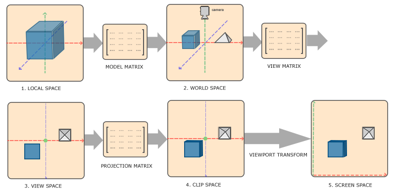
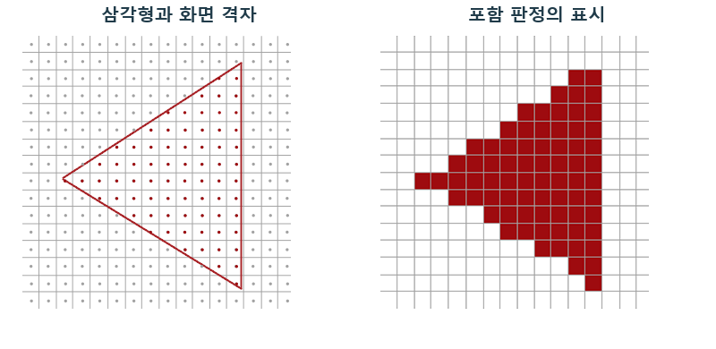
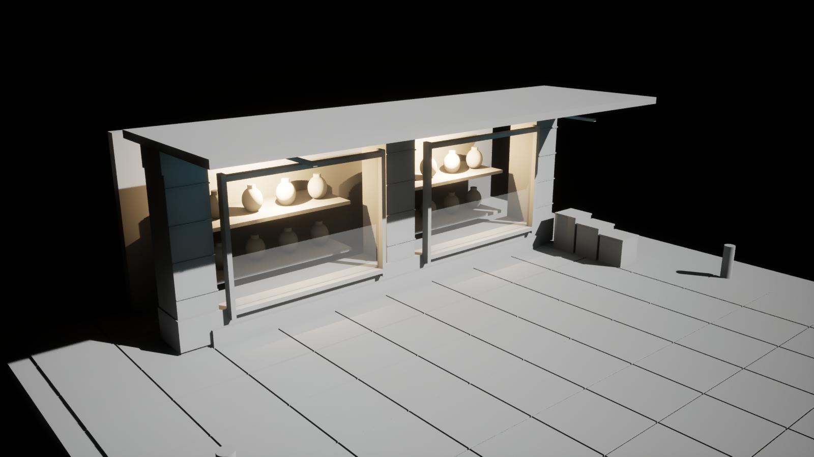

# 렌더링 파이프라인 장면이 이미지가 되기까지

배경 작업은 모델과 텍스처를 만드는 데서 끝나지 않습니다. 같은 에셋도 조명과 카메라, 렌더링 설정에 따라 전혀 다른 화면이 됩니다. 그 사이에서 무슨 일이 일어나는지 이해하는 출발점이 렌더링 파이프라인입니다.

렌더링 파이프라인은 모델·재질·조명·카메라로 이루어진 장면 데이터를 계산해, 화면에 표시할 픽셀의 색으로 만드는 일련의 처리 과정입니다. 파이프라인이라는 말은 한 작업의 결과를 다음 작업의 입력으로 넘기는 구조를 뜻합니다.

3D 장면은 그 자체로 사진이 아닙니다. 물체가 어디에 있고, 화면의 어디를 덮으며, 어떤 표면에 어떤 빛이 도달하는지 계산해야 이미지가 됩니다. 파이프라인은 이 일을 여러 단계로 나누고 필요한 중간 정보를 전달하는 렌더링의 전체 구조입니다.

## 장면을 여러 계산으로 나누는 이유

입력은 메시의 정점·배치, 텍스처와 재질, 광원, 카메라, 렌더링 설정입니다. 출력은 표시할 2D 이미지입니다. 중간에는 화면 위치, 깊이, 표면 특성, 조명 결과 같은 정보가 생깁니다.

| 처리 단계 | 입력으로 받는 정보 | 다음에 전달하는 결과 |
|---|---|---|
| 그릴 작업 준비 | 메시·배치·재질·카메라·장면 상태 | 처리할 후보와 그리기 명령 |
| 형태를 화면에 대응 | 정점 위치와 변환·카메라 | 화면의 삼각형·샘플과 보간 속성 |
| 깊이와 표면 계산 | 표면 후보·텍스처·재질 | 앞뒤 관계와 색·거칠기·법선 등 |
| 조명과 그림자 반영 | 표면 속성·광원·가림과 간접광 | 조명된 표면의 색 |
| 합성과 후처리 | 표면 색·반투명·노출과 효과 | 표시할 최종 이미지 |

대표적인 래스터 렌더링의 데이터 의존 관계입니다. 그림자 등의 별도 갈래와 병렬 실행을 생략한 설명이며 고정된 GPU 실행 순서표는 아닙니다.

## 형태를 화면에 옮기는 동안

그릴 작업을 준비합니다. CPU는 장면 상태와 카메라를 바탕으로 후보를 정리하고 명령을 준비합니다. 렌더 스레드는 이 준비를 맡는 CPU 실행 흐름이며, RHI는 명령을 DirectX·Vulkan 같은 그래픽 API에 연결하는 계층입니다. GPU는 제출된 일을 실행합니다.

메시는 삼각형으로 표면을 표현하고, 정점은 그 꼭짓점입니다. 정점 셰이더는 모델 내부의 위치에 장면 배치와 카메라 변환을 반영합니다. 같은 물체도 카메라가 달라지면 화면의 다른 위치와 크기로 보이는 이유입니다.

외부 참고 그림 · 모델의 로컬 공간부터 월드·카메라·클립·화면 공간까지 이어지는 좌표 변환입니다.

[© Joey de Vries · LearnOpenGL · @JoeyDeVriez · 출처 37](https://learnopengl.com/Getting-started/Coordinate-Systems)

[이용 조건 CC BY 4.0](https://creativecommons.org/licenses/by/4.0/)

원본 전체·색상·비율 유지. 투명 배경은 흰색으로 표시했습니다.

모델 내부의 좌표는 장면의 좌표와 다릅니다. 회전과 확대가 없는 경우, 원점을 월드 X=10에 놓은 모델의 로컬 X=1인 점은 월드 X=11이 됩니다. 이후 카메라 기준 표현과 투영을 거쳐 화면 위치가 됩니다.

위치가 화면에 대응되는 것과 표면의 무늬가 정해지는 것은 별개의 일입니다. UV는 텍스처에서 읽을 위치를, 법선은 표면이 향하는 방향을 전달합니다. 위치·무늬·빛 반응의 방향은 서로 연결되지만 같은 데이터는 아닙니다.

## 삼각형 내부에도 값이 필요한 이유

화면으로 옮긴 삼각형은 아직 픽셀 색이 아닙니다. 래스터화는 삼각형이 화면의 어느 샘플 위치를 덮는지 판정하는 과정입니다. 샘플은 검사를 수행하는 화면 위치이며, 가려짐 등의 검사를 거쳐 실제 화면에 기여할 후보가 남습니다.

외부 비교 그림 · 삼각형과 화면 격자, 그리고 포함 판정을 표시한 결과를 나란히 배치했습니다.

[© Joey de Vries · LearnOpenGL · @JoeyDeVriez · 출처 38](https://learnopengl.com/Advanced-OpenGL/Anti-Aliasing)

[이용 조건 CC BY 4.0](https://creativecommons.org/licenses/by/4.0/)

원본 2점을 나란히 배치하고 표제를 추가했습니다. 색상은 유지했습니다.

삼각형의 꼭짓점에만 UV가 있어도 가운데에는 텍스처가 이어져 보입니다. 보간으로 알려진 꼭짓점 값 사이의 중간값을 구하기 때문입니다. 원근 투영에서는 이에 맞는 보정이 적용돼, 표면 내부에서 필요한 값을 연속적으로 얻을 수 있습니다.

이 관계는 텍스처의 세밀함과 실루엣의 세밀함을 구분해 줍니다. 큰 삼각형 안의 무늬는 세밀할 수 있지만 바깥 윤곽이 둥글게 바뀌지는 않습니다. 표면이 흐린 문제와 형상이 각진 문제를 같은 수정으로 해결하기 어려운 이유입니다.

## 표면 정보가 빛을 만나 최종 색이 된다

재질은 해당 표면의 기본 색과 거칠기, 법선 같은 정보를 계산합니다. 일반적인 Deferred 경로에서는 Base Pass가 이를 GBuffer에 기록하고, 조명 작업이 그 정보를 읽습니다. 버퍼는 계산 중 데이터를 보관하는 메모리이고 패스는 특정 목적의 작업 단위입니다.

기본 색은 물체의 최종 사진색이 아닙니다. 광원의 방향과 밝기, 주변의 간접광과 반사, 그림자가 더해져 조명된 색이 됩니다. 그림자는 광원 관점의 가림 정보도 필요하므로 같은 메시가 카메라 표면과 별도 작업에 참여할 수 있습니다.

직접 제작·동일 카메라의 실제 엔진 캡처 Base Color

직접 제작·동일 카메라의 실제 엔진 캡처 Lighting Only

두 화면은 역할을 분리한 진단이며 단순한 합으로 Lit를 구성하는 분해식은 아닙니다.

유리와 연기처럼 뒤가 비치는 표면은 배경의 색과 합성돼야 합니다. 이후 노출과 톤매핑, Bloom 등의 처리가 표시할 이미지를 구성합니다. 톤매핑은 넓은 장면 밝기를 표시 범위로 옮기고 Bloom은 밝은 부분을 주변으로 퍼뜨립니다. 효과의 정확한 적용 위치는 렌더 경로에 따릅니다.

## 아티스트의 작업은 어느 계산을 바꿀까

윤곽과 굽힘은 정점·삼각형·변형의 문제입니다. 큰 곡선의 실루엣은 텍스처 해상도만 올려 해결되지 않습니다. 반면 표면 무늬와 재료의 미세한 인상은 텍스처·UV·색·거칠기·법선과 연결됩니다. 흐린 무늬와 각진 형상은 서로 다른 수정 대상을 가집니다.

표면 입력이 같아도 광원과 그림자, 간접광과 환경 반사가 달라지면 외관은 바뀝니다. 최종 번짐과 색에는 발광·노출·톤매핑·Bloom도 관여합니다. 밝은 번짐이 과한 것을 기본 표면색만 낮춰 고치면 다른 조명에서 재료 자체가 어두워질 수 있습니다.

직접 제작·동일 구도의 실제 엔진 캡처 Bloom 적용

직접 제작·동일 구도의 실제 엔진 캡처 Bloom 해제

쇼윈도 캡처에서 Bloom을 끈 쪽은 밝은 바 주변의 번짐이 줄어듭니다. 이것은 벽의 기본 색이나 메시 형상을 바꾼 결과가 아니라, 밝은 화면 정보를 처리하는 후반부의 차이입니다. 눈에 보이는 밝음을 모두 텍스처의 밝기로 취급할 수 없는 이유가 여기에 있습니다.

## 폴리곤을 줄이는 일과 픽셀 일을 줄이는 일

한 메시도 깊이·카메라 표면·그림자 등 여러 작업에 참여할 수 있습니다. 삼각형 수, 그리는 화면 면적, 재질 계산, 광원과 중간 데이터의 읽기·쓰기가 서로 다른 비용을 만듭니다. 무엇을 줄일지는 실제로 느린 작업을 확인한 뒤 정합니다.

렌더링 파이프라인을 안다는 것은 패스 이름을 순서대로 외우는 일이 아닙니다. 내가 바꾼 데이터가 어떤 계산을 거쳐 화면에 나타나는지 이해하는 일입니다. 그 연결이 보이면 더 세밀하게 만들 대상과 단순하게 줄일 대상을 구분할 수 있습니다.

## 참고 자료

- [Rendering Settings](https://dev.epicgames.com/documentation/en-us/unreal-engine/rendering-settings-in-the-unreal-engine-project-settings)
- [Render Dependency Graph](https://dev.epicgames.com/documentation/en-us/unreal-engine/rendering-dependency-graph-in-unreal-engine)
- [Introduction to Performance Profiling and Configuration](https://dev.epicgames.com/documentation/en-us/unreal-engine/introduction-to-performance-profiling-and-configuration-in-unreal-engine)
- [Graphics Programming Overview · Epic](https://dev.epicgames.com/documentation/en-us/unreal-engine/graphics-programming-overview-for-unreal-engine)

[포스트 목록](../../README.md#포스트-목록) · [용어 찾아보기](../Glossary.md) · [이미지 출처](../Images/Sources.md)
