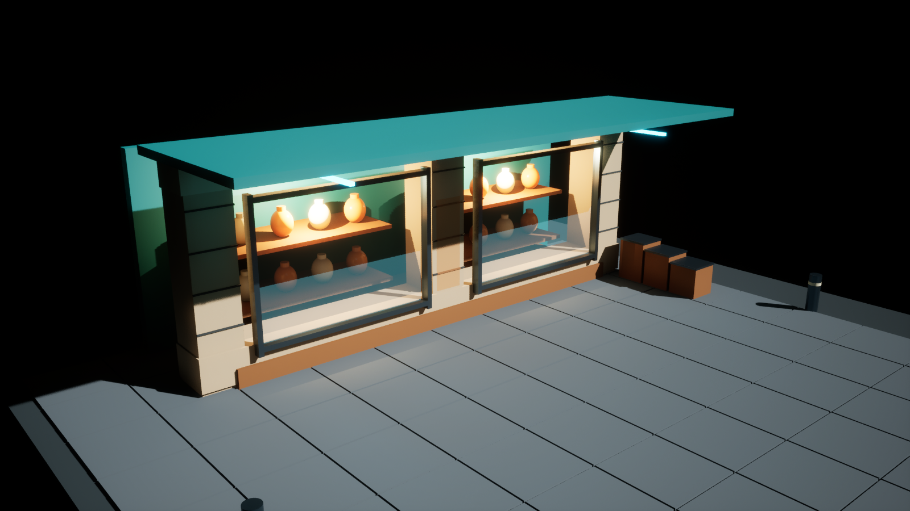
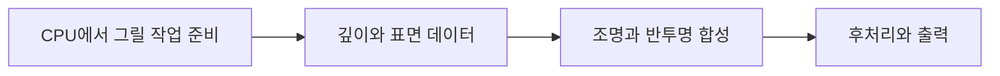
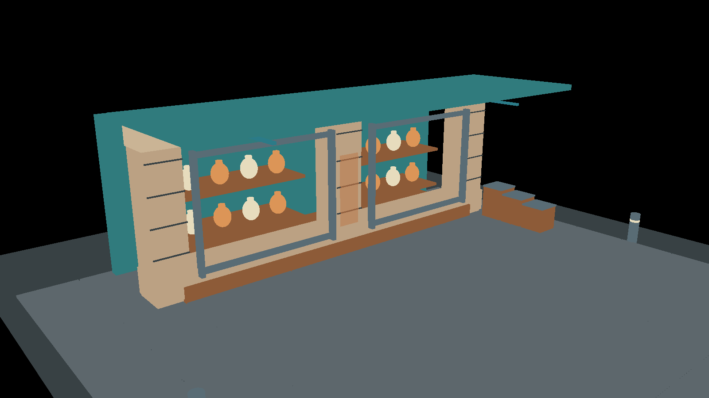
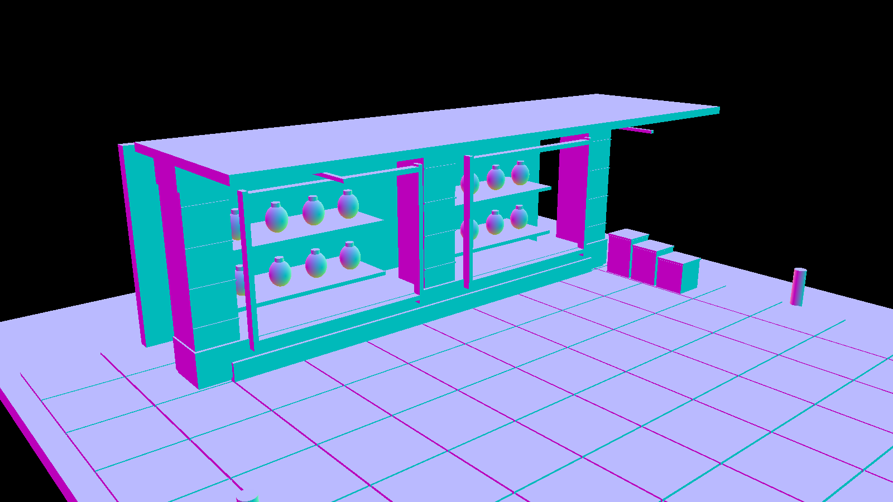
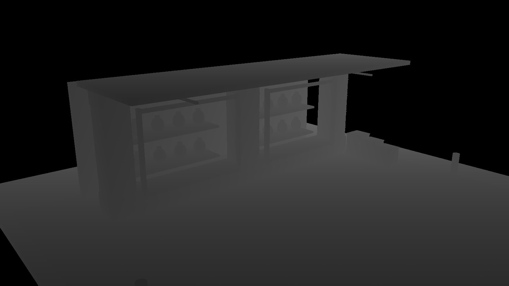
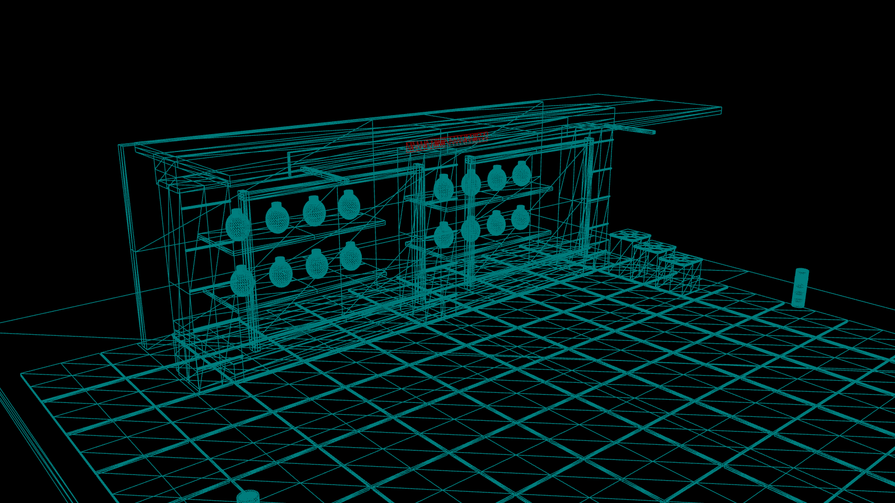
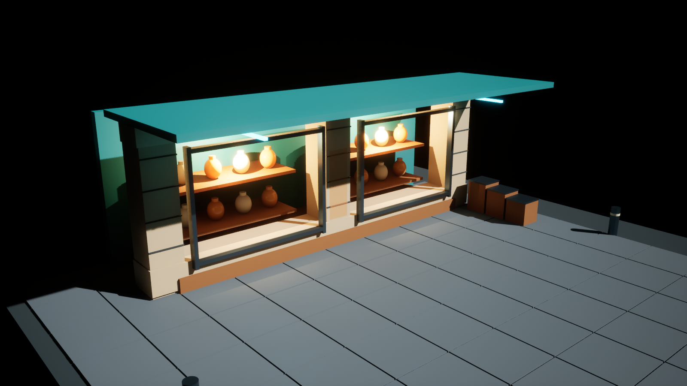
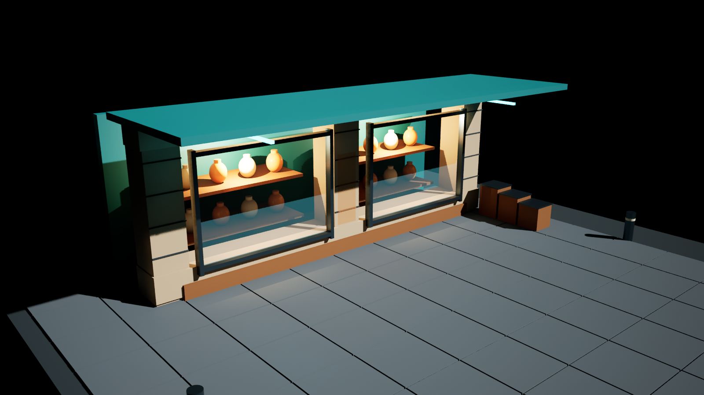
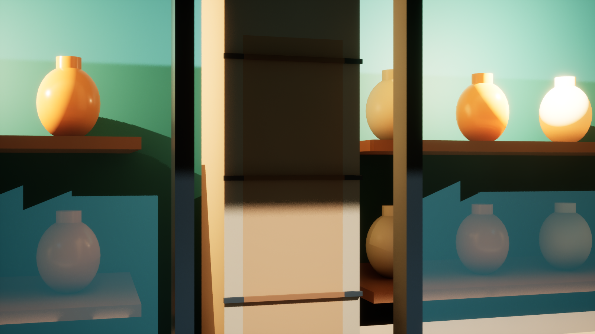
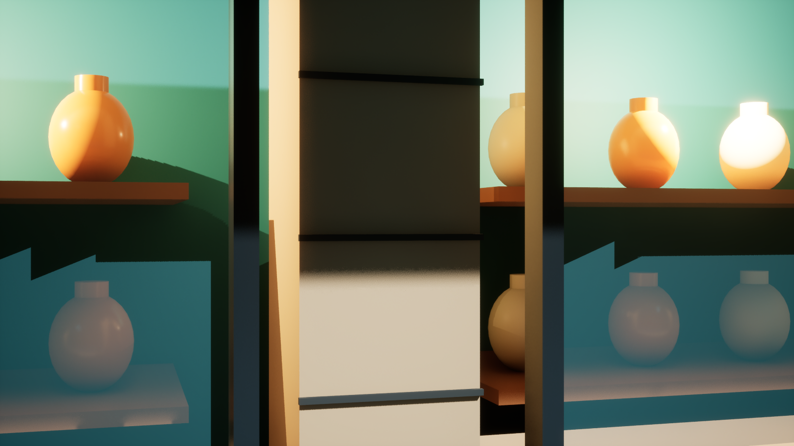

# CH01 렌더링 파이프라인

## 챕터 학습 목표

화면이 만들어지는 과정을 이해해 시각적 오류와 성능 문제를 담당하는 단계의 후보를 좁힙니다. 재질·조명·후처리 중 무엇을 수정할지 판단하고, 성능 측정 도구와 엔진 담당자에게 문제를 구체적으로 전달할 수 있어야 합니다.

### 예제 학습 목표

쇼윈도 씬의 표면·깊이 진단 화면을 읽고 유리·데칼·Bloom을 하나씩 바꿔, 변경한 요소와 최종 화면의 관계를 확인합니다.

**구현 상태 — 실제 DX12 에디터에서 씬과 비교 캡처 검증 완료**

UE 5.8.4 / NVIDIA GeForce RTX 3070 Ti / DX12 / 1600×900

각 이미지는 이 프로젝트의 씬을 실제 엔진에서 촬영한 원본입니다. 캡처 중의 시간은 평상시 성능 측정으로 사용하지 않습니다.

## 01 예제와 읽는 순서



직접 제작·엔진 캡처. CH01 골목의 Lit 화면. 동일 카메라로 진단 화면과 A/B 결과를 비교합니다.

### 이 예제의 구성

작은 상점에 벽·프레임·진열대, 뒤가 비치는 유리, 벽에 투영하는 표식인 데칼과 밝게 빛나는 바를 배치했습니다. 여러 요소가 최종 화면에 기여하는 방식을 관찰하는 장면입니다. UE에서 레벨에 배치하는 오브젝트 단위를 Actor라고 합니다.

### 실습 레벨

/Game/RenderingLab/Chapters/Part01_RenderingBasics/CH01_RenderingPipeline/Maps/L_CH01_RenderingPipeline

### 읽는 순서

먼저 다음 두 쪽에서 모델·셰이더·렌더링 단계의 뜻을 읽습니다. 이후 같은 구도의 표면·깊이 화면과 한 요소만 바꾼 결과를 비교합니다.

## 02 모델이 화면에 보이기 위한 기초

### CPU와 GPU

CPU는 게임 규칙, 오브젝트 상태와 여러 작업의 준비를 처리하는 장치입니다. GPU는 많은 정점과 화면 위치의 계산을 병렬로 처리하도록 설계된 장치입니다. 화면 계산을 맡은 엔진 부분을 렌더러라고 부릅니다. 둘이 작업을 나누므로 GPU가 빨라도 CPU의 준비가 늦으면 프레임 진행이 제한될 수 있습니다.

### 지오메트리와 메시

지오메트리는 모델의 위치와 모양을 정하는 기하 정보입니다. 이 실습의 메시, 즉 3D 표면 형상은 주로 삼각형으로 구성됩니다. 정점은 삼각형의 꼭짓점입니다. 바닥의 포장석을 구분하는 틈은 이 예제에서는 실제 형상으로 만들었으므로 깊이와 삼각형 표시에서도 확인할 수 있습니다.

### 셰이더의 역할

셰이더는 GPU에서 실행하는 계산 프로그램입니다. 정점 셰이더는 꼭짓점의 위치 등을, 픽셀 셰이더는 화면에서 표면을 표현할 값 등을 처리합니다. 머티리얼 그래프는 이런 표면 반응을 노드로 제작하는 화면이며, 그래프 전체가 하나의 픽셀 셰이더와 항상 일대일로 대응하는 것은 아닙니다.

### 정점 위치를 어떻게 변환할까

꼭짓점은 먼저 모델 내부의 기준점에 대한 위치를 가집니다. 모델을 회전·확대·이동한 결과를 장면의 공통 좌표인 월드 좌표로 바꾸고, 다시 카메라 기준으로 해석해 화면 위치를 구합니다. 예를 들어 모델을 오른쪽으로 옮기면 각 꼭짓점의 장면 위치에도 그 이동이 반영됩니다. 원근 투영은 멀리 있는 것이 작게 보이도록 하는 과정입니다.

### 텍스처 좌표와 표면 방향

UV는 모델 표면의 어느 위치에서 텍스처 이미지의 어느 부분을 읽을지 정하는 2D 좌표입니다. 법선은 표면이 향하는 방향을 나타냅니다. 같은 색의 벽도 법선과 빛 방향이 다르면 다른 밝기로 보입니다. 이 두 정보가 꼭짓점 사이에서 어떻게 이어지는지는 다음 쪽의 보간 설명과 연결됩니다.

### 전통적인 경로라는 표현

여기서는 일반적인 메시를 정점 처리와 삼각형 기반 화면 처리로 그리는 흐름을 뜻합니다. Nanite처럼 화면에 필요한 형상을 고르고 그리는 방식이 다른 시스템도 있으므로 모든 지오메트리에 같은 세부 실행 과정이 적용된다는 뜻은 아닙니다. Nanite는 CH17에서 따로 설명합니다.

## 03 CPU의 준비가 화면 계산으로 이어지는 과정



### 1 그릴 작업을 준비합니다

스레드는 프로그램이 명령을 이어 실행하는 흐름입니다. 게임 스레드는 주로 게임 상태를 갱신하고, 렌더 스레드는 CPU에서 장면을 그릴 명령을 준비합니다. RHI는 Render Hardware Interface의 약자로 엔진의 그래픽 명령을 DirectX·Vulkan 같은 그래픽 API에 연결하는 계층입니다. API는 다른 프로그램이나 장치의 기능을 사용하도록 정해 놓은 요청 방식입니다. 별도 RHI 스레드 사용 여부 등은 보충 주석 1을 참고합니다.

### 2 삼각형이 덮는 위치를 찾습니다

래스터화는 화면으로 옮긴 삼각형이 화면의 어느 위치를 덮는지 판정하는 과정입니다. 이때 검사하는 화면상의 위치를 샘플이라고 합니다. 한 픽셀 안에서 여러 위치를 검사할 수도 있습니다. 가려짐 등의 검사를 거쳐 남은 후보의 계산 결과가 최종 화면에 기여합니다.

### 3 꼭짓점 사이의 값을 이어 줍니다

보간은 알려진 값 사이에서 중간 위치의 값을 계산하는 것입니다. 삼각형 내부의 위치에서는 세 꼭짓점에 저장된 UV 등으로 그 위치에 필요한 값을 구합니다. 따라서 삼각형 한가운데에서도 텍스처의 어느 부분을 읽을지 정할 수 있습니다. 원근에 따른 보정 등 수학적 세부는 이 흐름을 이해한 뒤 읽어도 됩니다.

### 4 깊이와 표면 정보를 준비합니다

버퍼는 계산 중 사용할 데이터를 보관하는 메모리 공간입니다. 깊이 버퍼는 앞쪽 표면의 깊이를, GBuffer는 조명에 필요한 재질 정보를 담습니다. Depth Prepass는 깊이를 먼저 준비하는 단계이고 Base Pass는 주로 불투명 표면 정보를 준비하는 작업입니다. 이런 작업 단위를 렌더 패스라고 합니다. 자세한 데이터는 CH03·05에서 관찰합니다.

### 5 조명과 최종 화면을 만듭니다

표면의 방향과 반사 특성에 빛·그림자 등을 반영합니다. 유리처럼 뒤가 비치는 표면은 배경과 별도로 계산한 결과를 합성합니다. 이후 Bloom처럼 밝은 부분을 주변으로 퍼뜨리거나 화면 색을 조정하는 후처리도 적용합니다. 이 도식은 대표적인 의존 관계이며 실제 실행은 분기와 추가 작업을 포함합니다.

## 04 씬에서 비교할 대상을 찾기


직접 엔진 캡처. 바닥·기둥, 두 쇼윈도와 내부 진열대, 처마 아래 발광 바를 관찰합니다.

### 1 벽과 바닥

01_OpaqueArchitecture 폴더에는 석재 기둥, 포장석과 금속 프레임이 있습니다. 같은 재질 색도 조명 방향과 표면 방향에 따라 Lit에서 다르게 보입니다. 포장석 틈은 실제 삼각형 형상이므로 삼각형 에지를 표시하는 Wireframe과 깊이에서도 확인할 수 있습니다.

### 2 쇼윈도 내부와 유리

02_OpaqueDisplay의 선반·도자기 앞에 03_Translucency의 GlassPane_1과 GlassPane_2가 놓여 있습니다. 유리 두 개만 숨기면 내부 물체와 조명 배치를 유지한 채 반투명 합성의 영향을 관찰할 수 있습니다.

### 3 표면 얼룩과 발광 바

04_Decals의 WallPatina_DBuffer는 중앙 석재를 바꿉니다. 05_Signage의 발광 바는 표면 자체가 밝게 보이도록 하는 Emissive 입력을 사용합니다. 빛나는 표면, 주변을 비추는 광원, 화면에서 퍼지는 Bloom은 각각 영향을 분리해 확인할 수 있습니다.

### 에디터에서 시작하기

CH01 맵을 열고 장면의 배치 목록인 Outliner에서 CH01_ComparisonCamera를 선택합니다. Pilot은 뷰포트를 해당 카메라의 시점으로 보는 기능입니다. 06_Lighting과 08_PostProcess를 펼쳐 실습 대상을 확인합니다. 카메라와 수동 노출은 비교 동안 유지합니다. 에디터 구도와 실제 캡처 해상도는 별개이므로 비교 캡처는 모두 1600×900으로 맞춥니다.

## 05 Base Color와 법선을 분리해서 읽기

**Base Color**



**World Normal**



직접 엔진 캡처 비교. 왼쪽 Base Color, 오른쪽 World Normal. 동일 장면의 다른 표면 데이터를 보여 줍니다.

### Base Color에서 확인할 것

Viewport의 View Mode → Buffer Visualization → Base Color를 선택합니다. 석재와 도자기, 포장석의 입력 색이 어떻게 구분되는지 봅니다. Lit의 어두운 면이 이 화면에서도 어둡다면 재질 입력을, 이 화면에서는 비슷한데 Lit에서만 크게 다르면 조명·가림·반사 등을 다음 후보로 조사합니다.

### World Normal에서 확인할 것

World Normal을 선택합니다. 표면 방향인 법선의 세 방향 성분을 색으로 표현하므로 방향이 다른 면은 색도 달라집니다. 구의 색이 연속적으로 변하는 것은 꼭짓점 사이의 표면 방향을 부드럽게 이어 계산하기 때문입니다. 벽을 회전하면 월드 법선이 달라집니다. 작은 표면 방향 변화를 이미지로 넣는 노멀 맵이 없어도, 면의 방향에 따라 서로 다른 색이 나타납니다.

### 직접 바꿔 보기

MI_CH01_Sandstone의 BaseColor만 바꾼 다음 두 버퍼를 다시 봅니다. 색 입력은 바뀌지만 메시와 법선을 바꾸지 않았으므로 World Normal은 같은 형태를 유지해야 합니다. 실습 뒤 원래 값으로 되돌립니다. 이 방식으로 바꾼 변수와 영향을 받은 데이터의 관계를 확인합니다.

### 버퍼 화면의 의미

이 이미지는 엔진의 진단 시각화입니다. GBuffer의 저장 데이터를 그대로 읽은 화면과는 표시 방식이 다를 수 있습니다. 특히 반투명 표면은 불투명 표면과 다른 경로로 처리되므로 Lit의 유리색이 모든 버퍼에 같은 방식으로 기록될 것이라 예상하지 않습니다.

## 06 깊이와 삼각형을 함께 관찰하기

**Scene Depth**



**Wireframe**



직접 엔진 캡처 비교. 왼쪽 Scene Depth 진단 화면, 오른쪽 Wireframe. 색과 밝기는 표시용 표현입니다.

### Scene Depth에서 확인할 것

Buffer Visualization → Scene Depth를 선택합니다. 가까운 볼라드, 앞쪽 포장석과 뒤쪽 진열대가 서로 다른 깊이로 표현되는지 확인합니다. 화면에 표시된 명암을 월드 거리 수치로 바로 읽지 않습니다. 하드웨어 깊이와 진단 화면의 변환 방식이 개입합니다.

### 유리와 깊이의 관계

일반적인 반투명 유리는 불투명 표면처럼 기본 깊이를 덮어쓰지 않습니다. 따라서 기본 Scene Depth에서 유리 뒤 물체의 깊이가 관찰될 수 있습니다. 선택한 물체의 깊이를 따로 기록하는 Custom Depth나 특정 반투명 기능은 별도 설정이므로 이 실습의 기본 깊이와 구분합니다.

### Wireframe에서 확인할 것

Alt+2 또는 View Mode → Wireframe을 선택해 삼각형 에지를 봅니다. 삼각형이 많아 보인다는 이유만으로 해당 장면의 병목을 정할 수는 없습니다. 표면이 화면을 덮는 크기, 재질 계산, 그림자와 가시성도 영향을 줍니다. Alt+4로 Lit에 돌아갑니다.

### 가려짐 실험

카메라 가까이에 불투명 큐브를 놓아 일부 도자기를 가립니다. Scene Depth가 앞쪽 큐브를 나타내는 위치와 Lit에서 가려지는 위치를 비교합니다. 깊이 검사로 어떤 표면 계산이 줄었는지까지 판단하려면 깊이를 먼저 준비한 작업과 가시성, GPU에 기록된 작업 구간을 추가로 확인합니다. Early Z의 조건은 CH05에서 설명합니다.

## 07 유리를 숨겨 반투명 합성을 확인하기

**유리 표시**


**유리 숨김**



직접 엔진 A/B 캡처. 왼쪽 유리 표시, 오른쪽 GlassPane_1·2만 숨김. 카메라·조명·노출은 동일합니다.

### 실습 절차

Lit에서 원본 화면을 확인합니다. Outliner의 03_Translucency 폴더를 펼쳐 GlassPane_1과 GlassPane_2를 선택하고 에디터 가시성만 끕니다. 선반, 도자기, 프레임과 광원은 그대로 둡니다. 같은 카메라로 다시 캡처한 뒤 유리 표시 상태를 복원합니다.

### 관찰 결과를 설명하기

두 이미지에서 쇼윈도 내부의 색과 대비, 유리 표면에 나타나는 반사 기여를 비교합니다. 이 실습의 유리는 Opacity 0.28, Roughness 0.10과 청록색 Base Color를 가진 뒤의 색을 합성하는 단순 Translucent 재질입니다. 물리적 두께에 따른 흡수나 굴절을 정교하게 검증하는 실험은 이후 Translucency 챕터에서 다룹니다.

### 어느 단계를 조사할까

유리만 숨겼을 때 문제가 사라지면 반투명 셰이딩·정렬·합성 및 관련 반사를 조사할 근거가 됩니다. 불투명 배경이 동일하게 그려졌는지도 함께 확인합니다. Lumen처럼 다른 표면의 가시성과 화면 추적에 반응하는 기능 때문에 변화가 반투명 패스 하나에만 국한되지는 않을 수 있습니다.

### 성능 검증으로 이어가기

stat gpu 또는 GPU 작업을 시간축에 펼친 분석 화면에서 Translucency 계열과 전체 GPU 시간을 기록합니다. A와 B의 측정 순서를 바꿔 반복합니다. 셰이더 준비와 로딩을 마쳐 안정화하는 워밍업 구간은 별도로 기록합니다. 이 문서의 비교 이미지는 시각적 변화의 증거이며, 고해상도 캡처 중의 프레임 시간을 성능 수치로 사용하지 않습니다.

## 08 Bloom과 발광을 구분하기

**Bloom 1.0**


**Bloom 0.0**



직접 엔진 A/B 캡처. 왼쪽 Bloom Intensity 1.0, 오른쪽 0.0. 발광 재질과 실제 광원은 유지했습니다.

### 실습 절차

08_PostProcess의 CH01_FixedExposure를 선택합니다. Bloom Intensity 옆의 Override 체크를 유지한 채 값을 조정합니다. Override는 이 볼륨의 설정을 실제로 적용한다는 뜻입니다. 값을 1.0에서 0.0으로 바꿉니다. 카메라 노출, M_CH01_SignEmission과 진열장 Point Light는 수정하지 않습니다. 캡처 후 값을 1.0으로 되돌립니다.

### 관찰할 차이

처마 아래 밝은 바의 주변으로 퍼지는 화면 효과를 비교합니다. Bloom을 줄여도 발광 재질의 밝은 중심 자체는 남습니다. 그린 화면을 가공하는 후처리의 번짐과 장면 조명의 기여를 따로 생각하면, 간판이 과하게 번질 때 어떤 값을 먼저 바꿀지 판단하기 쉽습니다.

### 발광이 주변에 미치는 영향

이 씬은 Lumen을 사용하므로 Emissive가 간접광에 기여할 수 있습니다. 진열장에는 별도의 WarmDisplayLight도 있습니다. Bloom만 바꾸는 실험에서 두 광원의 에너지를 동시에 바꾸지 않아야 비교 의도가 유지됩니다.

### 아트 실무의 진단

밝은 간판을 고치려다 Base Color를 어둡게 만들기 전에 Bloom, 수동 노출과 Emissive 값을 각각 확인합니다. 톤매핑은 계산한 장면의 밝기를 디스플레이에 보여 줄 범위로 바꾸는 처리입니다. 이때 높은 밝기의 차이가 압축되어 보이는 영향도 함께 판단합니다. 최종 출력 색은 Base Color 값만으로 결정되지 않습니다.

## 09 데칼과 조명에서 생긴 변화를 찾기

**데칼 표시 근접**



**데칼 숨김 근접**



직접 엔진 A/B 근접 캡처. 같은 중앙 기둥에서 데칼 표시와 숨김을 비교합니다.

### 데칼 실험

04_Decals의 WallPatina_DBuffer만 숨기고 원본 Lit와 중앙 기둥을 비교합니다. 이 데칼은 색과 Roughness 계열 표면 값을 수정합니다. DBuffer 경로에서는 Base Pass 전에 데칼 정보를 준비하고 수신 머티리얼이 이를 적용합니다. 데칼이 최종 색을 화면 위에 단순히 붙이는 것처럼만 이해하면 반사 변화의 원인을 놓치기 쉽습니다.

### 조명 실험

데칼을 다시 표시하고 View Mode → Lighting Only를 선택합니다. 표면의 색을 중립 재질로 바꾸어 빛과 음영 구조를 관찰합니다. 이 화면은 최종 Lit의 밝기를 정확히 분해한 수치가 아니라 조명 상태를 읽기 위한 진단 표현입니다.

### 같은 위치를 여러 데이터로 확인하기

중앙 기둥이 어둡다면 Base Color, World Normal, Lighting Only, 데칼 가시성을 차례로 확인합니다. 입력 색, 방향, 빛과 표면 수정 중 어떤 변화와 연결되는지 기록합니다. 서로 다른 진단 모드의 픽셀 밝기를 그대로 빼서 조명 에너지라고 해석하지 않습니다.

### 실무 예시

모듈 벽면의 얼룩은 데칼로 변주하면서 기본 재질은 공유할 수 있습니다. 투영 박스를 좁히고 겹침을 줄였을 때 시각적 범위가 유지되는지 확인하고, 비용은 별도의 전후 프로파일링으로 확인합니다.

## 10 제작 과정을 직접 재현하기

### 1 기본 씬 열기

RenderingLab.uproject를 UE 5.8.4에서 엽니다. CH01 레벨과 CH01_ComparisonCamera를 선택합니다. CH01은 Deferred, Lumen, VSM, TSR과 Substrate Blendable 시작 설정을 사용합니다. 이 비교를 위해 렌더러 설정을 바꿀 필요는 없습니다.

### 2 불투명 재질 만들기

CH01의 Materials 폴더에서 MI_CH01_Sandstone과 MI_CH01_MetalFrame을 엽니다. 부모 재질 M_LabSurface는 색·금속성·거칠기를 설정값으로 노출한 기본 표면입니다. Material Instance는 이 구조를 공유하며 값을 바꾸는 변형입니다. 금속 프레임은 Metallic 0.85, Roughness 0.26이고 석재는 Metallic 0, Roughness 0.82입니다. 학습용 수치이며 측정된 실물 재질 데이터는 아닙니다.

### 3 유리와 발광 구성하기

M_CH01_Glass는 뒤의 색과 합성하는 Translucent 재질입니다. 표면의 조명을 계산할 방식으로 Surface ForwardShading을 선택했습니다. Base Color (0.10, 0.32, 0.38), Opacity 0.28, Roughness 0.10을 연결합니다. M_CH01_SignEmission의 Emissive 입력은 (0.04, 3.5, 5.0)입니다. 이 숫자는 재질에 넣은 설정값이며 저장된 스크린샷의 픽셀 숫자와 같지 않습니다. 최종 색에는 빛과 화면 표시용 변환이 추가됩니다.

### 4 빛과 비교 조건 맞추기

Sun_Key와 WarmDisplayLight_1·2가 직접광을 만듭니다. CH01_FixedExposure는 Manual 노출과 물리 카메라 노출 비적용을 사용합니다. 비교 중 라이트와 노출을 고정합니다. 캡처 도구는 내부 렌더링 크기를 정하는 Screen Percentage를 100으로 고정합니다. 부하에 따라 크기를 자동 변경하는 Dynamic Resolution은 끄고, 1600×900으로 출력합니다.

### 5 캡처 재현하기

File → Execute Python Script에서 Content/Python/capture_ch01.py를 실행하면 이 챕터의 진단·A/B 이미지를 순서대로 저장합니다. 이 도구는 전용 에디터 세션에서 실행하고, 실행 전 다른 작업을 저장합니다. 완료 시 에디터가 종료됩니다. 원본과 같은 파일 이름으로 캡처를 갱신합니다.

### 생성 도구의 범위

build_ch01.py는 CH01 레벨의 액터를 재구성하는 제작 도구입니다. 기존 CH01을 수정한 뒤 다시 실행하려면 변경을 커밋하거나 복사본을 확보합니다. 일반적인 학습과 재캡처에는 이미 저장된 레벨과 capture_ch01.py를 사용합니다.

## 11 검증 기록과 다음 실습

### 이 챕터에서 확인한 것

UE 5.8.4와 NVIDIA GeForce RTX 3070 Ti의 DX12 에디터에서 CH01을 렌더링했습니다. Lit, Base Color, World Normal, Scene Depth, Roughness, Wireframe, Lighting Only와 유리·Bloom·데칼 A/B 및 근접 화면을 촬영했습니다. 원본 이미지 12개와 CaptureManifest.json은 Docs/Images/CH01에 있습니다.

### 관찰과 측정을 구분하기

본 실습은 각 기능이 화면에 미치는 영향을 확인합니다. 처리 비용을 결론내리려면 대상 기기에서 워밍업한 동일 카메라 경로를 반복 실행해야 합니다. 고해상도 캡처는 렌더링을 동기화하고 작업량도 바꿀 수 있으므로 이 챕터에 임의의 ms 개선값을 붙이지 않았습니다.

### 검증 체크

① Base Color만 바꿨을 때 World Normal의 형태가 유지되는가. ② 유리만 숨겼을 때 내부 선반과 도자기는 남는가. ③ Bloom만 껐을 때 발광 바의 중심은 남는가. ④ 데칼을 숨겼을 때 중앙 기둥의 표면 변화가 사라지는가. ⑤ 비교마다 카메라·해상도·노출을 유지했는가.

### 문제가 생기면

장면이 검게 보이면 셰이더·거리장 준비가 끝났는지, Sun_Key와 노출이 유효한지 확인합니다. 유리가 불투명하면 올바른 머티리얼과 Blend Mode를 봅니다. 진단 모드 뒤에는 Alt+4로 Lit에 돌아갑니다. 캡처 파일이 누락되면 Saved/Logs/CH01Capture.log와 CaptureManifest.json의 complete 값을 확인합니다.

### 핵심 정리

메시 배치, 표면 입력, 조명, 반투명과 후처리는 서로 다른 데이터를 바꾸면서 최종 화면에 연결됩니다. 증상이 보이는 위치를 여러 진단 모드와 한 변수의 전후 화면으로 확인하면 조사할 패스와 설정을 좁힐 수 있습니다. 다음 CH02에서는 표면과 조명을 평가하는 시점이 다른 Forward와 Deferred를 비교합니다.

## 캡처를 다시 만드는 방법

실행 중인 이 프로젝트를 저장하고 에디터를 닫은 뒤, 프로젝트 루트의 PowerShell에서 실행합니다.

```powershell
.\Scripts\CaptureCH01.ps1
```

실행 도구는 전용 에디터에서 원본 이미지와 촬영 기록을 갱신하고 종료합니다.

[Roughness 원본](../Images/CH01/05_Roughness.png) · [Lighting Only 원본](../Images/CH01/10_LightingOnly.png) · [촬영 기록](../Images/CH01/CaptureManifest.json)

## 공식 자료

- [Viewport Modes](https://dev.epicgames.com/documentation/en-us/unreal-engine/viewport-modes-in-unreal-engine)
- [Decal Materials](https://dev.epicgames.com/documentation/en-us/unreal-engine/decal-materials-in-unreal-engine)
- [Lit Translucency](https://dev.epicgames.com/documentation/en-us/unreal-engine/lit-translucency-in-unreal-engine)
- [Render Dependency Graph](https://dev.epicgames.com/documentation/unreal-engine/render-dependency-graph-in-unreal-engine)
- [Scripting the Editor Using Python](https://dev.epicgames.com/documentation/en-us/unreal-engine/scripting-the-unreal-editor-using-python)
- [Parallel Rendering Overview](https://dev.epicgames.com/documentation/unreal-engine/parallel-rendering-overview-for-unreal-engine)
- [Direct3D Rasterizer Stage](https://learn.microsoft.com/en-us/windows/win32/direct3d11/d3d10-graphics-programming-guide-rasterizer-stage)

[처음 읽는 방법](../ReadingGuide.md) · [용어집](../Glossary.md) · [보충 주석](../SupplementaryNotes.md) · [챕터 목록](../../README.md#학습-순서)
