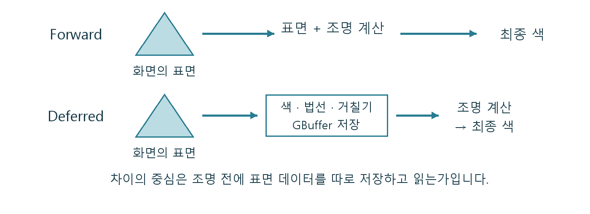

# CH02 Forward와 Deferred

## 중심 질문

왜 렌더러를 바꾸면 같은 에셋의 표현과 비용 조건이 달라질까?

## 먼저 알아둘 답

두 방식은 표면과 빛을 결합하는 시점이 달라, 중간 데이터와 사용할 수 있는 기능의 조건도 달라집니다.

## 왜 알아야 할까

목표 플랫폼과 필요한 표현을 기준으로 렌더러를 선택하고, 그 선택에 맞는 에셋 제작 조건을 이해하기 위해 배웁니다.

### 예제 학습 목표

같은 장면에서 표면 처리와 조명 작업이 어디에 배치되는지 확인합니다.

**구현 상태 — 기본 레벨 준비, 아래 절차에 따른 특화 예제 제작과 실측 필요**

레벨 `/Game/RenderingLab/Chapters/Part01_RenderingBasics/CH02_ForwardDeferred/Maps/L_CH02_ForwardDeferred`

## 왜 이런 결과가 생길까

Forward는 표면을 그리는 계산에서 조명을 함께 평가합니다. Deferred는 먼저 화면에 보이는 표면의 색·방향·거칠기 등을 저장하고, 조명 단계가 그 정보를 읽어 빛을 계산합니다. Deferred는 표면 정보를 다시 사용할 수 있지만, 저장하고 읽는 작업도 필요합니다. UE의 Forward 역시 영향을 주는 광원을 선별하며 무조건 모든 광원을 전부 계산하지 않습니다.

## 제작 중에는 이렇게 나타납니다

조명이 많은지뿐 아니라 필요한 AA, 반사, 재질 기능과 중간 데이터의 비용까지 선택에 영향을 줍니다. 이름만 보고 어느 쪽이 항상 빠르다고 정할 수 없는 이유가 여기에 있습니다.

직접 제작 개념도. 표면과 조명을 결합하는 시점 및 중간 저장의 차이입니다. 실제 프레임의 모든 패스를 나열한 도식은 아닙니다.

## 실습 절차

프로젝트 복사본에서 Forward Shading을 바꾸고 재시작합니다. 공통 지원하는 불투명 재질과 그림자 없는 이동형 라이트만 둔 작은 장면을 준비합니다. 해상도와 지원 기능을 맞춘 뒤 광원 수를 한 단계씩 늘려 패스 구성을 비교합니다.

## 예상 결과와 이유

Deferred에서는 표면을 기록한 뒤 별도 조명 작업이 이어지고, Forward에서는 표면을 그리는 작업에 조명 계산이 포함되는 구조를 확인할 수 있을 것입니다.

## 결과를 어떻게 해석할까

패스 이름 하나의 시간만 직접 맞대지 않습니다. 계산이 서로 다른 작업으로 나뉘므로 전체 GPU 시간과 화면 결과를 함께 기록합니다. 설정 변경 후 기능이 빠졌다면 동일한 화질의 성능 비교로 사용하지 않습니다.

## 실제 제작에서의 선택

VR의 경계 품질이나 반사 표현처럼 필요한 기능을 먼저 적고, 그 조건을 만족하는 렌더러 안에서 비용을 비교합니다.

## 이해한 뒤 확인할 조건

이 장은 데스크톱 렌더링의 기본 구조를 설명합니다. 모바일 경로와 플랫폼별 기능 지원표는 공식 문서에서 별도로 확인합니다.

## 공식 자료와 확장

- [Rendering Settings](https://dev.epicgames.com/documentation/en-us/unreal-engine/rendering-settings-in-the-unreal-engine-project-settings)
- [Forward Shading Renderer](https://dev.epicgames.com/documentation/en-us/unreal-engine/forward-shading-renderer-in-unreal-engine)

[읽는 순서](../ReadingGuide.md) · [용어집](../Glossary.md) · [심화와 적용 조건](../SupplementaryNotes.md)
