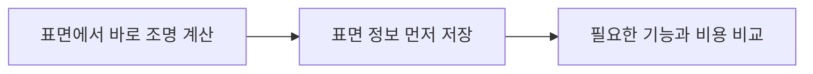

# CH02 Forward와 Deferred

## 챕터 학습 목표

표면과 조명을 평가하는 방식의 차이가 기능 지원과 비용에 어떻게 연결되는지 이해합니다. VR, 모바일, 데스크톱 등 목표 환경에서 필요한 화질·AA·조명 기능을 기준으로 렌더러 선택과 에셋 제작 조건을 판단합니다.

### 예제 학습 목표

동일한 장면과 공통 지원 설정에서 광원 겹침을 바꿔 Forward와 Deferred의 화면 및 패스 비용을 비교합니다.

**구현 상태 — 기본 실습 레벨 준비**

바닥, 조명, 카메라와 비교용 기본 도형을 가진 시작 레벨입니다. 아래 항목은 챕터별 예제를 완성할 때 수행할 실습 절차입니다.

레벨 경로 `/Game/RenderingLab/Chapters/Part01_RenderingBasics/CH02_ForwardDeferred/Maps/L_CH02_ForwardDeferred`

## 흐름 개념도

## 원리

Forward와 Deferred는 표면과 빛을 계산하는 순서가 다른 렌더링 방식입니다. Forward는 물체의 표면을 그리면서 조명을 계산합니다. Deferred는 표면 정보를 먼저 저장하고, 뒤의 조명 단계가 그 정보를 읽습니다. 이 문서에서는 PC·콘솔에서 사용하는 데스크톱 경로를 설명합니다.

## 작동 과정

한 벽을 여러 라이트가 비추더라도 모든 라이트를 항상 전부 계산할 필요는 없습니다. 엔진은 화면과 공간을 나누어 해당 위치에 영향을 주는 광원을 추립니다. UE의 Forward도 이런 선별을 사용합니다. 반사 환경을 미리 담아 두는 Reflection Capture 역시 영향을 주는 범위에 따라 선택됩니다.

## 아트 실무

VR에서는 머리 움직임에 따른 가장자리의 안정성이 중요합니다. 계단처럼 보이는 가장자리를 줄이는 처리를 안티앨리어싱 또는 AA라고 합니다. MSAA는 한 픽셀 안의 여러 위치에서 도형의 경계를 검사하는 방식입니다. 시간적 누적 방식인 TAA·TSR은 CH23·24에서 설명합니다. 렌더러를 정할 때 필요한 AA·조명·반사 기능이 함께 지원되는지 확인합니다.

## 성능 비용

Deferred는 화면 크기의 표면 데이터를 메모리에 쓰고 다시 읽습니다. Forward는 표면을 그릴 때 필요한 광원을 함께 처리합니다. 무엇이 빠른지는 광원 겹침, 그림자, 재질과 지원 기능에 따라 달라집니다. 특정 장면의 결과를 다른 프로젝트의 성능 보장으로 사용하지 않습니다.

## 언리얼 실습

프로젝트 복사본에서 Project Settings → Rendering → Forward Shading을 바꾸고 재시작합니다. 두 방식이 공통 지원하는 조명·반사·AA를 맞춥니다. 같은 구도에서 겹치는 광원 수만 바꾸고 stat gpu의 Base Pass와 조명 관련 시간을 기록합니다. Base Pass는 주로 불투명 표면 정보를 준비하는 작업이며 CH03에서 이어 설명합니다.

## 핵심 요약

계산 순서의 차이를 필요한 기능과 연결해 렌더러를 선택합니다. 비교할 때는 한쪽에서 빠진 기능 때문에 빨라진 것인지도 확인합니다.

## 공식 자료

- [Rendering Settings](https://dev.epicgames.com/documentation/en-us/unreal-engine/rendering-settings-in-the-unreal-engine-project-settings)
- [Forward Shading Renderer](https://dev.epicgames.com/documentation/en-us/unreal-engine/forward-shading-renderer-in-unreal-engine)

## 관련 개념

- [CH01 렌더링 파이프라인](CH01_RenderingPipeline.md)
- [CH23 TAA와 프레임 히스토리](CH23_TAA.md)
- [CH24 TSR과 시간적 업스케일링](CH24_TSR.md)

## 작업 기록

- 제작한 에셋
- 바꾼 변수와 유지한 조건
- 전후 화면과 실행 시간
- 확인한 기기와 설정

[처음 읽는 방법](../ReadingGuide.md) · [용어집](../Glossary.md) · [보충 주석](../SupplementaryNotes.md) · [챕터 목록](../../README.md#학습-순서)
