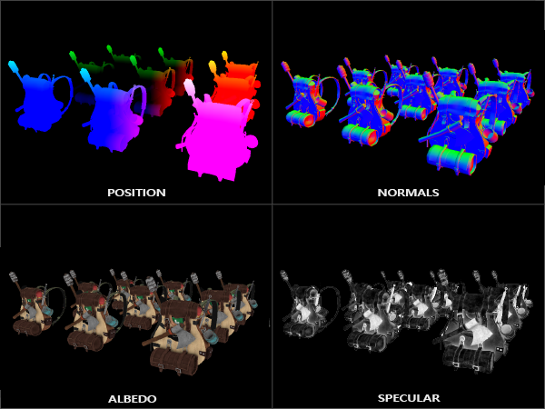

# CH03 GBuffer와 표면 정보

## 챕터 학습 목표

최종 색을 만드는 재질 데이터와 조명 결과를 구분합니다. 색·법선·거칠기 문제를 진단하고, 해상도와 저장 형식이 메모리·대역폭에 미치는 영향을 이해해 재질과 렌더링 설정을 함께 판단합니다.

### 예제 학습 목표

같은 벽의 거칠기 입력을 바꾸고 버퍼 시각화와 내부 해상도 비교로 입력 데이터와 비용의 관계를 확인합니다.

**구현 상태 — 기본 실습 레벨 준비**

바닥, 조명, 카메라와 비교용 기본 도형을 가진 시작 레벨입니다. 아래 항목은 챕터별 예제를 완성할 때 수행할 실습 절차입니다.

레벨 경로 `/Game/RenderingLab/Chapters/Part01_RenderingBasics/CH03_GBuffer/Maps/L_CH03_GBuffer`

## 흐름 개념도

## 원리

버퍼는 계산 중 필요한 데이터를 보관하는 메모리 공간입니다. GBuffer는 Deferred 조명이 읽을 표면 정보의 묶음입니다. 재질의 기본 색인 Base Color, 반사가 퍼지는 정도인 Roughness, 표면이 향하는 방향인 법선 등이 여기에 관여합니다. 최종 화면 색과는 역할이 다릅니다.

## 작동 과정

Base Pass는 화면에 보이는 불투명 표면의 정보를 기록하는 대표 작업입니다. 조명 단계는 그 값을 읽어 표면에 빛이 어떻게 반사될지 계산합니다. 깊이를 저장한 별도 데이터인 Scene Depth와 카메라 정보를 이용해 표면 위치를 알아낼 수도 있습니다. 어떤 값을 몇 개의 채널에 담는지는 플랫폼과 저장 형식에 따라 달라집니다.

## 아트 실무

벽이 유난히 번들거리면 Roughness 화면을 먼저 봅니다. 밝은 반사 부분의 방향이 이상하면 World Normal을 봅니다. 노멀 맵은 작은 표면 방향 변화를 텍스처로 표현하는 방법입니다. 노멀 맵에 쓰는 방향 기준이 메시와 맞지 않으면 반사가 어색해질 수 있습니다. 방향 기준의 세부 구현은 용어집의 탄젠트를 참고합니다.

## 성능 비용

메모리 사용량은 저장할 픽셀 수와 픽셀당 데이터 크기에 영향을 받습니다. 가정한 저장량이 32바이트/픽셀이면 1080p는 약 63.3 MiB이며 4K에서는 네 배입니다. 실제 UE 버퍼 크기를 뜻하는 수치는 아닙니다. 대역폭은 일정 시간에 데이터를 옮길 수 있는 양이며, 같은 데이터를 자주 읽고 쓰면 이 한도도 중요해집니다.

## 언리얼 실습

같은 벽 재질의 설정값 변형인 Material Instance를 두 개 만들고 Roughness를 0.2와 0.8로 둡니다. View Mode → Buffer Visualization에서 Roughness와 Base Color를 비교합니다. 다음에는 내부 렌더링 해상도만 바꿔 Base Pass와 전체 GPU 시간을 확인합니다. 머티리얼 인스턴스의 제작 방식은 CH07에서 설명합니다.

## 핵심 요약

재질 입력이 잘못됐는지와 조명 이후에 문제가 생겼는지를 분리합니다. 노드가 늘어난다고 저장 바이트까지 항상 늘어나는 것은 아닙니다.

## 그림으로 연결하기

외부 시각화 이미지 · 같은 장면의 위치·법선·Albedo·Specular를 분리해 표시한 GBuffer 예시입니다.

읽을 곳  왼쪽 위는 위치에 따라, 오른쪽 위는 표면 방향에 따라 색이 달라집니다. 아래쪽은 재질의 색과 반사 입력입니다. 진단용 색을 최종 외관이나 UE 채널 구성으로 읽지 않습니다.

[© Joey de Vries · LearnOpenGL · @JoeyDeVriez · 출처 39](https://learnopengl.com/Advanced-Lighting/Deferred-Shading)

[CC BY 4.0](https://creativecommons.org/licenses/by/4.0/) · 원본 전체를 유지하고 투명 배경을 흰색으로 표시했습니다.

## 공식 자료

- [Render Dependency Graph](https://dev.epicgames.com/documentation/en-us/unreal-engine/rendering-dependency-graph-in-unreal-engine)
- [Programming with Substrate GBuffer Formats](https://dev.epicgames.com/documentation/en-us/unreal-engine/programming-with-substrate-gbuffer-formats)

## 관련 개념

- [CH07 PBR과 재질 입력](CH07_PBR.md)
- [CH11 Substrate와 재질 레이어](CH11_Substrate.md)

## 작업 기록

- 제작한 에셋
- 바꾼 변수와 유지한 조건
- 전후 화면과 실행 시간
- 확인한 기기와 설정

[처음 읽는 방법](../ReadingGuide.md) · [용어집](../Glossary.md) · [보충 주석](../SupplementaryNotes.md) · [챕터 목록](../../README.md#학습-순서)
