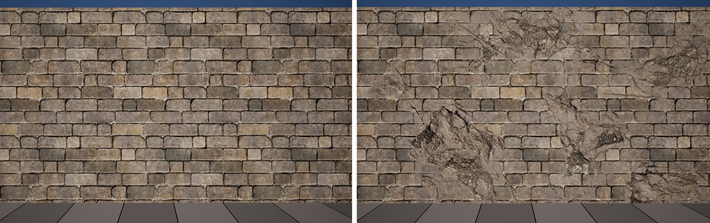

# CH04 DBuffer와 데칼

## 무엇인가

DBuffer는 데칼이 바꾸는 표면의 색·법선·거칠기 정보를 기본 표면 계산 전에 준비하는 버퍼입니다. 데칼은 오염·손상·표식을 다른 표면에 투영하는 표현이고, DBuffer는 그 변경을 전달하는 중간 데이터입니다.

## 렌더링에서 맡는 역할

데칼 변경을 벽의 기본 재질 계산에 반영해 이후 조명에 참여하게 합니다. 화면 위에 완성된 그림을 붙이는 것과 달리, 빛을 받을 표면 특성을 수정하는 역할입니다.

## 입력과 출력

입력은 데칼 재질, 투영 박스, 깊이 정보와 수신 조건입니다. 출력은 수신 표면에 적용할 변경 데이터이며 Base Pass가 이를 읽어 기본 표면과 결합합니다.

## 작동 과정

데칼의 투영 박스로 적용할 공간을 정합니다. 엔진은 깊이로 찾은 표면 위치가 이 범위 안에 있는지 판단하고 데칼의 텍스처 위치를 계산합니다.

데칼 재질의 변경값을 DBuffer에 준비합니다. 겹치는 데칼은 해당 경로의 합성 규칙에 따라 처리됩니다. 어떤 표면이 받는지는 수신 설정에도 달려 있습니다.

수신 재질의 Base Pass가 데칼 정보를 읽어 색·거칠기·방향 등에 반영합니다. 조명은 이렇게 바뀐 표면에 반응하므로 젖은 자국과 긁힘도 빛의 방향에 따라 다르게 보입니다.

공식 비교 이미지 · 같은 돌벽에 데칼을 적용하기 전과 후입니다. UE 5.5 문서의 사례입니다.

읽을 곳  반복되는 벽돌 위에 생긴 손상과 표면 변화가 어디까지 이어지는지 봅니다. 데칼 수나 성능의 통제 실험은 아니므로 투영 면적·겹침의 비용은 실습에서 따로 측정합니다.

[© Epic Games · 공식 문서 · 출처 46](https://dev.epicgames.com/documentation/en-us/unreal-engine/decal-materials-in-unreal-engine?application_version=5.5)

원본 전체 유지 · 투명 배경은 흰색으로 표시

원저작권과 원문 출처 표시는 유지합니다

## 왜 배경 제작에 필요한가

모듈 벽의 반복을 깨고 도로 표식이나 얼룩을 추가할 때 필요합니다. 원치 않는 소품에 묻으면 텍스처색보다 투영 범위와 Receives Decals·Decal Response를 먼저 봅니다.

## 성능과 제작 비용

보이는 화면 면적과 중첩, 깊이 준비, 수신 재질에서 읽는 작업이 비용을 만듭니다. 이미 필요한 깊이 작업 전체를 데칼 하나의 추가 비용으로 계산하지 않습니다.

## 원리 확인 예제

이 예제는 위에서 설명한 주제의 일부 관계를 확인합니다. 특정 예제가 기술 전체의 정의나 유일한 사용 목적은 아닙니다.

### 예제 학습 목표

벽의 얼룩을 유지하면서 박스 깊이만 줄여 잘못 묻는 소품을 제외합니다.

**구현 상태 — 기본 레벨 준비, 아래 절차에 따른 특화 예제 제작과 실측 필요**

레벨 `/Game/RenderingLab/Chapters/Part01_RenderingBasics/CH04_DBufferDecals/Maps/L_CH04_DBufferDecals`

### 실습 절차

벽 앞에 작은 소품을 놓고 하나의 얼룩 데칼을 투영합니다. 먼저 큰 박스에서 잘못 묻는 표면을 찾고, 데칼의 전면 크기는 유지한 채 박스 깊이만 줄입니다.

### 예상 결과와 이유

벽의 얼룩은 남고 박스 밖으로 빠진 소품의 얼룩은 사라질 것입니다. 이후 라이트 방향만 바꾸면 얼룩을 포함한 표면이 빛에 함께 반응할 것입니다.

### 결과를 어떻게 해석할까

소품에 계속 묻으면 실제 박스 위치와 수신 설정을 확인합니다. 색만 비교하지 말고 거칠기나 법선 변경도 확인해야 물기·스크래치 데칼의 효과를 놓치지 않습니다.

## 이 챕터에서 기억할 것

DBuffer는 데칼의 표면 변경을 기본 재질에 전달합니다. 투영 공간과 수신 조건을 알아야 원하는 표면만 바꿀 수 있습니다.

## 이해한 뒤 확인할 조건

Receives Decals는 물체의 수신 여부, Decal Response는 재질이 받을 변경을 정합니다. 다른 데칼 경로와 적용 순서는 공식 자료의 심화 항목입니다.

## 공식 자료와 확장

- [Programming with Substrate GBuffer Formats](https://dev.epicgames.com/documentation/en-us/unreal-engine/programming-with-substrate-gbuffer-formats)
- [Decal Materials](https://dev.epicgames.com/documentation/en-us/unreal-engine/decal-materials-in-unreal-engine)

[읽는 순서](../ReadingGuide.md) · [용어집](../Glossary.md) · [심화와 적용 조건](../SupplementaryNotes.md)
