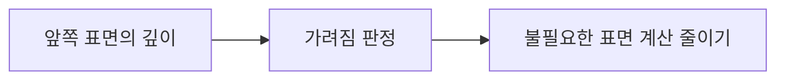
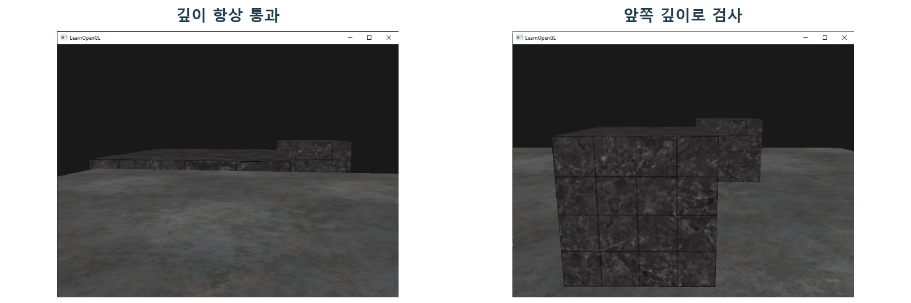

# CH05 Depth와 Early Z

## 챕터 학습 목표

가려진 표면을 어떤 시점에 제외할 수 있는지 이해합니다. 밀집된 건축물·실내·식생에서 깊이 프리패스와 Early Z가 줄이는 작업을 구분하고, 가림 효과와 선행 비용을 함께 판단합니다.

### 예제 학습 목표

불투명 가림판으로 패널의 노출 범위를 바꾸며 Scene Depth와 PrePass·Base Pass의 변화를 확인합니다.

**구현 상태 — 기본 실습 레벨 준비**

바닥, 조명, 카메라와 비교용 기본 도형을 가진 시작 레벨입니다. 아래 항목은 챕터별 예제를 완성할 때 수행할 실습 절차입니다.

레벨 경로 `/Game/RenderingLab/Chapters/Part01_RenderingBasics/CH05_DepthEarlyZ/Maps/L_CH05_DepthEarlyZ`

## 흐름 개념도

## 원리

깊이 버퍼는 화면 위치마다 앞쪽 표면의 깊이를 저장합니다. 새 삼각형이 이미 그린 표면 뒤에 있다면 최종 화면에 기여하지 않을 수 있습니다. Early Z는 가능한 경우 이런 가려짐을 먼저 검사해 비싼 표면 계산을 줄이는 GPU 동작입니다. Z는 깊이 축을 가리키는 관용적 이름입니다.

## 작동 과정

Depth Prepass는 주요 표면의 깊이를 먼저 준비하는 단계입니다. 뒤의 작업은 그 값을 읽어 가려진 후보를 제외할 수 있습니다. 삼각형이 덮는 화면 위치에서 만들어지는 처리 후보를 프래그먼트라고 부릅니다. 같은 화면 픽셀에도 여러 삼각형의 프래그먼트가 도착할 수 있으며, 모두 최종 색으로 남는 것은 아닙니다.

## 그림으로 연결하기

외부 비교 이미지 · 왼쪽은 깊이 비교를 항상 통과, 오른쪽은 앞쪽 깊이를 선택한 OpenGL 예시입니다.

읽을 곳  왼쪽에서 바닥이 큐브를 잘못 덮는 부분과 오른쪽의 올바른 가림을 비교합니다. 깊이 검사의 필요성을 보여 주며, Early Z로 몇 ms를 절약했는지 입증하는 이미지는 아닙니다.

[© Joey de Vries · LearnOpenGL · @JoeyDeVriez · 출처 47](https://learnopengl.com/Advanced-OpenGL/Depth-testing)

[CC BY 4.0](https://creativecommons.org/licenses/by/4.0/)

동일 범위의 원본을 나란히 배치 · 표제 추가

## 아트 실무

벽 뒤 장식은 벽의 깊이로 가려질 수 있습니다. 반면 잎 카드처럼 구멍이 있는 표면은 먼저 구멍 여부를 알아야 합니다. Masked 재질은 텍스처 등의 값으로 해당 위치를 남길지 버릴지 정합니다. 구멍이 많은 카드와 꽉 찬 벽의 깊이 처리 효과가 다른 이유입니다.

## 성능 비용

깊이를 먼저 준비하는 일에도 메시 처리와 메모리 쓰기가 필요합니다. 뒤에서 줄이는 표면 계산이 크면 이득이 날 수 있지만, 단순한 장면에서는 선행 작업의 부담도 봐야 합니다. 깊이 화면의 밝기는 진단용 표시이므로 그 숫자를 카메라와 물체 사이의 실제 거리로 바로 읽지 않습니다.

## 언리얼 실습

불투명 가림판 뒤에 복잡한 재질의 패널을 둡니다. 패널 일부가 계속 보이도록 하여 오브젝트 전체가 제외되는 영향을 줄입니다. 가리는 면적만 바꾸며 Scene Depth와 PrePass·Base Pass 시간을 기록합니다. 오브젝트 전체를 제외하는 컬링은 CH18에서 구분해 설명합니다.

## 관찰과 판단

복잡한 패널 일부가 계속 보이게 두고 앞 가림판 면적만 바꿉니다. Scene Depth에서 앞쪽 깊이가 기록되는지 먼저 확인합니다. PrePass와 Base Pass 변화 뒤에 전체 GPU 시간도 확인합니다.

## 오판을 피하려면

패널 전체가 사라지면 오브젝트 컬링 효과가 섞일 수 있습니다. Masked의 구멍 검사나 픽셀 깊이를 바꾸는 설정도 조기 검사 동작에 관여합니다. 올바른 가림과 Early Z의 성능 이득은 다른 결론입니다.

## 핵심 요약

깊이 준비의 추가 작업과 줄어든 표면 계산을 함께 측정합니다. 화면에 안 보이는 물체라도 모든 비용이 자동으로 사라지는 것은 아닙니다.

## 공식 자료

- [Render Dependency Graph](https://dev.epicgames.com/documentation/en-us/unreal-engine/rendering-dependency-graph-in-unreal-engine)
- [Introduction to Performance Profiling and Configuration](https://dev.epicgames.com/documentation/en-us/unreal-engine/introduction-to-performance-profiling-and-configuration-in-unreal-engine)
- [Decal Materials](https://dev.epicgames.com/documentation/en-us/unreal-engine/decal-materials-in-unreal-engine)
- [Visibility and Occlusion Culling](https://dev.epicgames.com/documentation/en-us/unreal-engine/visibility-and-occlusion-culling-in-unreal-engine)

## 관련 개념

- [CH06 Overdraw와 화면 겹침](CH06_Overdraw.md)
- [CH18 Culling과 가시성](CH18_Culling.md)

## 작업 기록

- 제작한 에셋
- 바꾼 변수와 유지한 조건
- 전후 화면과 실행 시간
- 확인한 기기와 설정

[처음 읽는 방법](../ReadingGuide.md) · [용어집](../Glossary.md) · [보충 주석](../SupplementaryNotes.md) · [챕터 목록](../../README.md#학습-순서)
