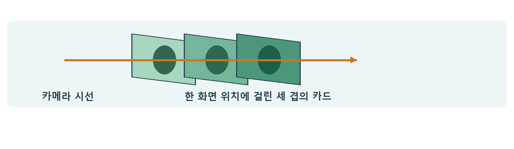

# CH06 Overdraw와 화면 겹침

## 챕터 학습 목표

화면의 같은 위치를 반복 처리하는 비용을 이해합니다. 식생, 파티클, 머리카락과 겹친 투명 표면에서 화면 면적·겹침·재질 계산량을 기준으로 형태와 표현 방식을 조정합니다.

### 예제 학습 목표

큰 잎 카드와 윤곽을 다듬은 카드를 비교해 삼각형 수, 커버리지와 GPU 비용이 함께 달라지는지 확인합니다.

**구현 상태 — 기본 실습 레벨 준비**

바닥, 조명, 카메라와 비교용 기본 도형을 가진 시작 레벨입니다. 아래 항목은 챕터별 예제를 완성할 때 수행할 실습 절차입니다.

레벨 경로 `/Game/RenderingLab/Chapters/Part01_RenderingBasics/CH06_Overdraw/Maps/L_CH06_Overdraw`

## 흐름 개념도

## 원리

Overdraw는 같은 화면 위치에서 여러 표면 후보를 반복 처리하는 현상입니다. 잎 카드 열 장이 겹치면 한 위치에 여러 삼각형의 계산 후보가 생깁니다. 어느 후보를 일찍 버릴 수 있는지는 불투명·구멍 마스크·반투명 재질의 처리 방식에 따라 달라집니다.

## 작동 과정

Opaque는 뒤를 가리는 불투명 표면입니다. Masked는 위치별로 남길지 버릴지 정하고, Translucent는 뒤의 색이 비치는 정도를 계산해 합성합니다. 불투명 앞면은 깊이로 뒤를 가릴 수 있습니다. 반투명 층끼리는 여러 층의 색이 필요해 처리가 반복되기 쉽습니다.

## 아트 실무

큰 사각형 한가운데 작은 잎만 그리면 투명한 주변 영역에도 마스크를 확인하는 작업이 필요할 수 있습니다. 잎 윤곽에 맞게 메시를 다듬으면 삼각형은 늘어도 불필요한 화면 영역은 줄일 수 있습니다. 근거리의 윤곽, 원거리의 깜빡임과 그림자까지 함께 비교합니다.

## 성능 비용

겹친 면적, 층 수, 한 번 처리할 때의 재질 계산량이 함께 중요합니다. Shader Complexity는 셰이더 명령 수 등을 바탕으로 한 진단 표현이며 실행 시간 자체가 아닙니다. Quad Overdraw는 GPU가 작은 화면 묶음으로 처리할 때 생기는 비효율을 살피는 모드입니다. 필요할 때 켜 보고 실제 시간과 대조합니다.

## 언리얼 실습

같은 잎 이미지로 큰 카드와 윤곽을 다듬은 카드를 만듭니다. 배치와 조명을 맞춘 뒤 Shader Complexity와 지원되는 Quad Overdraw를 확인합니다. 근거리·원거리에서 GPU 시간과 외관을 기록합니다. Nanite 메시는 전용 Overdraw 시각화도 사용합니다.

## 핵심 요약

삼각형 수 하나로 식생의 효율을 판단하지 않습니다. 실제로 반복 처리하는 화면 영역을 함께 봅니다.

## 그림으로 연결하기

동일한 화면 위치에 카드가 여러 겹 놓입니다. 보이지 않는 층까지 처리하면 비용이 늘 수 있으며, 실제 비용은 재질과 깊이 검사 조건에 달려 있습니다.

## 공식 자료

- [Render Dependency Graph](https://dev.epicgames.com/documentation/en-us/unreal-engine/rendering-dependency-graph-in-unreal-engine)
- [Viewport Modes](https://dev.epicgames.com/documentation/en-us/unreal-engine/viewport-modes-in-unreal-engine)
- [Nanite Virtualized Geometry](https://dev.epicgames.com/documentation/en-us/unreal-engine/nanite-virtualized-geometry-in-unreal-engine)

## 관련 개념

- [CH05 Depth와 Early Z](CH05_DepthEarlyZ.md)
- [CH12 Translucency와 굴절](CH12_TranslucencyRefraction.md)

## 작업 기록

- 제작한 에셋
- 바꾼 변수와 유지한 조건
- 전후 화면과 실행 시간
- 확인한 기기와 설정

[처음 읽는 방법](../ReadingGuide.md) · [용어집](../Glossary.md) · [보충 주석](../SupplementaryNotes.md) · [챕터 목록](../../README.md#학습-순서)
