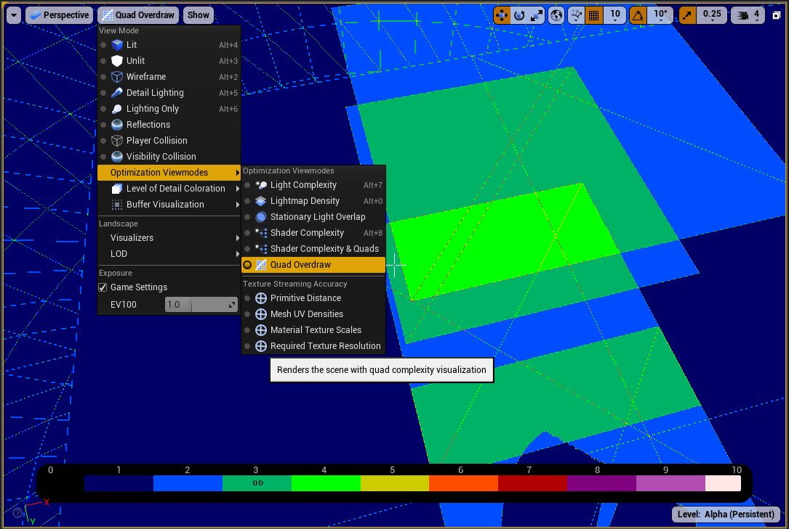

# Overdraw 삼각형이 적은 풀이 더 느릴 수 있는 이유

풀 한 장을 사각형 두 삼각형으로 만들면 충분히 가벼워 보입니다. 하지만 작은 잎 주변에 넓은 빈 영역이 남고 수많은 카드가 겹치면 GPU가 처리할 화면의 일은 커질 수 있습니다. 폴리곤 수만으로 식생의 효율을 설명하기 어려운 이유입니다.

Overdraw는 화면의 같은 영역에 여러 표면 후보가 그려져 반복 처리되는 현상입니다. 앞뒤 표면의 겹침, 마스크 검사와 반투명 층 합성 등에서 생길 수 있으며 반복 처리 모두가 불필요한 것은 아닙니다.

삼각형 개수만으로 설명되지 않는 화면 단위의 작업량을 이해하는 개념입니다. 깊이로 일찍 제거할 수 없는 표면이나 여러 층이 필요한 합성에서는 중복 비용이 남기 쉽습니다.

## 같은 화면 영역을 반복해서 처리한다는 것

겹친 삼각형이 만드는 화면 범위에 재질과 깊이 조건이 더해지면 실제로 반복할 일이 정해집니다. 같은 겹침이라도 한 번의 계산이 무겁다면 비용은 더 커집니다.

삼각형이 화면을 덮으면 표면 후보가 생깁니다. Opaque는 불투명, Masked는 마스크로 남길 부분을 결정하고, Translucent는 뒤의 색과 섞는 표현입니다. 큰 풀 카드의 빈 부분도 어느 영역을 버릴지 마스크를 확인해야 할 수 있습니다. 잎이 작은데 카드가 크면 잎 바깥의 넓은 영역까지 후보를 만듭니다. 여러 카드나 투명 층이 겹치면 비슷한 화면 위치를 반복 처리합니다. 불투명 깊이 제거, 마스크와 반투명 조건에 따라 실제 실행과 생략의 정도가 달라집니다.

외부 Quad Overdraw 진단 화면은 작은 화면 묶음의 처리 비효율을 드러냅니다. 진단색은 GPU 실행 시간 자체가 아닙니다.

[Android Developers · Google · 출처 48](https://developer.android.com/games/optimize/materials)

원본 전체 유지 · 투명 배경은 흰색으로 표시

[이용 조건 CC BY 4.0](https://creativecommons.org/licenses/by/4.0/)

## 잎이 없는 공간도 공짜는 아니다

풀·나뭇잎·연기·머리카락에서 메시의 빈 공간과 겹침을 줄일 때 필요합니다. 윤곽을 다듬어 삼각형을 늘려도 화면 낭비가 줄어 전체가 빨라지는 경우를 설명합니다.

사각형 카드의 대부분이 비어 있다면 그 영역에서도 마스크를 확인하는 일이 필요할 수 있습니다. 잎의 윤곽을 따라 메시를 다듬은 쪽은 삼각형이 늘지만 불필요한 후보 영역은 줄어듭니다. 어느 쪽이 유리한지는 화면 크기와 실제 병목에 달려 있습니다.

## 진단색이 곧 GPU 시간은 아니다

겹치는 면적·층 수·재질 계산이 함께 비용을 만듭니다. Shader Complexity와 Quad Overdraw는 원인 후보를 보는 진단이며 실제 실행 시간과 같은 단위가 아닙니다.

식생의 효율은 적은 삼각형만으로 완성되지 않습니다. 화면에서 차지하는 범위와 겹친 층, 빈 공간까지 함께 보아야 형상과 표면 계산 사이의 균형을 잡을 수 있습니다.

## 참고 자료

- [Render Dependency Graph](https://dev.epicgames.com/documentation/en-us/unreal-engine/rendering-dependency-graph-in-unreal-engine)
- [Viewport Modes](https://dev.epicgames.com/documentation/en-us/unreal-engine/viewport-modes-in-unreal-engine)

[포스트 목록](../../README.md#포스트-목록) · [용어 찾아보기](../Glossary.md) · [이미지 출처](../Images/Sources.md)
