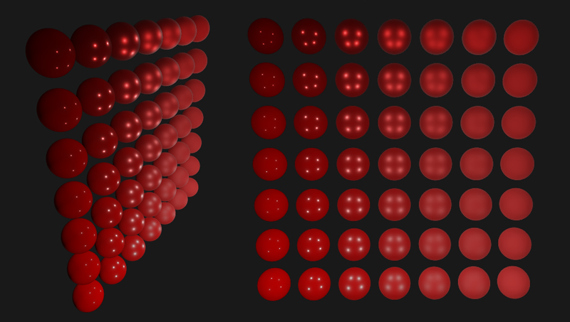

# PBR 조명이 바뀌어도 재료답게 보이는 표면

한 라이팅에서는 그럴듯했던 금속이 다른 장면에서 플라스틱처럼 보이기도 합니다. 이런 차이를 무조건 텍스처색의 문제로 돌리면 수정은 끝나지 않습니다. PBR은 재료에 속한 특성과 장면의 빛을 분리해서 다루는 기준을 제공합니다.

PBR은 Physically Based Rendering으로, 물질과 빛의 상호작용을 물리적으로 그럴듯하게 근사하는 렌더링 접근입니다. 아트 제작에서는 재료의 특성을 입력하고 장면의 빛에 일관되게 반응하도록 만드는 기준이 됩니다.

재질의 고유 특성과 특정 장면의 조명을 분리합니다. 한 환경에서만 그럴듯한 색을 그리는 대신, 다른 조명에서도 금속·도장·돌의 구분이 유지되도록 합니다.

## 재질 입력이 빛에 대한 반응이 되는 과정

기본 색과 금속성, 거칠기, 표면 방향은 재료가 빛에 반응할 조건을 제공합니다. 셰이딩 모델은 이 조건을 장면의 빛과 결합해 카메라 방향으로 나오는 빛을 계산합니다.

재료를 금속·비금속과 표면 상태로 구분합니다. 일반 비금속의 Base Color는 주로 확산 반사색에, 금속의 Base Color는 금속 반사색에 관여합니다. Roughness로 반사가 퍼지는 정도를, 법선으로 미세 표면 방향을 정합니다. Specular 등 입력의 역할은 사용하는 모델에 맞게 적용하며, 밝기 조정용 만능 값으로 쓰지 않습니다. 렌더러가 재료 반응에 광원·환경과 그림자를 결합합니다. 그래서 재료 입력은 같아도 장면의 최종 외관은 달라질 수 있습니다. 조명을 바꿔 재료 구분이 유지되는지 확인합니다.

외부 재질 구 배열은 금속성과 거칠기에 따른 빛 반응의 차이를 보여 줍니다. 배치와 조명 조건도 외관에 관여합니다.

[© Joey de Vries · LearnOpenGL · @JoeyDeVriez · 출처 40](https://learnopengl.com/PBR/Lighting)

원본 전체와 비율 유지

[이용 조건 CC BY 4.0](https://creativecommons.org/licenses/by/4.0/)

## 페인트와 드러난 철은 다른 재료다

도장 아래 드러난 철, 녹과 오염을 재료별로 나눌 때 필요합니다. Base Color에 특정 방향의 하이라이트를 그려 넣으면 광원이 움직여도 남으므로 물질 흔적과 조명 흔적을 구분합니다.

도장면과 녹은 비금속이고 벗겨진 철은 금속입니다. 단순히 밝고 어두운 무늬로 구분하면 조명 변화에서 재료의 차이가 약해질 수 있습니다. 기본 색에 특정 광원의 하이라이트까지 그려 넣은 경우에는 라이트가 이동해도 그 흔적만 표면에 남습니다.

## 물리 기반이라는 이름이 비용을 정하지는 않는다

PBR이라는 이름이 고정 성능 비용을 정하지는 않습니다. 사용하는 텍스처, 혼합 구조, 셰이딩 모델과 화면 점유율이 실제 계산·메모리 부담을 만듭니다.

PBR은 현실 사진을 그대로 붙이는 요령보다 재료의 고유 반응을 분리해 작성하는 방식에 가깝습니다. 재질이 어떤 빛을 받아도 같은 색으로 보여야 하는 것은 아니지만, 재료의 성격은 이어져야 합니다.

## 참고 자료

- [Physically Based Materials](https://dev.epicgames.com/documentation/en-us/unreal-engine/physically-based-materials-in-unreal-engine)
- [Using Fresnel](https://dev.epicgames.com/documentation/en-us/unreal-engine/using-fresnel-in-your-unreal-engine-materials)

[포스트 목록](../../README.md#포스트-목록) · [용어 찾아보기](../Glossary.md) · [이미지 출처](../Images/Sources.md)
