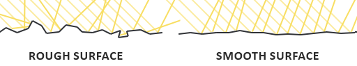

# CH08 BRDF와 반사 분포

## 중심 질문

같은 밝기의 재질인데 왜 하이라이트의 폭과 모양이 다를까?

## 먼저 알아둘 답

빛은 모든 방향으로 똑같이 반사되지 않으며, 표면의 미세한 방향 분포가 반사의 모양을 바꿉니다.

## 왜 알아야 할까

거칠기와 광원 중 무엇을 조절해야 원하는 재질감이 나오는지 판단하기 위해 배웁니다.

### 예제 학습 목표

거칠기와 광원 크기를 따로 바꿔 비슷한 하이라이트 폭의 다른 원인을 확인합니다.

**구현 상태 — 기본 레벨 준비, 아래 절차에 따른 특화 예제 제작과 실측 필요**

레벨 `/Game/RenderingLab/Chapters/Part02_MaterialsAndLight/CH08_BRDF/Maps/L_CH08_BRDF`

## 왜 이런 결과가 생길까

BRDF는 들어오는 빛이 관찰 방향으로 얼마나 반사되는지 나타내는 함수입니다. 거친 표면은 여러 방향의 작은 면을 가진 것으로 근사할 수 있습니다. 거칠기가 높아지면 반사가 넓은 방향으로 퍼져 하이라이트가 넓어집니다. 넓은 광원 역시 여러 방향에서 빛을 보내므로 하이라이트 크기에 영향을 줍니다.

## 제작 중에는 이렇게 나타납니다

넓은 하이라이트를 봤다고 재질이 반드시 거칠다고 단정할 수 없습니다. 광원 크기와 표면 방향도 같은 외관에 관여합니다. 서로 다른 원인을 나눠 조절해야 재질을 다른 장면에 옮겨도 의도가 유지됩니다.

외부 개념도 · 미세한 표면 방향의 차이가 반사광의 퍼짐에 영향을 주는 모습입니다.

읽을 곳  거친 표면에서는 여러 방향으로, 매끈한 표면에서는 더 모인 방향으로 반사하는 차이를 봅니다. 확대된 개념도이며 실제 메시의 모든 미세 면을 직접 만드는 뜻은 아닙니다.

[© Joey de Vries · LearnOpenGL · @JoeyDeVriez · 출처 41](https://learnopengl.com/PBR/Theory)

원본 전체와 비율 유지

[이용 조건 CC BY 4.0](https://creativecommons.org/licenses/by/4.0/)

## 실습 절차

구 하나와 Rect Light를 둡니다. 먼저 광원 크기·위치·밝기를 고정하고 Roughness만 바꿉니다. 원래 거칠기로 돌린 뒤 광원의 가로·세로 크기만 바꿉니다.

## 예상 결과와 이유

첫 비교에서는 재질의 반사 분포가, 두 번째에서는 반사에 나타나는 광원의 범위가 달라질 것입니다. 둘 다 하이라이트가 넓어질 수 있지만 원인은 다릅니다.

## 결과를 어떻게 해석할까

하이라이트 폭뿐 아니라 선명도와 주변 분포를 함께 봅니다. 밝기와 노출까지 동시에 바꾸면 두 원인을 구분하기 어려워집니다.

## 실제 제작에서의 선택

재질 반응을 맞출 때는 고정된 조명 환경을 기준으로 거칠기를 조정하고, 장면의 연출을 위해 광원 크기를 조정합니다.

## 이해한 뒤 확인할 조건

BRDF의 수식과 미세면 가림 항은 보충 주석에서 읽습니다. 이 장의 목표는 수식 암기보다 광원과 재질의 역할을 구분하는 것입니다.

## 공식 자료와 확장

- [Physically Based Materials](https://dev.epicgames.com/documentation/en-us/unreal-engine/physically-based-materials-in-unreal-engine)
- [Overview of Substrate Materials](https://dev.epicgames.com/documentation/en-us/unreal-engine/overview-of-substrate-materials-in-unreal-engine)

[읽는 순서](../ReadingGuide.md) · [용어집](../Glossary.md) · [심화와 적용 조건](../SupplementaryNotes.md)
