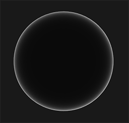

# CH09 Fresnel과 시선 각도

## 무엇인가

Fresnel은 두 물질의 경계에서 반사되는 빛의 비율이 각도와 물질 특성에 따라 달라지는 현상입니다. 일반 비금속 경계에서는 스치는 각도에서 반사가 강해지는 반응이 대표적입니다.

## 렌더링에서 맡는 역할

BRDF와 투과 모델 안에서 반사와 투과의 비중을 정하는 데 쓰입니다. 물·유리·코팅이 보는 각도에 따라 다르게 보이는 물리적 근거입니다.

## 입력과 출력

입력은 경계의 물질 특성과 입사각 등입니다. 결과는 반사율이며 이후 광원·환경·거칠기와 결합해 실제 화면에 보이는 반사가 됩니다.

## 작동 과정

정면과 비스듬한 입사의 반사율을 구분합니다. F0는 정면 입사에서의 반사율로, 물질 경계의 특성을 표현하는 기준 중 하나입니다.

각도 변화에 따른 반사율을 계산해 표면 반응에 반영합니다. 거친 표면에서는 미세면 방향들이 섞이므로 단순한 화면 가장자리 선 하나로 나타나는 현상은 아닙니다.

렌더러가 반사할 환경과 빛을 결합합니다. 한편 UE의 Fresnel 노드는 시선과 표면 방향으로 마스크를 만들 수 있어, 물리 반사 외의 림 효과에도 사용됩니다.

외부 시각화 이미지 · 구의 중심과 실루엣 부근에서 Fresnel 반사 계수가 달라지는 예입니다.

읽을 곳  중심보다 테두리가 밝습니다. 곡면의 테두리에서 시선이 표면에 더 비스듬하게 닿기 때문입니다. 물체의 완성 렌더가 아닌 반사 계수의 시각화입니다.

[© Joey de Vries · LearnOpenGL · @JoeyDeVriez · 출처 41](https://learnopengl.com/PBR/Theory)

원본 전체와 비율 유지

[이용 조건 CC BY 4.0](https://creativecommons.org/licenses/by/4.0/)

## 왜 배경 제작에 필요한가

물과 유리의 반사를 자연스럽게 조정하거나, 별도의 가장자리 발광을 설계할 때 필요합니다. 기본 PBR 반사에 포함된 각도 반응과 추가한 아트 효과를 구분해야 중복 보정을 피할 수 있습니다.

## 성능과 제작 비용

기본 재질의 각도 반응과 추가 텍스처·발광·반투명 기능의 비용은 다릅니다. Fresnel 노드 하나의 외관을 전체 유리 렌더링 비용과 동일시하지 않습니다.

## 원리 확인 예제

이 예제는 위에서 설명한 주제의 일부 관계를 확인합니다. 특정 예제가 기술 전체의 정의나 유일한 사용 목적은 아닙니다.

### 예제 학습 목표

각도 의존 반사와 Fresnel 발광 마스크의 차이를 확인합니다.

**구현 상태 — 기본 레벨 준비, 아래 절차에 따른 특화 예제 제작과 실측 필요**

레벨 `/Game/RenderingLab/Chapters/Part02_MaterialsAndLight/CH09_Fresnel/Maps/L_CH09_Fresnel`

### 실습 절차

반사할 환경이 있는 물 또는 유리 표면을 준비합니다. 카메라 각도만 바꿔 정면과 낮은 시점의 반사를 봅니다. 이후 별도 재질에 Fresnel 노드의 출력을 Emissive에 연결하고 조명을 줄여 비교합니다.

### 예상 결과와 이유

기본 표면에서는 각도에 따라 환경 반사의 비중이 달라질 것입니다. 발광 마스크는 환경이 어두워져도 스치는 부분을 밝힐 수 있습니다.

### 결과를 어떻게 해석할까

두 결과가 비슷해 보여도 빛을 만드는 원인이 다릅니다. Fresnel 노드의 마스크를 실제 물질의 반사율 전체와 동일시하지 않습니다.

## 이 챕터에서 기억할 것

Fresnel은 각도에 따른 반사율 변화입니다. 가장자리 발광 마스크와 물질의 실제 반사를 같은 것으로 취급하지 않습니다.

## 이해한 뒤 확인할 조건

F0는 정면 입사에서의 반사율입니다. 굴절률과 금속의 파장별 반응 같은 세부는 공식 PBR 자료에서 확장합니다.

## 공식 자료와 확장

- [Physically Based Materials](https://dev.epicgames.com/documentation/en-us/unreal-engine/physically-based-materials-in-unreal-engine)
- [Using Fresnel](https://dev.epicgames.com/documentation/en-us/unreal-engine/using-fresnel-in-your-unreal-engine-materials)
- [Overview of Substrate Materials](https://dev.epicgames.com/documentation/en-us/unreal-engine/overview-of-substrate-materials-in-unreal-engine)

[읽는 순서](../ReadingGuide.md) · [용어집](../Glossary.md) · [심화와 적용 조건](../SupplementaryNotes.md)
