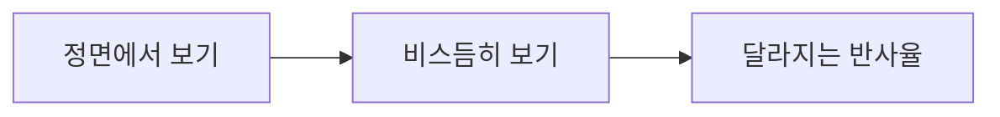

# CH09 Fresnel과 시선 각도

## 챕터 학습 목표

시선 각도에 따라 반사가 달라지는 이유를 이해합니다. 물·유리·젖은 바닥·코팅 표면의 반사를 설계하고, 광학적 반응과 의도적으로 추가한 림 효과를 구분해 조절합니다.

### 예제 학습 목표

바닥을 보는 각도에 따른 반사 변화와 Fresnel 노드로 만든 발광 마스크를 각각 관찰합니다.

**구현 상태 — 기본 실습 레벨 준비**

바닥, 조명, 카메라와 비교용 기본 도형을 가진 시작 레벨입니다. 아래 항목은 챕터별 예제를 완성할 때 수행할 실습 절차입니다.

레벨 경로 `/Game/RenderingLab/Chapters/Part02_MaterialsAndLight/CH09_Fresnel/Maps/L_CH09_Fresnel`

## 흐름 개념도

## 원리

Fresnel은 빛이 두 물질의 경계를 만날 때 각도에 따라 반사 비율이 달라지는 성질입니다. 물이나 유리 같은 비금속은 정면보다 스치는 각도에서 반사가 강해지는 경우가 흔합니다. F0는 표면에 수직으로 빛이 들어올 때의 반사율을 뜻합니다.

## 작동 과정

잔잔한 물을 위에서 보면 물속이 잘 보이다가 낮은 시선에서는 하늘 반사가 강해지는 현상을 떠올릴 수 있습니다. 재질 모델은 각도에 따른 반사율을 계산하거나 근사합니다. 근사는 계산 비용을 줄이면서 주요 경향을 재현하는 방법입니다. 세부 수식보다 정면과 가장자리의 반응을 먼저 관찰합니다.

## 그림으로 연결하기

외부 시각화 이미지 · 구의 중심과 실루엣 부근에서 Fresnel 반사 계수가 달라지는 예입니다.

읽을 곳  중심보다 테두리가 밝습니다. 곡면의 테두리에서 시선이 표면에 더 비스듬하게 닿기 때문입니다. 물체의 완성 렌더가 아닌 반사 계수의 시각화입니다.

[© Joey de Vries · LearnOpenGL · @JoeyDeVriez · 출처 41](https://learnopengl.com/PBR/Theory)

[CC BY 4.0](https://creativecommons.org/licenses/by/4.0/)

## 아트 실무

젖은 바닥을 높은 시점과 낮은 시점에서 비교합니다. UE의 Fresnel 노드는 시선과 표면 방향에 따라 달라지는 마스크에도 쓸 수 있습니다. 마스크는 효과를 어느 부분에 얼마나 적용할지 정하는 값입니다. 이를 발광에 연결한 림 효과는 재질의 자연 반사와 목적을 구분해 조절합니다.

## 성능 비용

간단한 각도 마스크의 계산과 새 투명 레이어·반사 기능을 추가하는 일은 부담이 다릅니다. 마스크를 만드는 노드 수보다 그 값으로 어떤 추가 작업을 켰는지도 확인합니다. 실제 반사 계산의 각도와 아트용 Fresnel 마스크의 각도 사용은 구현이 다를 수 있습니다.

## 언리얼 실습

반사할 환경이 있는 레벨에서 젖은 판을 정면과 낮은 시선으로 봅니다. 별도 재질에서 Fresnel 출력을 Emissive에 연결해 마스크의 모양만 확인합니다. Emissive는 표면 자체가 밝게 보이도록 하는 입력입니다. 두 결과가 조명 변화에 어떻게 반응하는지 비교합니다.

## 관찰과 판단

같은 젖은 판을 높은 시점과 스치는 시점에서 봅니다. 별도 재질의 Fresnel 마스크는 Emissive로 출력해 모양만 확인합니다. 광원을 바꿨을 때 자연 반사와 인위적 림이 어떻게 달라지는지 봅니다.

## 오판을 피하려면

Emissive에 연결한 각도 마스크는 물리적 반사와 같지 않습니다. 실루엣이 밝다는 사실만으로 재질의 F0가 올바르다고 판정하지 않습니다.

## 핵심 요약

정면의 반사율과 각도에 따른 변화, 의도적으로 넣은 림 표현의 역할을 구분합니다.

## 공식 자료

- [Physically Based Materials](https://dev.epicgames.com/documentation/en-us/unreal-engine/physically-based-materials-in-unreal-engine)
- [Using Fresnel](https://dev.epicgames.com/documentation/en-us/unreal-engine/using-fresnel-in-your-unreal-engine-materials)
- [Overview of Substrate Materials](https://dev.epicgames.com/documentation/en-us/unreal-engine/overview-of-substrate-materials-in-unreal-engine)
- [Real Shading in Unreal Engine 4 · Brian Karis](https://blog.selfshadow.com/publications/s2013-shading-course/karis/s2013_pbs_epic_notes_v2.pdf)

## 관련 개념

- [CH08 BRDF와 반사 분포](CH08_BRDF.md)
- [CH12 Translucency와 굴절](CH12_TranslucencyRefraction.md)

## 작업 기록

- 제작한 에셋
- 바꾼 변수와 유지한 조건
- 전후 화면과 실행 시간
- 확인한 기기와 설정

[처음 읽는 방법](../ReadingGuide.md) · [용어집](../Glossary.md) · [보충 주석](../SupplementaryNotes.md) · [챕터 목록](../../README.md#학습-순서)
