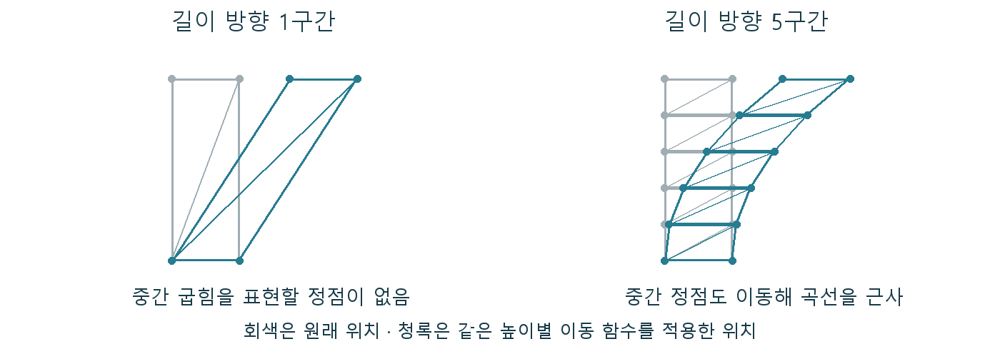

# CH10 셰이더와 머티리얼

## 무엇인가

셰이더는 GPU에서 실행하는 계산 프로그램입니다. 머티리얼은 표면이 어떻게 보이고 빛에 반응할지 작성하는 엔진의 제작 체계이며, 머티리얼 그래프는 셰이더 계산으로 변환되는 입력 중 하나입니다.

## 렌더링에서 맡는 역할

지오메트리·텍스처·재질 속성을 실제 화면 계산으로 연결합니다. 정점의 위치를 바꾸는 일, 표면 값을 구하는 일과 화면 이미지를 처리하는 일은 서로 다른 단계의 프로그램으로 실행될 수 있습니다.

## 입력과 출력

입력은 정점 속성·텍스처·파라미터·장면 데이터 등입니다. 출력은 단계에 따라 변환된 위치, 표면 속성, 색 또는 다른 계산 데이터가 됩니다.

## 작동 과정

그래프를 작성하면 엔진이 사용 경로와 설정에 맞는 코드를 구성하고 컴파일합니다. 컴파일은 실행할 프로그램으로 바꾸는 준비 과정입니다. 설정 조합에 따라 서로 다른 셰이더 순열이 필요할 수 있습니다.

정점 셰이더는 위치와 속성 등을 처리합니다. WPO는 기존 정점 위치에 이동량을 더하는 머티리얼 입력입니다. 같은 함수라도 정점 배치가 다르면 표현할 수 있는 굽힘이 달라집니다.

픽셀 셰이더는 표면 후보에서 텍스처와 재질 계산을 수행합니다. 컴퓨트 셰이더는 그림이나 버퍼를 일반적인 병렬 계산으로 처리하는 데 쓰입니다. 그래프의 노드 전체가 픽셀 셰이더 하나와 항상 일대일로 대응하지는 않습니다.

직접 제작 기하 예시. 정점 사이를 직선으로 잇기 때문에 같은 변위 함수라도 정점 배치에 따라 굽힘 표현이 달라집니다.

## 왜 배경 제작에 필요한가

식생 변형은 정점, 표면 혼합은 주로 재질 평가, 후처리는 화면 계산을 바꿉니다. 어떤 입력이 어느 일을 늘리는지 알아야 텍스처 해상도로 형상 문제를 고치려는 혼동을 피할 수 있습니다.

## 성능과 제작 비용

정점·픽셀 수, 읽는 데이터와 실행 연산이 GPU 비용을 만듭니다. 컴파일 대기와 쿠킹 준비 시간은 실행 비용과 별개의 지표입니다. 노드 수만으로 실제 실행 시간을 단정하지 않습니다.

## 원리 확인 예제

이 예제는 위에서 설명한 주제의 일부 관계를 확인합니다. 특정 예제가 기술 전체의 정의나 유일한 사용 목적은 아닙니다.

### 예제 학습 목표

같은 변위 함수에서 정점의 구간 수가 굽힘에 미치는 영향을 확인합니다.

**구현 상태 — 기본 레벨 준비, 아래 절차에 따른 특화 예제 제작과 실측 필요**

레벨 `/Game/RenderingLab/Chapters/Part02_MaterialsAndLight/CH10_ShadersWPO/Maps/L_CH10_ShadersWPO`

### 실습 절차

길이 방향으로 1구간인 카드와 여러 구간인 카드를 만듭니다. 같은 높이 기반 가중치와 같은 바람 함수를 연결합니다. 변형 크기를 고정하고 옆면 실루엣과 바닥 그림자를 비교합니다.

### 예상 결과와 이유

여러 구간 카드는 중간 정점도 이동해 휘어 보이고, 1구간 카드는 중간 굽힘을 표현하지 못할 것입니다. WPO를 끄면 두 카드가 원래 형상으로 돌아옵니다.

### 결과를 어떻게 해석할까

외관 비교 뒤 정점 수와 그림자 조건을 기록하고 비용을 따로 봅니다. 움직임이 화면 가장자리에서 사라지면 메시를 감싸는 판정 범위인 Bounds도 확인합니다.

## 이 챕터에서 기억할 것

셰이더는 GPU의 계산이고 머티리얼은 그중 표면 반응을 작성하는 체계입니다. WPO는 정점 계산을 확인하는 예제이며 셰이더 전체의 정의는 아닙니다.

## 이해한 뒤 확인할 조건

셰이더 순열은 설정 조합별로 준비하는 프로그램 변형입니다. 실행 중 WPO 비용과 컴파일·쿠킹 준비 비용은 다른 문제이므로 이 실습의 결론에 섞지 않습니다.

## 공식 자료와 확장

- [Render Dependency Graph](https://dev.epicgames.com/documentation/en-us/unreal-engine/rendering-dependency-graph-in-unreal-engine)
- [Material Editor UI](https://dev.epicgames.com/documentation/en-us/unreal-engine/unreal-engine-material-editor-ui)
- [Material Inputs](https://dev.epicgames.com/documentation/en-us/unreal-engine/material-inputs-in-unreal-engine)
- [Graphics Programming Overview · Epic](https://dev.epicgames.com/documentation/en-us/unreal-engine/graphics-programming-overview-for-unreal-engine)

[읽는 순서](../ReadingGuide.md) · [용어집](../Glossary.md) · [심화와 적용 조건](../SupplementaryNotes.md)
