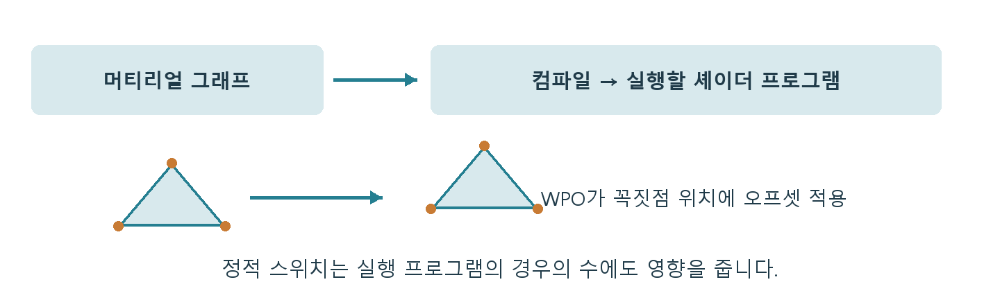

# CH10 Shader와 순열과 WPO

## 챕터 학습 목표

재질과 움직임을 만드는 그래프가 GPU의 어떤 작업으로 이어지는지 이해합니다. 여러 에셋이 공유할 재질과 흔들리는 식생을 설계할 때 실행 부담, 준비할 프로그램의 종류와 배포 준비 시간을 구분해 관리합니다.

### 예제 학습 목표

같은 풀 메시에서 WPO를 켜고 끄며 변형 범위, 플랫폼 통계와 Base Pass·그림자 비용을 확인합니다.

**구현 상태 — 기본 실습 레벨 준비**

바닥, 조명, 카메라와 비교용 기본 도형을 가진 시작 레벨입니다. 아래 항목은 챕터별 예제를 완성할 때 수행할 실습 절차입니다.

레벨 경로 `/Game/RenderingLab/Chapters/Part02_MaterialsAndLight/CH10_ShadersWPO/Maps/L_CH10_ShadersWPO`

## 흐름 개념도

## 원리

셰이더는 GPU에서 실행되는 계산 프로그램입니다. 재질 그래프는 표면의 색과 반사 등을 노드로 표현한 제작 화면이며, 엔진은 이를 GPU가 실행할 프로그램으로 바꿉니다. 이런 준비 과정을 컴파일이라고 합니다. 같은 그래프라도 플랫폼과 사용 기능에 따라 여러 실행 버전이 필요할 수 있습니다.

## 작동 과정

정점 셰이더는 모델 꼭짓점의 위치 등을 처리하고, 픽셀 셰이더는 화면에서 표면을 표현할 값을 계산합니다. WPO는 World Position Offset의 약자로 정점에 위치 변화를 더하는 입력입니다. 풀 끝에 시간에 따라 변하는 이동량을 주면 흔들림을 만들 수 있습니다. 표현할 굽힘의 세밀함은 원래 정점의 수와 배치에도 영향을 받습니다.

## 아트 실무

여러 재질이 공유할 기본 그래프를 마스터 재질이라고 부릅니다. Static Switch는 컴파일할 때 경로를 고르는 스위치입니다. 실제로 쓰는 스위치 조합에 따라 별도 버전, 즉 셰이더 순열이 생길 수 있습니다. 반면 일반 Scalar Parameter는 같은 실행 버전에서 숫자를 바꾸는 용도입니다.

## 성능 비용

정점 수, 화면 면적, 텍스처 읽기와 계산이 각각 부담을 만듭니다. 텍스처 샘플은 이미지에서 필요한 좌표의 값을 읽는 작업입니다. 캐시는 자주 쓰는 데이터를 가까이 두어 다시 읽기 쉽게 하는 임시 저장 영역입니다. 컴파일 시간과 배포용 데이터를 준비하는 쿠킹 시간은 실행 중 GPU 시간과 따로 기록합니다.

## 언리얼 실습

같은 풀 메시에서 WPO 켜짐·꺼짐을 비교합니다. 변형한 정점이 오브젝트의 가시성 판정 범위인 bounds 밖으로 나가는지 봅니다. Material Editor의 Platform Stats는 대상 플랫폼용 셰이더 통계입니다. 이 통계와 함께 실제 Base Pass·Shadow Depths 시간을 기록합니다. 뒤의 이름은 각각 표면 준비와 그림자용 깊이 작업을 가리킵니다.

## 핵심 요약

노드 개수, 컴파일할 버전 수, 실제 프레임의 작업량은 서로 다른 지표입니다. 그래프의 변화가 어느 작업에 영향을 주는지 확인합니다.

## 그림으로 연결하기

정적 분기는 컴파일할 프로그램의 경우의 수를, WPO는 정점 위치를 바꿉니다. 그래프 노드 수를 GPU 시간으로 바로 읽지 않습니다.

## 공식 자료

- [Render Dependency Graph](https://dev.epicgames.com/documentation/en-us/unreal-engine/rendering-dependency-graph-in-unreal-engine)
- [Material Editor UI](https://dev.epicgames.com/documentation/en-us/unreal-engine/unreal-engine-material-editor-ui)
- [Material Inputs](https://dev.epicgames.com/documentation/en-us/unreal-engine/material-inputs-in-unreal-engine)
- [Material Instances](https://dev.epicgames.com/documentation/unreal-engine/instanced-materials-in-unreal-engine)

## 관련 개념

- [CH15 Instancing과 반복 배치](CH15_Instancing.md)
- [CH22 Virtual Shadow Maps와 페이지 캐시](CH22_VirtualShadowMaps.md)

## 작업 기록

- 제작한 에셋
- 바꾼 변수와 유지한 조건
- 전후 화면과 실행 시간
- 확인한 기기와 설정

[처음 읽는 방법](../ReadingGuide.md) · [용어집](../Glossary.md) · [보충 주석](../SupplementaryNotes.md) · [챕터 목록](../../README.md#학습-순서)
