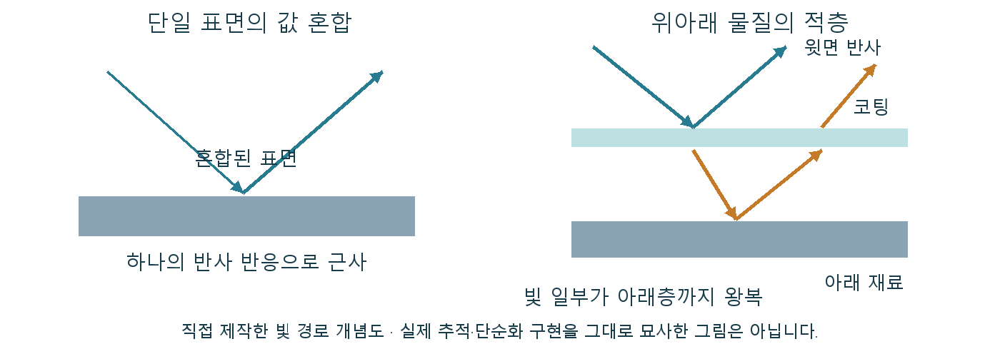

# Substrate 재료를 섞는 것과 층을 쌓는 것의 차이

거친 페인트 위에 매끈한 코팅이 올라간 표면은 거칠기 두 값을 평균한 표면과 다릅니다. 빛 일부는 코팅에서 반사되고 나머지는 아래 재료까지 내려갔다 돌아옵니다. Substrate는 이런 재료의 구성과 관계를 표현하는 머티리얼 체계입니다.

Substrate는 UE에서 물질의 빛 반응을 모듈식으로 작성하고 혼합·적층하는 머티리얼 프레임워크입니다. 하나의 코팅 효과 이름이 아니라 여러 물질 표현을 구성하는 체계입니다.

고정된 모델의 제한된 입력만 고르는 대신 물질 단위와 관계를 연결해 복합 표면을 표현합니다. 도장·코팅·물기·산란 같은 재료의 구성을 설명할 수 있게 합니다.

## 물질 단위와 관계로 표면을 구성한다

Slab 같은 물질 단위의 특성과 연산자의 연결이 표면 구성을 만듭니다. 렌더러는 이를 처리 가능한 표현으로 준비한 뒤 조명에서 빛 반응을 평가합니다.

Slab은 반사·투과·산란 같은 상호작용을 표현하는 물질 단위입니다. BSDF는 경계에서 빛이 어느 방향으로 반사·투과되는지 나타내는 분포 함수의 범주입니다. 혼합은 재료의 비중을 결합하고, 수직 적층은 빛이 위아래 물질을 거치는 관계를 표현합니다. 아래층의 반응은 윗층을 통과하는 빛의 영향을 받으므로 단순한 색·거칠기 평균과 다를 수 있습니다. 구성한 표현은 플랫폼과 예산에 맞는 단순화·저장·평가를 거칩니다. 작성한 층의 의도와 실제 실시간 결과를 여러 조명과 각도에서 확인합니다.

단일 표면의 값 혼합과 위아래 물질을 통과하는 빛의 관계를 나눈 직접 제작 도식입니다. 실제 런타임 추적·단순화를 그대로 재현한 그림은 아닙니다.

## 아래 페인트와 위 코팅이 함께 보여야 할 때

광택 코팅 아래 거친 페인트, 젖은 돌, 재료 경계처럼 서로 다른 반응을 함께 만들 때 필요합니다. 차이가 읽히지 않는 원거리 표면까지 복잡한 구성을 유지할 필요는 없습니다.

윗층의 선명한 반사와 아래층의 넓은 반응이 동시에 읽히는 표면이라면 하나의 거칠기 평균으로 두 인상을 맞추기 어렵습니다. 반면 멀리 보이는 소품에서는 그 차이가 거의 사라질 수 있습니다. 복잡한 물질 구성이 필요한지는 화면에서 읽히는 반응에 달려 있습니다.

## 작성한 층과 실시간 평가의 관계

물질의 복잡도·저장량·평가 경로와 단순화가 비용에 관여합니다. Slab 개수만으로 고정된 바이트나 시간을 약속하지 않고 대상 환경의 실제 결과를 확인합니다.

Substrate의 의미는 무조건 층을 더 쌓을 수 있다는 데 있지 않습니다. 원하는 재료 반응을 어떤 단위와 관계로 구성할지 명확하게 만들고, 필요한 표현에 맞춰 복잡도를 배분하는 데 있습니다.

## 참고 자료

- [Programming with Substrate GBuffer Formats](https://dev.epicgames.com/documentation/en-us/unreal-engine/programming-with-substrate-gbuffer-formats)
- [Decal Materials](https://dev.epicgames.com/documentation/en-us/unreal-engine/decal-materials-in-unreal-engine)
- [Overview of Substrate Materials](https://dev.epicgames.com/documentation/en-us/unreal-engine/overview-of-substrate-materials-in-unreal-engine)

[포스트 목록](../../README.md#포스트-목록) · [용어 찾아보기](../Glossary.md) · [이미지 출처](../Images/Sources.md)
