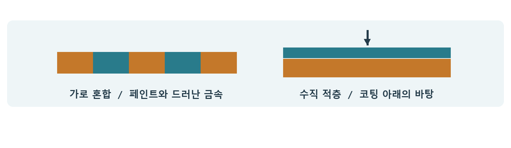

# CH11 Substrate와 재질 레이어

## 챕터 학습 목표

물질의 혼합과 적층이 빛에 어떻게 다르게 반응하는지 이해합니다. 도장·코팅·물기 같은 복합 표면을 만들 때 필요한 표현을 선택하고, 대상 기기에서 허용할 계산과 저장량 안에서 품질을 조정합니다.

### 예제 학습 목표

단일 Slab, 두 층 적층과 파라미터 혼합을 비교해 외관·단순화 결과·패스 비용의 차이를 확인합니다.

**구현 상태 — 기본 실습 레벨 준비**

바닥, 조명, 카메라와 비교용 기본 도형을 가진 시작 레벨입니다. 아래 항목은 챕터별 예제를 완성할 때 수행할 실습 절차입니다.

레벨 경로 `/Game/RenderingLab/Chapters/Part02_MaterialsAndLight/CH11_Substrate/Maps/L_CH11_Substrate`

## 흐름 개념도

## 원리

Substrate는 여러 재료의 빛 반응을 조합하는 머티리얼 제작 체계입니다. Slab BSDF는 재료 하나의 반사·투과·산란 성질을 나타내는 기본 단위입니다. 노드 이름의 Slab은 층을 떠올리게 하지만, 단일 재료를 정의하는 데도 사용합니다. 먼저 단일 재료가 어떻게 보이는지 확인한 뒤 혼합을 추가합니다.

## 작동 과정

Horizontal Blend는 페인트와 드러난 금속처럼 표면에서 나란히 존재하는 재료의 비중을 섞습니다. Vertical Layer는 코팅 아래에 나무가 있는 것처럼 위층과 아래층의 반응을 연결합니다. 두 재료의 설정값을 합쳐 하나의 재료로 근사하는 방식은 파라미터 블렌딩입니다. 복수 반응을 따로 계산하는 것과 외관·비용이 달라질 수 있습니다.

## 아트 실무

벗겨진 철문은 가로 혼합을, 물막이 있는 돌은 적층을 후보로 둡니다. Diffuse Albedo는 확산 반사의 색, F0는 정면 반사율, Roughness는 반사가 퍼지는 정도입니다. 넓은 바닥에서는 실제 적층과 거칠기만 조정한 단순 버전을 함께 만들어 표현 차이가 작업량을 정당화하는지 봅니다.

## 성능 비용

Closure는 실행 시 조명에 대해 평가할 재료 반응의 단위를 가리킵니다. 그래프의 Slab 수와 최종 평가 수가 항상 같지는 않습니다. Blendable GBuffer는 고정된 저장량과 예측 가능한 비용을 지향하며, Adaptive는 더 복잡한 반응을 담되 예산에 따라 단순화할 수 있습니다. 예산은 픽셀당 저장 바이트와 평가 수 등의 제한입니다. 지원 조건은 보충 주석 3에 정리했습니다.

## 언리얼 실습

기존 재질을 복제한 뒤 단일 Slab, 두 층 적층, 파라미터 혼합을 만듭니다. 화면에서 차지하는 면적을 맞춥니다. Material Editor와 Substrate 시각화에서 자동 단순화 여부를 확인하고 관련 GPU 시간을 비교합니다. GBuffer Format 변경은 프로젝트 설정이므로 맵만 바꿔 자동 전환되는 것으로 가정하지 않습니다.

## 핵심 요약

표현하려는 재료 관계에 맞춰 혼합 방식을 선택합니다. 보기 복잡한 그래프와 실제로 복잡하게 평가되는 재질을 구분합니다.

## 그림으로 연결하기

가로 혼합과 수직 적층은 다른 표면 구성을 나타냅니다. 층을 추가한 결과는 조명·거칠기·플랫폼 조건을 유지하고 검증합니다.

## 공식 자료

- [Programming with Substrate GBuffer Formats](https://dev.epicgames.com/documentation/en-us/unreal-engine/programming-with-substrate-gbuffer-formats)
- [Decal Materials](https://dev.epicgames.com/documentation/en-us/unreal-engine/decal-materials-in-unreal-engine)
- [Overview of Substrate Materials](https://dev.epicgames.com/documentation/en-us/unreal-engine/overview-of-substrate-materials-in-unreal-engine)

## 관련 개념

- [CH08 BRDF와 반사 분포](CH08_BRDF.md)
- [CH13 SSS와 표면 아래 산란](CH13_SubsurfaceScattering.md)

## 작업 기록

- 제작한 에셋
- 바꾼 변수와 유지한 조건
- 전후 화면과 실행 시간
- 확인한 기기와 설정

[처음 읽는 방법](../ReadingGuide.md) · [용어집](../Glossary.md) · [보충 주석](../SupplementaryNotes.md) · [챕터 목록](../../README.md#학습-순서)
