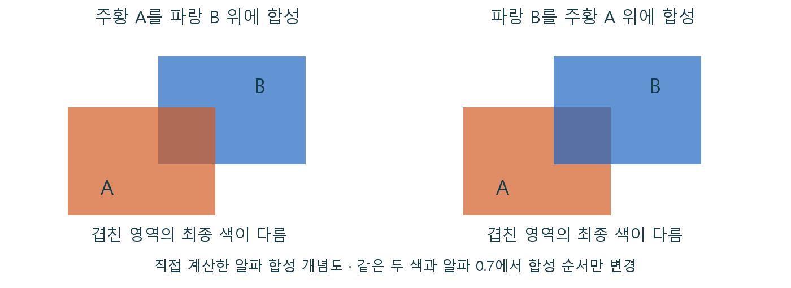

# CH12 Translucency와 합성

## 중심 질문

유리판을 겹치면 왜 불투명 벽과 다른 오류가 생길까?

## 먼저 알아둘 답

반투명은 앞면 하나만 남겨서는 색을 결정할 수 없고, 뒤의 색과 여러 층을 순서에 맞춰 합쳐야 합니다.

## 왜 알아야 할까

유리·물·연기에서 겹침과 정렬 오류의 원인을 구분하고 레이어 구성을 설계하기 위해 배웁니다.

### 예제 학습 목표

굴절을 끈 두 판으로 합성 순서와 교차 오류를 분리해 관찰합니다.

**구현 상태 — 기본 레벨 준비, 아래 절차에 따른 특화 예제 제작과 실측 필요**

레벨 `/Game/RenderingLab/Chapters/Part02_MaterialsAndLight/CH12_TranslucencyRefraction/Maps/L_CH12_TranslucencyRefraction`

## 왜 이런 결과가 생길까

불투명 벽은 앞면이 뒤를 완전히 가리지만 유리는 뒤의 색도 필요합니다. 일반적인 알파 합성은 앞 색의 기여와 뒤 색의 기여를 섞습니다. 이 연산은 순서를 바꾸면 결과가 달라질 수 있습니다. 엔진이 물체 단위로 정렬하는 조건에서는 서로 교차하는 복잡한 표면을 모든 픽셀에서 올바른 순서로 처리하기 어렵습니다.

## 제작 중에는 이렇게 나타납니다

유리의 이상한 겹침은 Base Color를 조정해 해결할 문제가 아닐 수 있습니다. 굴절은 배경의 다른 위치를 읽거나 추적하는 별도의 문제이며, 먼저 합성 순서를 확인해야 원인을 나눌 수 있습니다.

직접 제작 합성 예시. 두 색과 알파는 같지만 합성 순서가 달라 겹친 색이 달라집니다. 실제 엔진 캡처가 아닌 기본 알파 연산의 비교입니다.

## 실습 절차

굴절을 끈 서로 다른 색의 반투명 판 두 개를 둡니다. 판을 떨어뜨린 상태와 교차시킨 상태에서 카메라만 천천히 이동합니다. 불투명 판으로 바꾼 비교도 남깁니다.

## 예상 결과와 이유

단순히 앞뒤로 떨어진 경우보다 교차한 경우에 겹침 순서가 갑자기 바뀌거나 일부 영역이 어색해질 가능성이 높습니다. 불투명 비교에서는 앞 표면의 깊이가 우선합니다.

## 결과를 어떻게 해석할까

굴절 없이도 오류가 나면 먼저 정렬·교차 구조를 조사합니다. 굴절을 켠 뒤 생기는 화면 가장자리 누락은 별도 실험으로 다룹니다.

## 실제 제작에서의 선택

겹친 반투명 층과 교차를 줄이고 필요한 실루엣을 유지하도록 메시를 구성합니다. 큰 화면 점유율과 층 수는 합성 비용도 늘릴 수 있습니다.

## 이해한 뒤 확인할 조건

모든 반투명 모드가 같은 정렬과 추적을 사용하지는 않습니다. 이 장의 기본 알파 합성을 이해한 뒤 프로젝트의 선택 경로를 확인합니다.

## 공식 자료와 확장

- [Lit Translucency](https://dev.epicgames.com/documentation/en-us/unreal-engine/lit-translucency-in-unreal-engine)
- [Using Refraction](https://dev.epicgames.com/documentation/en-us/unreal-engine/using-refraction-in-unreal-engine)

[읽는 순서](../ReadingGuide.md) · [용어집](../Glossary.md) · [심화와 적용 조건](../SupplementaryNotes.md)
