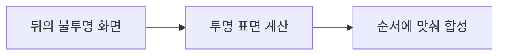
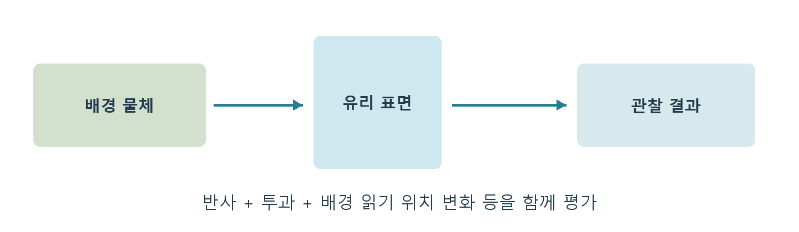

# CH12 Translucency와 굴절

## 챕터 학습 목표

배경을 투과시키는 표면의 셰이딩·정렬·굴절·합성을 이해합니다. 유리, 물, 연기와 겹친 효과에서 발생하는 화면 오류를 진단하고, 표현에 필요한 레이어와 화면 점유율을 판단합니다.

### 예제 학습 목표

유리판의 겹침과 굴절을 바꾸며 내부 배경, 화면 가장자리, 정렬 오류와 반투명 비용을 비교합니다.

**구현 상태 — 기본 실습 레벨 준비**

바닥, 조명, 카메라와 비교용 기본 도형을 가진 시작 레벨입니다. 아래 항목은 챕터별 예제를 완성할 때 수행할 실습 절차입니다.

레벨 경로 `/Game/RenderingLab/Chapters/Part02_MaterialsAndLight/CH12_TranslucencyRefraction/Maps/L_CH12_TranslucencyRefraction`

## 흐름 개념도

## 원리

Translucency는 뒤의 색이 비치는 표면을 표현합니다. 가장 단순한 알파 합성은 앞 색과 뒤 색을 투명도에 따라 섞는 방식입니다. 알파는 이때 사용할 비중을 나타내는 값입니다. 굴절은 물질 경계에서 빛의 방향이 바뀌어 배경이 휘어 보이는 현상입니다.

## 작동 과정

반투명은 보통 불투명 표면을 그린 뒤 별도 작업으로 합성합니다. 앞뒤 순서에 따라 섞인 색이 달라지므로 그리기 순서도 중요합니다. Sort Priority는 큰 합성 순서를 조절하는 설정이지만, 서로 교차한 두 면의 모든 화면 위치에서 올바른 앞뒤를 정해 주지는 못합니다.

## 아트 실무

유리, 김 서림과 빗방울을 여러 장 쌓기 전에 한 표면에서 표현할 수 있는 부분을 찾아봅니다. 화면 기반 굴절은 이미 그린 화면의 다른 위치를 읽어 왜곡하는 방식입니다. 화면 밖 정보나 앞 물체에 가려져 없던 배경을 충분히 얻기 어려우므로 가장자리와 얇은 프레임 주변을 확인합니다.

## 성능 비용

층 수, 화면을 덮는 면적, 조명 방식과 굴절이 모두 관여합니다. 그래프가 단순해도 큰 투명 레이어를 여러 장 합성하면 비용이 커질 수 있습니다. 불투명 깊이에 의해 가려지는 것과 투명층끼리 색을 합성하는 작업을 구분해 생각합니다.

## 언리얼 실습

같은 유리판을 한 장과 네 장으로 배치합니다. 카메라·조명·재질을 맞추고 겹침만 비교합니다. 다음에는 굴절 켜짐·꺼짐만 바꿉니다. 카메라를 옆으로 움직여 정렬과 가장자리 오류를 보고 Translucency 관련 GPU 시간을 기록합니다.

## 핵심 요약

반투명 문제는 재질 입력, 합성 순서와 읽을 수 있는 배경 정보로 나누어 조사합니다.

## 그림으로 연결하기

반투명 결과에는 표면 자체의 반사와 뒤쪽 배경의 영향이 함께 들어갑니다. 굴절은 배경을 읽는 위치도 바꾸며 단순 알파 합성만으로 끝나지 않습니다.

## 공식 자료

- [Lit Translucency](https://dev.epicgames.com/documentation/en-us/unreal-engine/lit-translucency-in-unreal-engine)
- [Using Refraction](https://dev.epicgames.com/documentation/en-us/unreal-engine/using-refraction-in-unreal-engine)

## 관련 개념

- [CH05 Depth와 Early Z](CH05_DepthEarlyZ.md)
- [CH23 TAA와 프레임 히스토리](CH23_TAA.md)

## 작업 기록

- 제작한 에셋
- 바꾼 변수와 유지한 조건
- 전후 화면과 실행 시간
- 확인한 기기와 설정

[처음 읽는 방법](../ReadingGuide.md) · [용어집](../Glossary.md) · [보충 주석](../SupplementaryNotes.md) · [챕터 목록](../../README.md#학습-순서)
