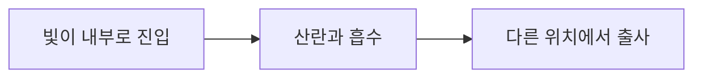
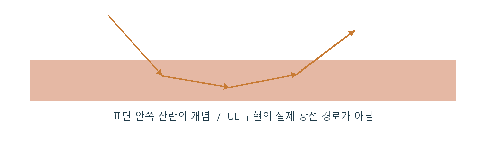

# CH13 SSS와 표면 아래 산란

## 챕터 학습 목표

표면 아래를 지난 빛이 만드는 외관과 재질 두께의 역할을 이해합니다. 왁스·대리석·피부·식생의 밀도감과 역광 표현에 맞는 산란 모델과 거리 스케일을 선택합니다.

### 예제 학습 목표

두께가 다른 왁스 형상을 전면광·역광에서 비교하고 일반 표면과 산란 재질의 결과를 확인합니다.

**구현 상태 — 기본 실습 레벨 준비**

바닥, 조명, 카메라와 비교용 기본 도형을 가진 시작 레벨입니다. 아래 항목은 챕터별 예제를 완성할 때 수행할 실습 절차입니다.

레벨 경로 `/Game/RenderingLab/Chapters/Part02_MaterialsAndLight/CH13_SubsurfaceScattering/Maps/L_CH13_SubsurfaceScattering`

## 흐름 개념도

## 원리

SSS는 Subsurface Scattering의 약자로, 빛이 표면 아래에서 산란하는 현상입니다. 왁스에 들어간 빛이 내부에서 방향을 바꾸고 일부는 흡수된 뒤 다른 위치로 나와 부드러운 외관을 만듭니다. 단순히 뒤 배경이 보이는 투명도와 구별해 관찰합니다.

## 작동 과정

UE의 Subsurface Profile은 화면에 보이는 정보를 이용해 산란의 퍼짐을 근사하는 방식입니다. Profile은 퍼짐과 색 반응을 묶은 설정입니다. Substrate의 SSS MFP는 내부에서 빛이 상호작용하기까지의 평균 거리 스케일입니다. 같은 값이라도 물체의 두께와 크기, 사용하는 모델에 따라 결과가 달라집니다.

## 아트 실무

촛농의 얇은 가장자리와 두꺼운 몸통을 역광에서 비교합니다. 작은 소품을 거대한 크기로 가져오면 거리 기반 산란 설정이 의도와 다르게 보일 수 있습니다. 잎 뒷면의 빛 표현에 쓰는 Two Sided Foliage와 왁스용 산란 설정은 표현 목적과 처리 방식에 맞춰 선택합니다.

## 성능 비용

일반적인 표면 반사에 더해 산란을 근사하는 작업이 필요할 수 있습니다. 화면을 얼마나 채우는지와 사용하는 구현 경로가 영향을 줍니다. SSS라는 이름만으로 같은 비용이나 같은 투과 결과를 예상하지 않습니다.

## 언리얼 실습

실제 크기에 맞춘 왁스 기둥과 얇은 판을 만듭니다. 기본 조명 반응 모델인 Default Lit와 Subsurface Profile 또는 Substrate SSS를 각각 적용합니다. 노출을 고정한 전면광·역광에서 두께에 따른 차이를 보고, 화면 면적을 맞춰 GPU 작업도 비교합니다.

## 핵심 요약

산란 모델, 거리 스케일과 물체 두께를 함께 조정해 내부를 지난 빛의 외관을 만듭니다.

## 그림으로 연결하기

빛이 표면 안으로 들어가 여러 방향으로 퍼져 나온 상황을 단면으로 표현했습니다. UE의 화면 기반 근사는 실제 내부 광선을 모두 추적하는 방식과 다릅니다.

## 공식 자료

- [Overview of Substrate Materials](https://dev.epicgames.com/documentation/en-us/unreal-engine/overview-of-substrate-materials-in-unreal-engine)
- [Subsurface Profile Shading Model](https://dev.epicgames.com/documentation/en-us/unreal-engine/subsurface-profile-shading-model-in-unreal-engine)

## 관련 개념

- [CH07 PBR과 재질 입력](CH07_PBR.md)
- [CH11 Substrate와 재질 레이어](CH11_Substrate.md)

## 작업 기록

- 제작한 에셋
- 바꾼 변수와 유지한 조건
- 전후 화면과 실행 시간
- 확인한 기기와 설정

[처음 읽는 방법](../ReadingGuide.md) · [용어집](../Glossary.md) · [보충 주석](../SupplementaryNotes.md) · [챕터 목록](../../README.md#학습-순서)
