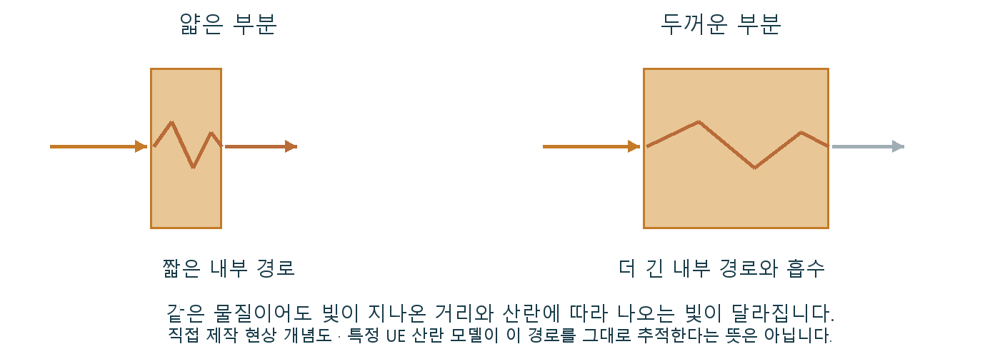

# CH13 SSS와 표면 아래 산란

## 무엇인가

SSS는 Subsurface Scattering으로, 빛이 표면 안으로 들어가 내부에서 흩어지고 흡수된 뒤 다시 나오는 현상입니다. 표면에서 즉시 반사되는 빛과 구분되는 전달입니다.

## 렌더링에서 맡는 역할

피부·왁스·대리석 등에서 부드러운 음영과 내부 빛 전달에 의한 색을 표현합니다. 표면 반사만으로는 만들기 어려운 재료의 밀도감을 담당합니다.

## 입력과 출력

입력은 선택 모델의 산란·흡수 특성, 스케일·두께 관련 정보와 조명입니다. 모델이 내부 전달을 근사해 표면에서 나오는 빛의 색과 분포에 반영합니다.

## 작동 과정

빛 일부가 표면 안으로 들어갑니다. 물질은 색에 따라 빛을 다르게 흡수하고, 내부 산란으로 진행 방향을 바꿉니다.

지나온 거리와 재료 특성에 따라 나오는 빛이 달라집니다. 그래서 같은 재료라도 얇은 가장자리와 두꺼운 몸통의 역광 반응이 다를 수 있습니다.

실시간 모델은 이 전달을 여러 방식으로 근사합니다. 모든 광선을 물질 내부에서 실제 추적하는 것은 아니며, 필요한 입력과 근사 조건은 선택 모델에 달려 있습니다.

직접 제작 빛 전달 개념도. 얇고 두꺼운 부분에서 달라질 수 있는 내부 경로를 비교합니다. 실제 결과는 재료와 선택한 산란 모델에 달려 있습니다.

## 왜 배경 제작에 필요한가

왁스의 얇은 부분, 피부의 부드러움과 일부 돌의 투광감을 만들 때 필요합니다. 알파를 내려 배경을 비추는 처리와 내부 빛 전달을 혼동하지 않습니다.

## 성능과 제작 비용

선택한 산란 모델, 화면 범위와 추가 계산이 비용에 관여합니다. 재료의 스케일과 두께를 틀리게 두고 산란색만 보정하면 다른 조명에서 의도가 무너질 수 있습니다.

## 원리 확인 예제

이 예제는 위에서 설명한 주제의 일부 관계를 확인합니다. 특정 예제가 기술 전체의 정의나 유일한 사용 목적은 아닙니다.

### 예제 학습 목표

한 산란 모델에서 얇은 부분과 두꺼운 부분의 역광 반응을 비교합니다.

**구현 상태 — 기본 레벨 준비, 아래 절차에 따른 특화 예제 제작과 실측 필요**

레벨 `/Game/RenderingLab/Chapters/Part02_MaterialsAndLight/CH13_SubsurfaceScattering/Maps/L_CH13_SubsurfaceScattering`

### 실습 절차

얇은 돌기와 두꺼운 몸통이 있는 형상에 같은 산란 재질을 적용합니다. 한 가지 SSS 모델을 고정하고 전면광과 역광을 각각 관찰합니다. 일반 불투명 표면 재질과도 비교합니다.

### 예상 결과와 이유

역광에서 얇은 부분의 빛 전달이 두꺼운 몸통과 다르게 보일 것으로 예상합니다. 일반 표면 재질은 같은 내부 산란 반응을 만들지 못할 것입니다.

### 결과를 어떻게 해석할까

예상 차이가 없으면 선택 모델이 두께를 어떻게 근사하거나 입력받는지 확인합니다. 모델의 입력 의미를 먼저 확인하지 않고 Opacity 숫자를 다른 SSS 방식에 옮기지 않습니다.

## 이 챕터에서 기억할 것

SSS는 빛의 내부 산란입니다. 표면 반사·일반 투명도와 구분하고 재료와 스케일에 맞는 모델을 사용합니다.

## 이해한 뒤 확인할 조건

Subsurface, Subsurface Profile, Substrate는 같은 입력값이 같은 의미라고 가정할 수 없습니다. 내부 경로 그림도 현상의 설명이며 선택한 모델의 실제 추적을 재현한 것은 아닙니다.

## 공식 자료와 확장

- [Overview of Substrate Materials](https://dev.epicgames.com/documentation/en-us/unreal-engine/overview-of-substrate-materials-in-unreal-engine)
- [Subsurface Profile Shading Model](https://dev.epicgames.com/documentation/en-us/unreal-engine/subsurface-profile-shading-model-in-unreal-engine)

[읽는 순서](../ReadingGuide.md) · [용어집](../Glossary.md) · [심화와 적용 조건](../SupplementaryNotes.md)
