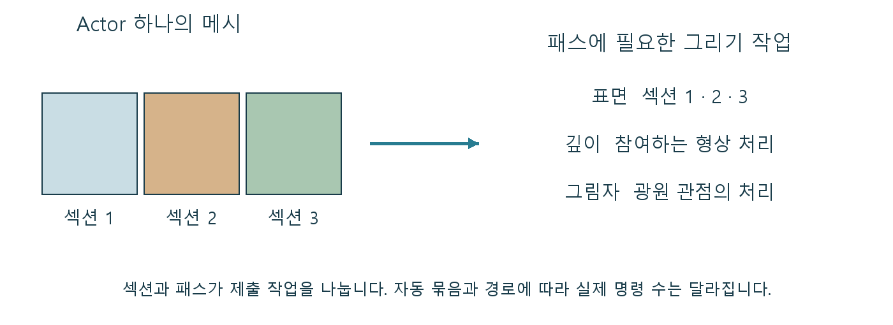

# Draw Call 소품 하나가 여러 그리기 작업이 되는 이유

레벨의 Actor 수가 적다고 그리기 명령도 적은 것은 아닙니다. 재질 슬롯이 많은 소품 하나는 여러 작업으로 나뉠 수 있고, 같은 형상도 그림자와 표면을 위해 다시 처리될 수 있습니다. Draw Call은 그 연결을 이해하는 단위입니다.

Draw Call은 GPU에 정해진 상태와 지오메트리로 그리기 작업을 실행하도록 제출하는 명령입니다. Actor는 레벨의 오브젝트 단위이고 Draw Call은 실행 작업의 단위이므로 개수가 같지 않습니다.

CPU가 준비한 장면을 GPU의 그리기 작업으로 연결합니다. 표면을 어떻게 나누고 어떤 재질과 패스에 참여시키는지가 제출 부담을 만드는 연결 지점입니다.

## 물체 수에서 명령 수로 넘어가는 사이

그릴 메시 구역과 재질, 패스의 상태가 실행 작업으로 준비됩니다. 렌더러는 호환되는 일을 묶어 제출할 수 있고, GPU는 전달된 조건으로 정점과 화면 처리를 수행합니다.

렌더러가 보이는 메시 섹션을 확인합니다. 섹션은 서로 다른 재질 등을 적용할 수 있는 메시 구역이며, 구역별 상태가 다르면 별도 작업이 필요할 수 있습니다. 깊이·기본 표면·그림자처럼 필요한 패스마다 참여 작업을 만듭니다. 같은 메시가 여러 패스에 쓰이므로 물체 하나가 한 번의 명령으로 끝나지 않을 수 있습니다. 호환되는 작업은 배칭이나 인스턴싱으로 묶을 수 있습니다. 실제 제출 수는 자동 묶음과 렌더 경로의 영향을 받으므로 Actor·섹션·실행 명령을 구분해 셉니다.

하나의 Actor와 여러 메시 섹션, 패스별 작업의 관계를 보여 주는 도식입니다. 자동 묶음과 경로에 따라 실제 명령 수는 달라집니다.

## 메시를 합쳐도 제출이 기대만큼 줄지 않을 때

모듈 건물의 슬롯 수·아틀라스·공유 재질·메시 합체를 결정할 때 필요합니다. 합체로 오브젝트를 줄여도 섹션이 남거나 가시성이 나빠지면 기대한 이득이 없을 수 있습니다.

나무·금속·흙을 여러 섹션으로 나눈 소품은 하나의 Actor 안에서도 서로 다른 상태의 그리기 작업을 만들 수 있습니다. 오브젝트를 합쳐도 그 구역이 남으면 제출이 그대로 남을 수 있고, 너무 크게 합친 형상은 가려진 부분을 따로 빼기 어려워집니다.

## 호출 수와 프레임 시간은 같은 지표가 아니다

명령과 상태를 준비하는 CPU 비용, GPU의 실제 표면 비용은 다릅니다. 호출 수가 줄어도 픽셀 계산이 지배적이면 총 시간이 거의 그대로일 수 있습니다.

Draw Call은 물체의 개수보다 GPU에 전달할 일의 구성을 보여 줍니다. 슬롯과 합체를 결정할 때 제출 부담과 공간별 가시성을 함께 고려해야 숫자 하나만 줄이는 최적화를 피할 수 있습니다.

## 참고 자료

- [Introduction to Performance Profiling and Configuration](https://dev.epicgames.com/documentation/en-us/unreal-engine/introduction-to-performance-profiling-and-configuration-in-unreal-engine)
- [Mesh Drawing Pipeline](https://dev.epicgames.com/documentation/en-us/unreal-engine/mesh-drawing-pipeline-in-unreal-engine)

[포스트 목록](../../README.md#포스트-목록) · [용어 찾아보기](../Glossary.md) · [이미지 출처](../Images/Sources.md)
