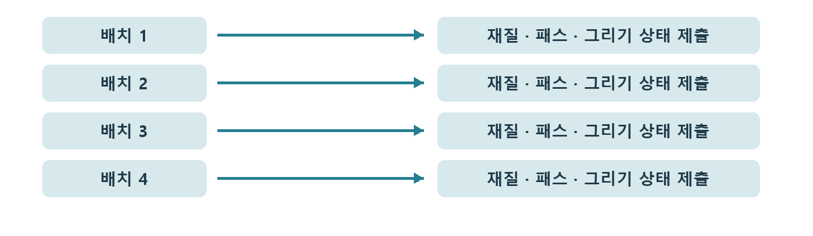

# CH14 Draw Call과 배칭

## 챕터 학습 목표

메시 섹션과 렌더 상태가 패스별 그리기 명령으로 이어지는 방식을 이해합니다. 모듈 배경과 소품의 슬롯·아틀라스·합체 단위를 설계할 때 CPU 제출 비용과 가시성 손실을 함께 판단합니다.

### 예제 학습 목표

형상이 같은 다중 섹션 메시와 단일 섹션 메시를 비교해 호출 수와 CPU·GPU 시간이 어떻게 달라지는지 확인합니다.

**구현 상태 — 기본 실습 레벨 준비**

바닥, 조명, 카메라와 비교용 기본 도형을 가진 시작 레벨입니다. 아래 항목은 챕터별 예제를 완성할 때 수행할 실습 절차입니다.

레벨 경로 `/Game/RenderingLab/Chapters/Part03_GeometryAndTextures/CH14_DrawCalls/Maps/L_CH14_DrawCalls`

## 흐름 개념도

## 원리

Draw Call은 GPU에 특정 지오메트리를 그리도록 제출하는 명령입니다. 하나의 Actor에 메시 하나가 있어도, 재질이 나뉜 섹션이나 깊이·그림자 패스 때문에 여러 그리기 작업이 생길 수 있습니다. Actor는 레벨에 배치한 오브젝트의 단위이므로 그 개수와 호출 수를 같게 세지 않습니다.

## 작동 과정

메시 섹션은 보통 서로 다른 재질을 적용할 수 있는 메시의 구역입니다. 렌더러는 보이는 섹션에 필요한 재질과 그리기 상태를 준비합니다. 호환되는 작업을 묶어 제출 부담을 줄이는 것을 배칭이라고 합니다. 실제로 묶일 수 있는 조건은 메시·재질·패스와 엔진 처리 방식에 따라 달라집니다.

## 아트 실무

소품 하나에 나무·금속·흙 슬롯을 각각 두면 표현은 편하지만 그리기 작업이 늘 수 있습니다. 여러 이미지를 한 장에 모으는 텍스처 아틀라스와 공유 재질을 대안으로 검토합니다. 반대로 동네 전체를 한 메시로 합치면 일부만 보일 때 필요한 부분을 제외하기 어려워질 수 있습니다.

## 성능 비용

명령과 상태를 준비하는 일은 CPU 부담이 될 수 있습니다. 호출을 줄여도 GPU가 처리하는 표면 면적과 재질 계산이 비슷하면 GPU 시간은 거의 그대로일 수 있습니다. CPU 제출이 병목인 상황과 화면 계산이 병목인 상황을 나누어 판단합니다.

## 언리얼 실습

형상과 외관이 비슷한 세 섹션 메시와 한 섹션 메시를 만듭니다. 같은 수를 같은 구도로 배치합니다. stat scenerendering 또는 stat rhi에서 관련 그리기 수치를 보고, stat unit의 Draw와 GPU 시간을 기록합니다. 여기서 Draw는 주로 CPU 렌더 스레드 시간이며 Draw Call 개수를 뜻하는 항목은 아닙니다.

## 핵심 요약

오브젝트 개수, 메시 섹션과 패스별 호출, CPU·GPU 시간을 각각 확인합니다.

## 그림으로 연결하기

서로 다른 그리기 상태를 CPU에서 준비하고 GPU에 제출합니다. Actor 하나가 Draw Call 하나라는 뜻은 아니며 여러 패스와 재질 슬롯이 영향을 줍니다.

## 공식 자료

- [Introduction to Performance Profiling and Configuration](https://dev.epicgames.com/documentation/en-us/unreal-engine/introduction-to-performance-profiling-and-configuration-in-unreal-engine)
- [Mesh Drawing Pipeline](https://dev.epicgames.com/documentation/en-us/unreal-engine/mesh-drawing-pipeline-in-unreal-engine)

## 관련 개념

- [CH15 Instancing과 반복 배치](CH15_Instancing.md)
- [CH25 CPU와 GPU 병목](CH25_CPUGPUBottlenecks.md)

## 작업 기록

- 제작한 에셋
- 바꾼 변수와 유지한 조건
- 전후 화면과 실행 시간
- 확인한 기기와 설정

[처음 읽는 방법](../ReadingGuide.md) · [용어집](../Glossary.md) · [보충 주석](../SupplementaryNotes.md) · [챕터 목록](../../README.md#학습-순서)
