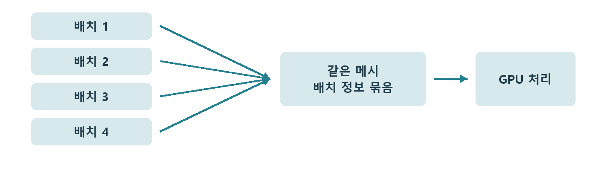

# CH15 Instancing과 반복 배치

## 챕터 학습 목표

반복 배치에서 공유 가능한 데이터와 인스턴스마다 필요한 작업을 구분합니다. 울타리·식생·군집 소품을 만들 때 ISM·HISM과 개별 배치의 관리·가시성·갱신 조건을 판단합니다.

### 예제 학습 목표

같은 기둥 200개를 개별 Actor와 ISM으로 배치하고 전부 또는 일부가 보이는 조건에서 비용을 비교합니다.

**구현 상태 — 기본 실습 레벨 준비**

바닥, 조명, 카메라와 비교용 기본 도형을 가진 시작 레벨입니다. 아래 항목은 챕터별 예제를 완성할 때 수행할 실습 절차입니다.

레벨 경로 `/Game/RenderingLab/Chapters/Part03_GeometryAndTextures/CH15_Instancing/Maps/L_CH15_Instancing`

## 흐름 개념도

## 원리

인스턴싱은 같은 메시 데이터를 여러 배치에서 재사용하는 방식입니다. 울타리 기둥마다 별도의 메시 데이터를 만드는 대신, 공통 형상과 재질을 공유하고 각 기둥의 위치·회전·크기를 따로 보관합니다. 이런 위치와 방향·크기의 정보를 변환 또는 Transform이라고 합니다.

## 작동 과정

ISM은 Instanced Static Mesh Component의 약자로 반복 메시를 한 컴포넌트 안에서 관리합니다. 컴포넌트는 Actor가 가진 메시·조명 같은 기능 요소입니다. HISM은 여기에 공간적으로 묶은 계층을 사용합니다. 어느 묶음을 보이게 하고 어떤 세부 형상을 쓸지는 기능과 버전의 처리 방식을 확인합니다.

## 아트 실무

같은 기둥 200개에 조금씩 다른 색을 주고 싶다면 Per Instance Custom Data를 검토합니다. 각 배치에 추가 숫자를 전달하고 재질에서 읽는 기능입니다. 메시와 재질을 매번 새로 만들지 않고 변주할 수 있습니다. 충돌과 그림자, 갱신할 위치의 수 같은 실제 사용 조건도 함께 맞춥니다.

## 성능 비용

배치마다 Actor와 컴포넌트를 관리하는 부담, 그리기 제출 부담을 줄일 수 있습니다. 공유해도 실제로 보이는 기둥의 삼각형과 픽셀 계산은 남습니다. 모든 기둥이 고정된 경우와 매 프레임 위치를 바꾸는 경우의 갱신 비용도 다를 수 있습니다.

## 언리얼 실습

개별 Static Mesh Actor 200개와 ISM 안의 200개를 별도 레벨 변형으로 준비합니다. 모든 기둥이 보이는 구도와 일부만 보이는 구도에서 Draw·GPU 시간을 기록합니다. 필요하면 HISM도 비교합니다. 어떤 방식을 쓰든 수량·재질·충돌·그림자 조건을 맞춥니다.

## 핵심 요약

공유로 줄이는 관리·제출 비용과 실제 가시 지오메트리의 계산량을 분리합니다.

## 그림으로 연결하기

같은 메시의 배치를 묶어 제출 준비를 줄일 수 있습니다. 각 배치의 화면 크기·재질·그림자 계산 비용은 여전히 남습니다.

## 공식 자료

- [Mesh Drawing Pipeline](https://dev.epicgames.com/documentation/en-us/unreal-engine/mesh-drawing-pipeline-in-unreal-engine)
- [Instanced Static Mesh Component](https://dev.epicgames.com/documentation/en-us/unreal-engine/instanced-static-mesh-component-in-unreal-engine)

## 관련 개념

- [CH14 Draw Call과 배칭](CH14_DrawCalls.md)
- [CH18 Culling과 가시성](CH18_Culling.md)

## 작업 기록

- 제작한 에셋
- 바꾼 변수와 유지한 조건
- 전후 화면과 실행 시간
- 확인한 기기와 설정

[처음 읽는 방법](../ReadingGuide.md) · [용어집](../Glossary.md) · [보충 주석](../SupplementaryNotes.md) · [챕터 목록](../../README.md#학습-순서)
