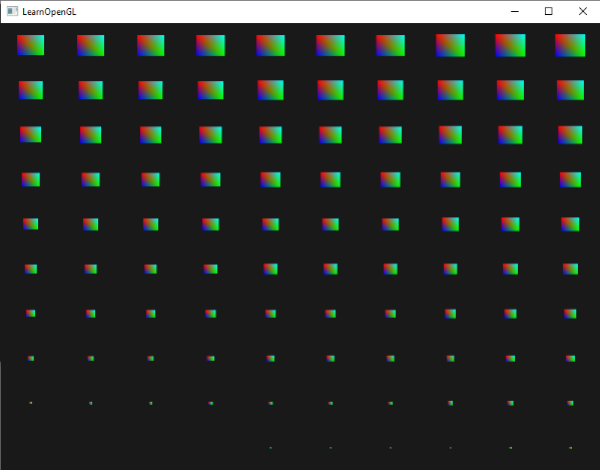

# CH15 Instancing과 반복 배치

## 중심 질문

같은 기둥 수백 개를 왜 개별 Actor 대신 인스턴스로 관리할까?

## 먼저 알아둘 답

공통 메시와 재질을 공유하고 배치별 정보만 따로 두면 반복 오브젝트의 관리·제출을 줄일 수 있습니다.

## 왜 알아야 할까

울타리·가로수·군집 소품을 반복 배치할 때 공유할 정보와 개별 정보를 구분하기 위해 배웁니다.

### 예제 학습 목표

동일 반복 배치를 개별 Actor와 ISM으로 관리할 때의 차이를 확인합니다.

**구현 상태 — 기본 레벨 준비, 아래 절차에 따른 특화 예제 제작과 실측 필요**

레벨 `/Game/RenderingLab/Chapters/Part03_GeometryAndTextures/CH15_Instancing/Maps/L_CH15_Instancing`

## 왜 이런 결과가 생길까

같은 기둥은 형상이 같고 위치·회전·크기만 다릅니다. 이런 변환 정보를 Transform이라고 합니다. 인스턴싱은 공통 데이터를 재사용하며 각 배치의 Transform을 따로 보관합니다. UE의 ISM은 Instanced Static Mesh Component로, 여러 배치를 하나의 컴포넌트에서 관리합니다. 반복 데이터를 다루는 준비 작업을 묶을 수 있습니다.

## 제작 중에는 이렇게 나타납니다

인스턴싱은 화면에 보이는 200개의 기둥을 한 개처럼 한 번만 셰이딩한다는 뜻이 아닙니다. 각 위치의 삼각형·픽셀·그림자는 여전히 처리해야 합니다.

외부 렌더 이미지 · 공통 사각형을 인스턴싱하면서 배치별 위치와 크기를 달리한 예입니다.

읽을 곳  같은 기본 형상을 공유해도 복사본마다 변환 정보가 다릅니다. OpenGL 학습 예시이며 UE ISM의 호출 수나 속도를 측정한 자료는 아닙니다. 외관을 유지하며 제출 비용이 줄었는지는 목표 장면에서 검증합니다.

[© Joey de Vries · LearnOpenGL · @JoeyDeVriez · 출처 52](https://learnopengl.com/Advanced-OpenGL/Instancing)

원본 전체 유지 · 투명 배경은 흰색으로 표시

[이용 조건 CC BY 4.0](https://creativecommons.org/licenses/by/4.0/)

## 실습 절차

같은 메시·재질의 기둥 200개를 개별 Actor로 둔 버전과 ISM으로 둔 버전을 준비합니다. 배치·충돌·그림자를 맞추고 같은 카메라에서 Actor·컴포넌트 구성과 CPU·GPU 시간을 비교합니다.

## 예상 결과와 이유

ISM에서는 독립적으로 관리할 Actor·컴포넌트 수가 줄 것입니다. CPU 관리나 제출이 문제였던 장면이라면 그 구간의 개선을 기대할 수 있습니다.

## 결과를 어떻게 해석할까

GPU 픽셀 비용이 지배하면 전체 프레임 변화는 작을 수 있습니다. 엔진의 자동 인스턴싱 때문에 제출 차이가 작아도 데이터 관리 방식의 차이는 남습니다.

## 실제 제작에서의 선택

공통 메시를 반복하는 곳에 인스턴싱을 검토하고, 배치별 색은 공유 재질의 Per Instance Custom Data 같은 입력으로 전달합니다.

## 이해한 뒤 확인할 조건

HISM은 공간 계층을 사용하는 확장입니다. 잦은 위치 갱신과 컬링·LOD·Nanite 조건에 따라 선택이 달라지므로 별도 성능 과제로 다룹니다.

## 공식 자료와 확장

- [Mesh Drawing Pipeline](https://dev.epicgames.com/documentation/en-us/unreal-engine/mesh-drawing-pipeline-in-unreal-engine)
- [Instanced Static Mesh Component](https://dev.epicgames.com/documentation/en-us/unreal-engine/instanced-static-mesh-component-in-unreal-engine)

[읽는 순서](../ReadingGuide.md) · [용어집](../Glossary.md) · [심화와 적용 조건](../SupplementaryNotes.md)
