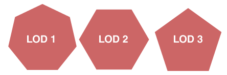

# CH16 LOD와 화면 크기

## 챕터 학습 목표

화면에서 읽히는 정보에 맞춰 디테일을 배분합니다. 원거리 에셋의 실루엣·그림자·재질을 유지하면서 지오메트리와 섹션을 줄이고, FOV와 플랫폼에 맞는 전환 기준을 정합니다.

### 예제 학습 목표

난간의 LOD별 형상과 화면 크기를 확인하고 카메라 이동 중 실루엣·그림자 전환과 비용을 비교합니다.

**구현 상태 — 기본 실습 레벨 준비**

바닥, 조명, 카메라와 비교용 기본 도형을 가진 시작 레벨입니다. 아래 항목은 챕터별 예제를 완성할 때 수행할 실습 절차입니다.

레벨 경로 `/Game/RenderingLab/Chapters/Part03_GeometryAndTextures/CH16_LOD/Maps/L_CH16_LOD`

## 흐름 개념도

## 원리

LOD는 Level of Detail의 약자로 화면에서 필요한 정도에 맞춰 디테일을 바꾸는 방식입니다. 가까운 난간에는 나사와 베벨이 보이지만 멀리서는 기둥의 굵기와 윤곽이 더 중요합니다. 전통적인 Static Mesh LOD는 여러 단계의 대체 메시를 사용합니다.

## 작동 과정

UE는 화면에서 차지하는 크기를 기준으로 LOD를 선택할 수 있습니다. 그래서 같은 거리라도 메시의 크기나 카메라의 시야각이 바뀌면 선택 결과가 달라질 수 있습니다. 시야각은 FOV라고 부르며, 넓을수록 더 넓은 범위를 한 화면에 담습니다. 단계별로 삼각형·섹션·재질을 줄이는 방법을 검토합니다.

## 아트 실무

작은 나사와 베벨을 먼저 줄이고 멀리서도 읽히는 상단 윤곽과 기둥 간격은 유지합니다. 단순화 과정에서 노멀과 색이 달라져 번쩍이는 전환이 생기는지도 봅니다. 디더 전환은 작은 점무늬의 가시성을 바꾸며 두 단계를 이어 보이게 하는 방법이며, 이동 중의 안정성까지 확인합니다.

## 성능 비용

정점 처리와 그림자에 그릴 지오메트리를 줄일 수 있습니다. 하지만 섹션 수와 화면 면적, 재질이 그대로라면 호출과 픽셀 비용은 많이 줄지 않을 수 있습니다. 전환 중 두 표현을 처리하는 구간의 비용도 함께 측정합니다.

## 언리얼 실습

Static Mesh Editor에서 각 LOD의 형상과 Screen Size를 확인합니다. Screen Size는 화면 크기 기준입니다. 지원되는 LOD Coloration으로 선택 단계를 보고 Forced LOD로 특정 단계를 고정해 형상을 비교합니다. 같은 카메라 이동에서 윤곽·그림자 튐과 GPU 시간을 기록합니다.

## 핵심 요약

멀리서 읽히는 정보를 유지하면서 줄일 대상을 고릅니다. 거리 하나보다 화면 크기와 실제 효과를 기준으로 판단합니다.

## 그림으로 연결하기

외부 비교 그림 · 비슷한 실루엣을 더 적은 변으로 근사한 세 가지 LOD입니다.

읽을 곳  오른쪽으로 갈수록 위쪽 윤곽이 각지게 바뀝니다. 원본의 LOD 1·2·3 표기는 해당 그림의 번호이며 UE에서 흔히 시작하는 LOD0 번호와 구별합니다.

[Sirotk · Wikimedia Commons · 출처 42](https://commons.wikimedia.org/wiki/File:LOD_Example.png)

[CC BY-SA 3.0](https://creativecommons.org/licenses/by-sa/3.0/) · 원본 전체를 유지하고 투명 배경을 흰색으로 표시했습니다.

## 공식 자료

- [Instanced Static Mesh Component](https://dev.epicgames.com/documentation/en-us/unreal-engine/instanced-static-mesh-component-in-unreal-engine)
- [Optimizing LOD Screen Size Per Platform](https://dev.epicgames.com/documentation/en-us/unreal-engine/optimizing-lod-screen-size-per-platform-in-unreal-engine)

## 관련 개념

- [CH17 Nanite와 가상화 지오메트리](CH17_Nanite.md)
- [CH23 TAA와 프레임 히스토리](CH23_TAA.md)

## 작업 기록

- 제작한 에셋
- 바꾼 변수와 유지한 조건
- 전후 화면과 실행 시간
- 확인한 기기와 설정

[처음 읽는 방법](../ReadingGuide.md) · [용어집](../Glossary.md) · [보충 주석](../SupplementaryNotes.md) · [챕터 목록](../../README.md#학습-순서)
