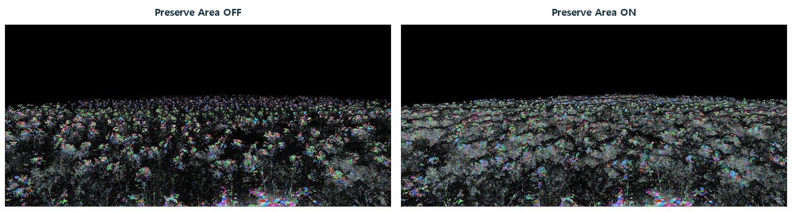

# CH17 Nanite와 가상화 지오메트리

## 챕터 학습 목표

가상화 지오메트리가 디테일과 가시 데이터를 선택하는 원리를 이해합니다. 고밀도 바위·건축·식생에 Nanite를 적용할 때 적합성, 겹침, 재질과 스트리밍 비용을 함께 판단합니다.

### 예제 학습 목표

같은 절벽에서 Nanite와 전통 LOD를 비교하고 클러스터·오버드로·이동 중 팝인과 비용을 확인합니다.

**구현 상태 — 기본 실습 레벨 준비**

바닥, 조명, 카메라와 비교용 기본 도형을 가진 시작 레벨입니다. 아래 항목은 챕터별 예제를 완성할 때 수행할 실습 절차입니다.

레벨 경로 `/Game/RenderingLab/Chapters/Part03_GeometryAndTextures/CH17_Nanite/Maps/L_CH17_Nanite`

## 흐름 개념도

## 원리

Nanite는 높은 디테일의 메시를 효율적으로 표시하기 위한 가상화 지오메트리 시스템입니다. 가상화는 원본의 모든 데이터를 항상 같은 방식으로 처리하는 대신, 필요한 부분과 세부 수준을 선택해 공급하는 접근입니다. 엔진은 메시를 작은 삼각형 묶음인 클러스터와 그 계층으로 구성합니다.

## 작동 과정

화면에서 허용할 형상 오차와 가시성을 바탕으로 클러스터를 선택합니다. 원본과 표시 형상이 화면에서 얼마나 달라도 되는지를 생각하면 오차 기준을 이해하기 쉽습니다. 필요한 메시 데이터는 스트리밍으로 공급합니다. Nanite는 전용 가시성·래스터 경로를 사용하므로 전통 메시의 호출 방식과 그대로 대응시키지 않습니다.

## 그림으로 연결하기

Epic 공식 비교 이미지 · Nanite Clusters 시각화에서 Preserve Area를 끈 상태와 켠 상태입니다.

읽을 곳  왼쪽의 검게 비어 보이는 잎 사이 공간과 오른쪽의 더 조밀한 수관을 비교합니다. 삼각형을 줄일 때 소실되는 잎 면적을 보존하는 사례입니다. 색은 재질색이 아닌 클러스터 구분이며 UE 5.5 문서의 예시로, 이 프로젝트의 UE 5.8 실측이나 성능 비교가 아닙니다.

[© Epic Games · UE 5.5 공식 문서 · 출처 45](https://dev.epicgames.com/documentation/en-us/unreal-engine/nanite-virtualized-geometry-in-unreal-engine?application_version=5.5)

원저작권은 Epic Games에 귀속됩니다. 공식 문서의 교육용 참고 이미지입니다.

원본 2점을 나란히 배치하고 상단 표제만 추가했습니다. 원본의 색상과 전체 구도를 유지했습니다.

## 아트 실무

복잡한 절벽에는 좋은 후보가 되지만 얇은 잎이 촘촘히 겹친 수관도 별도로 시험합니다. 서로 가까운 표면이 깊이상 겹치면 화면 계산이 남을 수 있습니다. 다른 렌더링 기능이 원본 대신 참조할 수 있는 대체 표현을 폴백 메시라고 합니다. 그 품질과 대상 플랫폼의 지원도 확인합니다.

## 성능 비용

원본 폴리곤 수 외에 인스턴스 수, 겹친 클러스터, 구멍 마스크와 정점 변형 재질, 디스크에서 데이터를 읽는 작업이 관여합니다. Nanite를 켠 사실만으로 조명·그림자·재질 비용이 없어지지는 않습니다. 기능 지원은 사용하는 엔진 버전과 프로젝트 조건을 기준으로 확인합니다.

## 언리얼 실습

같은 절벽 배치에 Nanite와 전통 LOD 버전을 준비합니다. Nanite Visualization에서 Triangles는 표시 삼각형, Clusters는 처리 묶음, Overdraw는 겹침을 살피는 데 사용합니다. 근거리·원거리·빠른 이동에서 외관과 GPU 시간을 기록합니다. 폴백 표현 때문에 비교 품질이 달라지지 않았는지도 봅니다.

## 관찰과 판단

Nanite Triangles·Clusters·Overdraw를 같은 카메라에서 따로 봅니다. 식생은 Preserve Area 전후의 수관 밀도와 그림자를 확인합니다. 원거리 WPO와 메시 중첩의 변경은 한 번에 하나씩 시험합니다.

## 오판을 피하려면

진단색이 곧 재질 색이나 GPU 시간은 아닙니다. Preserve Area는 소실되는 면적을 보완하는 기능이며 모든 식생의 성능을 자동으로 개선하는 스위치가 아닙니다.

## 핵심 요약

Nanite의 이점과 남아 있는 재질·겹침·스트리밍 비용을 함께 검증합니다.

## 공식 자료

- [Instanced Static Mesh Component](https://dev.epicgames.com/documentation/en-us/unreal-engine/instanced-static-mesh-component-in-unreal-engine)
- [Nanite Virtualized Geometry](https://dev.epicgames.com/documentation/en-us/unreal-engine/nanite-virtualized-geometry-in-unreal-engine)

## 관련 개념

- [CH06 Overdraw와 화면 겹침](CH06_Overdraw.md)
- [CH20 Texture Streaming과 메모리 예산](CH20_TextureStreaming.md)

## 작업 기록

- 제작한 에셋
- 바꾼 변수와 유지한 조건
- 전후 화면과 실행 시간
- 확인한 기기와 설정

[처음 읽는 방법](../ReadingGuide.md) · [용어집](../Glossary.md) · [보충 주석](../SupplementaryNotes.md) · [챕터 목록](../../README.md#학습-순서)
