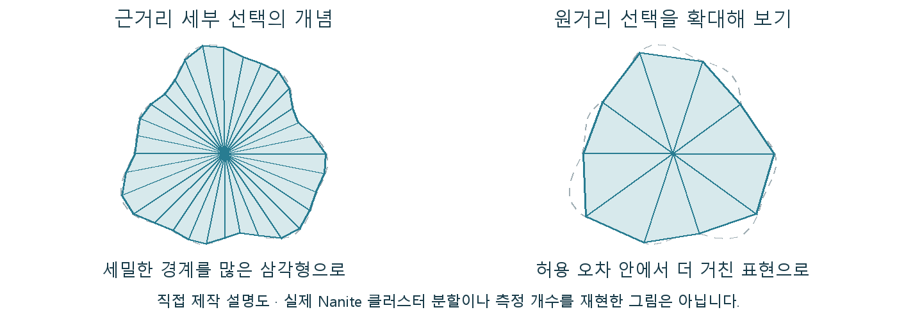

# Nanite 원본 디테일과 화면의 삼각형 수가 다른 이유

높은 디테일의 절벽을 가져왔다고 그 원본의 모든 삼각형이 매 프레임 같은 방식으로 그려지는 것은 아닙니다. Nanite는 필요한 지오메트리를 선택하고 공급하는 구조로 그 관계를 바꿉니다.

Nanite는 높은 디테일의 메시를 작은 묶음과 계층으로 준비하고, 화면에 필요한 세부를 선택·공급하는 UE의 가상화 지오메트리 시스템입니다.

고밀도 원본을 항상 같은 삼각형 집합으로 그리는 대신 가시성과 허용 오차에 맞춰 처리합니다. 전통 수동 LOD의 일부 역할을 다른 구조로 수행하지만 재질·조명 전체를 대신하지는 않습니다.

## 작은 묶음과 화면 오차로 세부를 선택한다

Nanite로 준비한 메시도 카메라와 배치 조건에 따라 필요한 세부가 달라집니다. 선택된 클러스터와 데이터가 전용 가시성·래스터 처리에 사용됩니다.

빌드 과정에서 메시를 삼각형 묶음인 클러스터와 그 계층으로 구성합니다. 여러 세부 수준을 선택할 수 있는 기반을 만듭니다. 런타임에 가시성과 화면 오차를 기준으로 필요한 묶음을 선택합니다. 작게 보이는 부분은 더 거친 표현으로 충분할 수 있으므로 원본 삼각형 수가 그대로 매 프레임 표시 수가 되지 않습니다. 필요한 메시 데이터를 스트리밍으로 공급하고 전용 경로로 화면에 표시합니다. 선택된 형상의 실루엣과 얇은 면의 보존은 실제 출력 조건에서 확인합니다.

원거리 선택도 비교를 위해 같은 크기로 확대한 개념도입니다. 삼각형을 줄인 경계와 원래 외곽의 차이가 나타나며 실제 Nanite 클러스터 분할의 재현은 아닙니다.

## 고밀도 바위와 얇은 잎의 조건은 다르다

바위·절벽·건축의 고밀도 디테일을 활용하고 에셋 예산을 판단할 때 필요합니다. 얇은 잎·촘촘한 겹침·정점 변형은 별도로 적용 적합성을 확인합니다.

바위의 촘촘한 표면은 화면 오차 안에서 세부를 줄일 여지가 있지만, 얇은 잎이 겹친 수관에서는 작은 면의 소실과 중첩이 다른 문제를 만듭니다. 고밀도 원본을 쓸 수 있다는 이점과 모든 종류의 형상이 같은 효율을 얻는다는 주장은 구분됩니다.

## 지오메트리 가상화 뒤에도 남는 비용

인스턴스와 보이는 클러스터·겹침·재질·스트리밍이 비용을 만듭니다. 원본 폴리곤 제한이 완화돼도 조명·그림자와 화면 중복 계산은 남습니다.

Nanite는 폴리곤을 무제한으로 써도 된다는 허가보다 원본과 화면 처리량을 연결하는 다른 방식입니다. 디테일 선택의 원리를 이해하면 원본 개수 밖의 겹침·재질·스트리밍 비용도 함께 보입니다.

## 참고 자료

- [Instanced Static Mesh Component](https://dev.epicgames.com/documentation/en-us/unreal-engine/instanced-static-mesh-component-in-unreal-engine)
- [Nanite Virtualized Geometry](https://dev.epicgames.com/documentation/en-us/unreal-engine/nanite-virtualized-geometry-in-unreal-engine)

[포스트 목록](../../README.md#포스트-목록) · [용어 찾아보기](../Glossary.md) · [이미지 출처](../Images/Sources.md)
