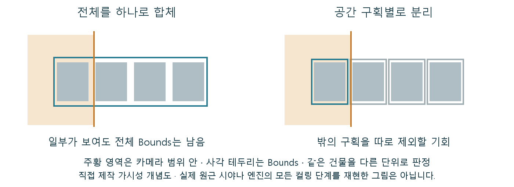

# CH18 Culling과 가시성

## 중심 질문

건물을 한 덩어리로 합치면 왜 벽 뒤 부분까지 처리할 수 있을까?

## 먼저 알아둘 답

가시성은 흔히 물체를 감싸는 범위로 판정하므로, 큰 묶음 일부가 보이면 나머지도 후보에 남을 수 있습니다.

## 왜 알아야 할까

건물·실내 모듈의 분할 단위를 제출 비용과 가림 효율 사이에서 결정하기 위해 배웁니다.

### 예제 학습 목표

합체·구획 버전에서 Bounds와 가림 후보가 어떻게 다른지 확인합니다.

**구현 상태 — 기본 레벨 준비, 아래 절차에 따른 특화 예제 제작과 실측 필요**

레벨 `/Game/RenderingLab/Chapters/Part03_GeometryAndTextures/CH18_Culling/Maps/L_CH18_Culling`

## 왜 이런 결과가 생길까

컬링은 최종 화면에 불필요한 렌더링 후보를 제외하는 과정입니다. 카메라의 시야 공간인 프러스텀 밖을 제외하는 판정과 다른 표면 뒤에 가려졌는지 보는 판정은 다릅니다. 엔진은 모든 삼각형 대신 물체를 감싸는 Bounds로 후보를 검사할 수 있습니다. 한 건물 전체의 Bounds가 보이면 그 내부의 구역을 따로 제외하기 어려워질 수 있습니다.

## 제작 중에는 이렇게 나타납니다

메시 합체는 제출 수를 줄일 수 있지만 공간별 제외 기회를 줄일 수 있습니다. 작은 조각으로 무조건 나누면 반대로 오브젝트 관리와 검사 부담이 늘어납니다.

직접 제작 Bounds 비교. 시야에 일부가 들어온 큰 묶음과, 개별 판정이 가능한 작은 구획의 차이입니다. 가려짐 검사 전의 기본 후보 판정으로 단순화했습니다.

## 실습 절차

전통 메시로 된 꺾인 복도에서 같은 건물을 통합 버전과 방·구획별 버전으로 준비합니다. Bounds를 표시하고 모서리 앞뒤에서 가시 후보와 관련 렌더링 수치를 비교합니다.

## 예상 결과와 이유

구획 버전은 완전히 가린 부분을 별도 후보로 제외할 기회가 더 많을 것입니다. 통합 버전은 작은 부분만 보여도 큰 범위가 남을 수 있습니다.

## 결과를 어떻게 해석할까

메인 화면에 안 보인다고 그림자 작업까지 모두 사라진 것은 아닙니다. 카메라 가시성과 조명 관점의 기여를 구분한 뒤 전체 비용을 비교합니다.

## 실제 제작에서의 선택

작업 편의만으로 합체하지 말고, 실제 카메라에서 가려지는 공간 단위를 분할 기준에 포함합니다.

## 이해한 뒤 확인할 조건

Nanite의 클러스터 컬링과 일반 Actor Bounds 판정은 같은 단위가 아닙니다. 이 실습에서는 경로를 고정합니다.

## 공식 자료와 확장

- [Instanced Static Mesh Component](https://dev.epicgames.com/documentation/en-us/unreal-engine/instanced-static-mesh-component-in-unreal-engine)
- [Nanite Virtualized Geometry](https://dev.epicgames.com/documentation/en-us/unreal-engine/nanite-virtualized-geometry-in-unreal-engine)

[읽는 순서](../ReadingGuide.md) · [용어집](../Glossary.md) · [심화와 적용 조건](../SupplementaryNotes.md)
