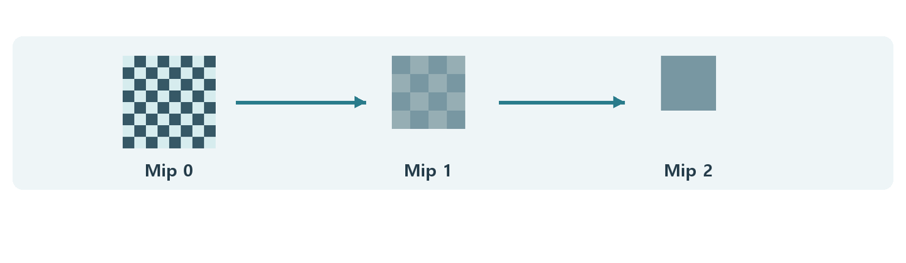

# CH19 Mipmap과 텍스처 샘플링

## 챕터 학습 목표

한 화면 픽셀이 덮는 텍스처 범위와 필터링을 이해합니다. 먼 바닥·비스듬한 벽·미세 노멀의 깜빡임과 흐림을 진단하고, 밉·필터·원본 패턴을 품질과 대역폭 관점에서 조정합니다.

### 예제 학습 목표

같은 복도 바닥에서 밉 사용 여부와 개별 밉을 비교하고 이동 중 패턴의 안정성을 확인합니다.

**구현 상태 — 기본 실습 레벨 준비**

바닥, 조명, 카메라와 비교용 기본 도형을 가진 시작 레벨입니다. 아래 항목은 챕터별 예제를 완성할 때 수행할 실습 절차입니다.

레벨 경로 `/Game/RenderingLab/Chapters/Part03_GeometryAndTextures/CH19_Mipmaps/Maps/L_CH19_Mipmaps`

## 흐름 개념도

## 원리

텍스처 샘플링은 이미지에서 필요한 위치의 값을 읽는 작업입니다. 모델 표면의 어느 지점이 이미지의 어디에 해당하는지 정하는 2D 좌표를 UV라고 합니다. 물체가 멀어지면 화면 한 픽셀이 텍스처의 넓은 영역을 덮게 되므로 원본 한 점만 읽어서는 안정적인 결과를 얻기 어렵습니다.

## 작동 과정

밉맵은 원본을 점점 작게 축소해 준비한 이미지 계층입니다. 엔진은 화면에서 UV가 얼마나 빠르게 바뀌는지 등을 이용해 읽을 단계를 고릅니다. 여러 값을 섞어 적절한 결과를 만드는 처리를 필터링이라고 합니다. 비스듬한 바닥처럼 한 방향으로 길게 늘어진 영역에는 이방성 필터링이 도움을 줄 수 있습니다.

## 아트 실무

복도 바닥을 낮은 시선으로 보며 줄눈과 미세 노멀의 깜빡임을 확인합니다. 너무 작은 반복무늬는 움직일 때 보였다 사라질 수 있습니다. 밉과 필터만 조절하기보다 원본 패턴의 크기, 노멀의 강도와 재질 거칠기도 함께 살핍니다.

## 성능 비용

이상적인 정사각형 2D 텍스처의 완전한 밉 체인은 최상위 단계보다 약 1/3의 텍셀을 더 가집니다. 텍셀은 텍스처의 한 데이터 칸입니다. 실제 저장량은 압축과 배치 방식에 따라 달라집니다. 필요한 작은 밉을 읽으면 캐시와 대역폭 사용에 유리할 수 있습니다.

## 언리얼 실습

원본 텍스처를 복제해 일반 밉과 NoMipmaps를 비교합니다. Texture Editor에서 개별 밉이 어떤 패턴을 남기는지 확인합니다. 같은 카메라 이동에서 바닥의 선명도와 깜빡임을 기록합니다. 메모리에 원하는 밉이 실제로 올라왔는지는 스트리밍 상태도 함께 확인합니다.

## 핵심 요약

밉은 작게 보이는 텍스처를 안정적으로 읽기 위한 준비입니다. 밉 선택과 메모리 상주 관리는 서로 연결된 다른 작업입니다.

## 그림으로 연결하기

작은 화면 영역이 넓은 텍스처 영역을 대표할 때 낮은 밉을 읽어 깜빡임과 읽기 비용을 줄입니다. 필터링의 개념이며 실제 텍스처 실측이 아닙니다.

## 공식 자료

- [Texture Asset Editor](https://dev.epicgames.com/documentation/en-us/unreal-engine/texture-asset-editor-in-unreal-engine)
- [Texture Streaming Overview](https://dev.epicgames.com/documentation/en-us/unreal-engine/texture-streaming-overview-for-unreal-engine)

## 관련 개념

- [CH20 Texture Streaming과 메모리 예산](CH20_TextureStreaming.md)
- [CH23 TAA와 프레임 히스토리](CH23_TAA.md)

## 작업 기록

- 제작한 에셋
- 바꾼 변수와 유지한 조건
- 전후 화면과 실행 시간
- 확인한 기기와 설정

[처음 읽는 방법](../ReadingGuide.md) · [용어집](../Glossary.md) · [보충 주석](../SupplementaryNotes.md) · [챕터 목록](../../README.md#학습-순서)
