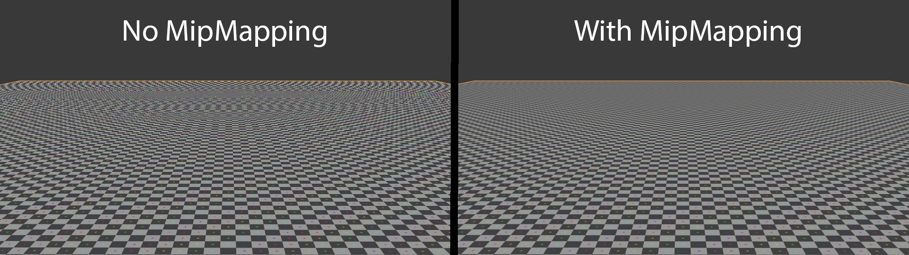

# CH19 Mipmap과 텍스처 샘플링

## 무엇인가

텍스처 샘플링은 UV 등으로 이미지에서 필요한 값을 읽는 작업입니다. Mipmap은 작게 보이는 표면을 안정적으로 읽도록 원본을 단계적으로 축소해 준비한 이미지 계층입니다.

## 렌더링에서 맡는 역할

화면 픽셀보다 세밀한 패턴을 적절한 크기로 대표하게 합니다. 원거리 깜빡임·모아레를 줄이고 불필요하게 큰 텍스처 데이터를 읽는 일을 줄이는 데 사용됩니다.

## 입력과 출력

입력은 텍스처·UV와 화면에서 UV가 변하는 정도, 필터 설정입니다. 읽을 밉과 값들을 선택·혼합해 해당 표면 위치의 재질 입력값을 만듭니다.

## 작동 과정

원본을 축소해 여러 크기의 밉을 준비합니다. 텍셀은 텍스처 데이터의 한 칸이며, 먼 표면에서는 화면 픽셀 하나가 많은 텍셀을 대표해야 합니다.

화면에서의 UV 변화 등을 이용해 적절한 밉을 선택합니다. 너무 세밀한 원본에서 한 점만 읽으면 작은 이동에도 서로 다른 무늬를 고르기 쉽습니다.

필터링으로 샘플과 밉 사이의 값을 섞습니다. 비스듬한 바닥처럼 한 방향으로 길게 늘어난 범위에는 이방성 필터링이 도움을 줄 수 있습니다.

외부 실제 렌더 비교 · 왼쪽 No MipMapping, 오른쪽 With MipMapping입니다.

읽을 곳  수평선에 가까운 먼 바닥에서 왼쪽의 물결무늬와 오른쪽의 안정된 패턴을 비교합니다. 원본은 Blender 렌더이며 필터링도 관여할 수 있으므로 UE에서 밉만 바꾼 통제 실험으로 해석하지 않습니다.

[BillyBob CornCob · Wikimedia Commons · 출처 43](https://commons.wikimedia.org/wiki/File:Mipmap_Aliasing_Comparison.png)

원본 전체와 비율 유지

[이용 조건 CC0 1.0](https://creativecommons.org/publicdomain/zero/1.0/)

## 왜 배경 제작에 필요한가

먼 바닥 줄눈과 반복무늬, 미세 노멀의 안정성을 조절할 때 필요합니다. 원본 해상도를 늘리는 것과 플레이 화면에서 읽히는 패턴을 만드는 일은 다릅니다.

## 성능과 제작 비용

밉 체인은 저장 데이터를 더 필요로 하지만 작은 밉 사용은 캐시·대역폭에 유리할 수 있습니다. 실제 상주 메모리는 스트리밍과 압축 등에도 달려 있습니다.

## 원리 확인 예제

이 예제는 위에서 설명한 주제의 일부 관계를 확인합니다. 특정 예제가 기술 전체의 정의나 유일한 사용 목적은 아닙니다.

### 예제 학습 목표

같은 이동에서 밉의 선명도 손실과 시간적 안정성을 함께 관찰합니다.

**구현 상태 — 기본 레벨 준비, 아래 절차에 따른 특화 예제 제작과 실측 필요**

레벨 `/Game/RenderingLab/Chapters/Part03_GeometryAndTextures/CH19_Mipmaps/Maps/L_CH19_Mipmaps`

### 실습 절차

잔무늬 바닥의 일반 밉 버전과 NoMipmaps 버전을 준비합니다. 원하는 밉이 상주한 조건에서 같은 낮은 시선으로 천천히 이동하며 원거리 영역을 녹화합니다.

### 예상 결과와 이유

밉이 없는 버전은 먼 패턴의 모아레와 깜빡임이 커지고, 일반 밉은 일부 선명도를 줄이면서 더 안정될 것으로 예상합니다.

### 결과를 어떻게 해석할까

정지 화면의 선명도만 고르지 않습니다. 비스듬한 바닥에서는 이방성 필터링도 관여하므로 그 설정을 고정한 뒤 밉 차이를 봅니다.

## 이 챕터에서 기억할 것

밉은 화면 크기에 맞는 대표 정보를 준비하고 샘플링은 그것을 읽는 과정입니다. 선명도와 이동 안정성을 함께 판단합니다.

## 이해한 뒤 확인할 조건

밉 체인의 데이터 증가와 캐시·대역폭 이득은 성능의 확장 주제입니다. 밉 선택과 실제 메모리 상주는 CH20에서 구분합니다.

## 공식 자료와 확장

- [Texture Asset Editor](https://dev.epicgames.com/documentation/en-us/unreal-engine/texture-asset-editor-in-unreal-engine)
- [Texture Streaming Overview](https://dev.epicgames.com/documentation/en-us/unreal-engine/texture-streaming-overview-for-unreal-engine)

[읽는 순서](../ReadingGuide.md) · [용어집](../Glossary.md) · [심화와 적용 조건](../SupplementaryNotes.md)
