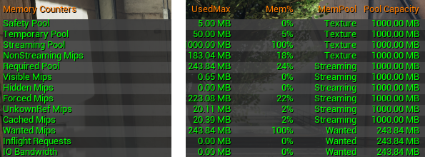

# Texture Streaming 선명한 원본이 잠시 흐리게 보이는 이유

가까이 다가간 소품이 잠깐 흐렸다가 선명해지는 현상은 원본 해상도가 부족한 경우와 다릅니다. 필요한 데이터와 지금 준비된 데이터 사이에 차이가 있기 때문입니다. 텍스처 스트리밍은 그 차이를 관리합니다.

Texture Streaming은 화면에 필요한 텍스처 밉을 추정하고 메모리 예산 안에서 불러오거나 내보내는 관리 시스템입니다. 원본 텍스처를 항상 최고 해상도로 메모리에 두는 방식과 다릅니다.

많은 에셋을 사용하는 장면에서 메모리와 로딩을 관리합니다. CH19의 밉 선택이 읽을 세부 수준의 문제라면, 스트리밍은 필요한 데이터가 실제로 준비돼 있는지의 문제입니다.

## 원하는 밉과 메모리에 있는 밉 사이

장면의 배치와 화면 요구량이 텍스처 수요를 만들고 메모리 예산이 준비할 범위를 제한합니다. 로드·해제 요청과 실제 상주하는 밉의 상태는 그 관리 결과입니다.

카메라와 물체 크기·거리 등을 이용해 필요한 세부 수준을 추정합니다. 화면에서 원하는 밉과 현재 준비된 밉을 구분합니다. 예산과 우선순위에 맞춰 로드·해제를 결정합니다. 스트리밍 풀은 이 관리에 쓰는 메모리 예산의 한 묶음이며 전체 GPU 메모리와 같은 뜻은 아닙니다. 디스크에서 데이터를 옮겨 요청한 밉을 준비합니다. 이 전송에 시간이 걸리므로 이동 직후 잠시 낮은 밉으로 보이다 선명해질 수 있습니다.

공식 통계 표의 예산·필요량·현재 상태는 서로 다른 항목입니다. 표시된 숫자는 권장 예산이 아니며 UI는 원문의 UE 5.5 기준입니다.

[© Epic Games · 공식 문서 · 출처 54](https://dev.epicgames.com/documentation/en-us/unreal-engine/texture-streaming-metrics-in-unreal-engine?application_version=5.5)

원본 통계 표 발췌 · 가운데 여백만 축소 · 값과 항목 유지

원저작권과 원문 출처 표시는 유지합니다

## 고해상도 텍스처를 더 만드는 것이 답이 아닐 때

큰 환경의 텍스처 해상도 배분, 흐린 소품과 팝인, 첫 진입 끊김을 조사할 때 필요합니다. 원본 크기·수요 추정·예산·전송 지연 중 원인을 구분합니다.

빠른 이동으로 높은 밉의 수요가 갑자기 늘면 전송과 예산 조정이 뒤따릅니다. 이미 준비된 구역을 다시 볼 때와 처음 진입할 때의 인상이 달라질 수 있는 이유입니다. 계속 흐린 상태는 최대 해상도나 수요 추정, 예산 조건과도 연결됩니다.

## 풀의 경고와 전체 메모리 여유

높은 밉의 메모리와 데이터 전송이 부담입니다. 풀을 키우면 다른 리소스 여유가 줄 수 있어 경고를 없애는 것만을 목표로 값을 늘리지 않습니다.

스트리밍을 이해하면 원본의 세밀함과 실행 중 준비 상태를 따로 생각하게 됩니다. 텍스처 해상도 배분은 파일의 크기만 정하는 일이 아니라 필요한 순간의 데이터 수요를 설계하는 일입니다.

## 참고 자료

- [Texture Asset Editor](https://dev.epicgames.com/documentation/en-us/unreal-engine/texture-asset-editor-in-unreal-engine)
- [Texture Streaming Overview](https://dev.epicgames.com/documentation/en-us/unreal-engine/texture-streaming-overview-for-unreal-engine)
- [Texture Streaming Metrics](https://dev.epicgames.com/documentation/en-us/unreal-engine/texture-streaming-metrics-in-unreal-engine)

[포스트 목록](../../README.md#포스트-목록) · [용어 찾아보기](../Glossary.md) · [이미지 출처](../Images/Sources.md)
