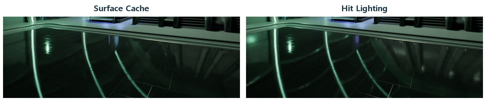

# CH21 Lumen과 동적 간접광

## 챕터 학습 목표

간접광과 반사가 장면의 표현·추적·갱신에 의존하는 방식을 이해합니다. 실내 누광, 누락된 반사와 노이즈를 진단하고, 메시 구성·라이팅·추적 품질을 목표 성능에 맞게 설계합니다.

### 예제 학습 목표

L자 방의 Lumen Scene과 Surface Cache를 관찰하고 메시 분할 또는 추적 설정의 영향을 비교합니다.

**구현 상태 — 기본 실습 레벨 준비**

바닥, 조명, 카메라와 비교용 기본 도형을 가진 시작 레벨입니다. 아래 항목은 챕터별 예제를 완성할 때 수행할 실습 절차입니다.

레벨 경로 `/Game/RenderingLab/Chapters/Part04_LightingAndImageQuality/CH21_Lumen/Maps/L_CH21_Lumen`

## 흐름 개념도

## 원리

직접광은 광원에서 표면으로 바로 도달한 빛이고, 간접광은 다른 표면에서 반사되어 온 빛입니다. Lumen은 움직이는 장면의 간접광과 반사를 계산합니다. 빨간 벽에서 튄 빛이 흰 벽에 붉은 기운을 주는 현상은 전역 조명, 즉 장면 전체의 빛 전달을 이해하는 사례입니다.

## 작동 과정

Lumen은 먼저 화면에 있는 정보를 따라 빛의 경로를 조사하는 Screen Trace를 활용합니다. 부족한 부분은 거리장으로 표현한 장면이나 하드웨어 레이 트레이싱으로 보완할 수 있습니다. 거리장은 표면까지의 거리를 저장한 표현입니다. 레이 트레이싱은 광선과 물체가 만나는 위치를 추적하는 계산 방식입니다.

## 그림으로 연결하기

Epic 공식 반사 비교 · 왼쪽 Surface Cache, 오른쪽 Hit Lighting입니다. 동일한 바닥 반사 영역을 발췌했습니다.

읽을 곳  오른쪽 바닥에 추가된 밝은 반사선과 조명 반응을 봅니다. 반사 조명 평가 방식의 차이이며 모든 Lumen 문제의 해결책은 아닙니다. 원문 UE 5.5 예시를 현재 기능 지원·GPU 시간과 구분합니다.

[© Epic Games · 공식 문서 · 출처 55](https://dev.epicgames.com/documentation/en-us/unreal-engine/lumen-technical-details-in-unreal-engine?application_version=5.5)

원저작권과 원문 출처 표시는 유지합니다

원본 일부 발췌·확대 · 색상 유지 · 표제 추가

## 아트 실무

Surface Cache는 추적한 표면의 재질과 조명 정보를 빠르게 조회하기 위한 저장 체계입니다. 여러 방향에서 표면을 담은 Cards를 사용합니다. 한 메시로 된 방의 일부가 분홍색으로 표시되면 이 표면 정보의 적용 범위를 확인합니다. 벽·바닥·천장을 분리한 버전과 비교하고, 얇은 벽의 누광은 거리장 표현도 살핍니다.

## 성능 비용

내부 해상도, 추적 거리, 반사 범위와 장면 갱신이 비용에 영향을 줍니다. 하드웨어 레이 트레이싱은 지원 GPU가 필요하며, 광선이 만날 후보를 빠르게 찾기 위한 가속 구조도 관리합니다. 인스턴스가 많거나 물체가 자주 변형되면 그 구조를 갱신하는 부담을 봅니다.

## 언리얼 실습

L자 방에서 노출을 고정합니다. Lumen Overview는 관련 결과를 모아 보는 모드, Lumen Scene은 추적에 쓰는 장면 표현, Surface Cache는 표면 정보의 적용 상태를 살피는 모드입니다. 메시 분할 또는 추적 설정 한 가지만 바꾸며 누광·반사·간접광과 GPU 시간을 비교합니다.

## 관찰과 판단

문제가 있는 구도에서 Lit와 Lumen Scene·Surface Cache를 비교합니다. 메시 분할 또는 추적 설정 하나만 바꾸고 반사 누락과 누광을 확인합니다. 반사 품질과 전체 GPU 시간을 함께 기록합니다.

## 오판을 피하려면

Surface Cache와 Hit Lighting의 비교는 반사 조명 평가 방식의 비교입니다. 하드웨어 RT 지원·설정 조건을 확인하며, 한 옵션이 모든 누광과 반사 문제를 해결한다고 일반화하지 않습니다.

## 핵심 요약

현재 화면의 정보, 추적할 장면 표현과 계산 예산을 나누어 Lumen 문제를 조사합니다.

## 공식 자료

- [Lumen Technical Details](https://dev.epicgames.com/documentation/en-us/unreal-engine/lumen-technical-details-in-unreal-engine)
- [Lumen Performance Guide](https://dev.epicgames.com/documentation/en-us/unreal-engine/lumen-performance-guide-for-unreal-engine)

## 관련 개념

- [CH03 GBuffer와 표면 정보](CH03_GBuffer.md)
- [CH22 Virtual Shadow Maps와 페이지 캐시](CH22_VirtualShadowMaps.md)

## 작업 기록

- 제작한 에셋
- 바꾼 변수와 유지한 조건
- 전후 화면과 실행 시간
- 확인한 기기와 설정

[처음 읽는 방법](../ReadingGuide.md) · [용어집](../Glossary.md) · [보충 주석](../SupplementaryNotes.md) · [챕터 목록](../../README.md#학습-순서)
