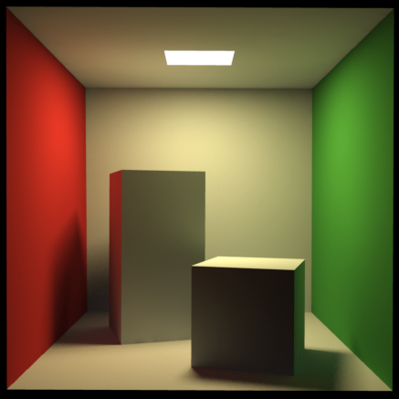

# Lumen 표면 사이를 이동하는 빛을 계산하는 방법

직접 빛이 닿지 않는 흰 벽에도 주변의 색이 묻어납니다. 거울과 매끈한 바닥에는 카메라가 바라보는 표면 밖의 장면도 나타납니다. Lumen은 이렇게 장면 안에서 전달되는 간접광과 반사를 실시간으로 다루는 시스템입니다.

Lumen은 UE에서 동적 전역 조명과 반사를 계산하는 시스템입니다. 전역 조명은 표면 사이에서 전달되는 빛을 포함하는 조명이며, Lumen은 변화하는 장면의 간접광과 반사를 실시간으로 근사합니다.

직접광만으로 설명되지 않는 실내 밝기와 색 번짐, 주변 장면의 반사를 만듭니다. 재질은 같은데 주변 표면이나 광원을 바꾸면 외관이 달라지는 빛 전달을 담당합니다.

## 화면 정보만으로 부족한 빛의 경로

형상과 재질, 조명과 카메라 정보가 빛 전달의 조건을 만듭니다. Lumen은 추적과 표면 정보 조회로 간접광과 반사를 구해 표면을 조명하는 데 사용합니다.

광원에서 바로 도달한 빛과 다른 표면을 거쳐 온 빛을 구분합니다. 붉은 벽에서 반사된 빛이 흰 벽을 붉게 비추는 것이 간접광의 예입니다. 화면에 있는 정보로 추적을 수행할 수 있고, 화면만으로 부족한 부분은 별도 장면 표현과 지원되는 소프트웨어·하드웨어 추적으로 보완합니다. 화면 밖 물체도 빛 전달에 참여하기 때문입니다. Surface Cache 같은 표면 표현에서 재질·조명 정보를 조회하고 결과를 갱신·통합합니다. 반사의 조명 평가 방식과 추적 설정은 사용 경로와 품질·비용 조건에 따라 선택합니다.

외부 경로 추적 Cornell box 렌더입니다. 색 벽이 주변 표면에 전달하는 간접광을 보여 주며 Lumen 실행 결과는 아닙니다.

[Trevorgoodchild · Public domain · 원본 전체·색상·비율 유지 · 출처 36](https://commons.wikimedia.org/wiki/File:Cornellbox_pathtracing_irradiancecaching.png)

## 흰 벽의 붉은 기운은 텍스처색이 아닐 수 있다

실내 누광·빛 번짐·반사 누락과 재질색을 구분하고 메시 구성·조명 예산을 정할 때 필요합니다. 흰 벽의 붉은 기운을 바로 텍스처에서 상쇄하기 전에 주변 빛 전달을 봅니다.

붉은 벽이 반사한 빛이 흰 벽에 도달하면 수신 표면의 Base Color를 바꾸지 않아도 최종 색이 달라집니다. 이를 푸른 텍스처색으로 상쇄하면 다른 조명에서는 벽 자체가 틀어질 수 있습니다. 재료의 고유 색과 주변에서 들어오는 빛을 나눠 보는 이유입니다.

## 움직이는 장면 표현을 유지하는 비용

장면 표현의 갱신, 추적, 조회와 화면 결과의 통합에 비용이 듭니다. 복잡한 장면·변화·품질 설정에 따라 달라지므로 간접광과 반사 관련 작업을 따로 관찰합니다.

Lumen의 역할은 장면을 전체적으로 밝게 만드는 스위치보다 넓습니다. 표면과 표면 사이의 빛 전달을 근사하기 때문에 메시의 구성과 재질, 주변 조명도 결과에 함께 참여합니다.

## 참고 자료

- [Lumen Technical Details](https://dev.epicgames.com/documentation/en-us/unreal-engine/lumen-technical-details-in-unreal-engine)
- [Lumen Performance Guide](https://dev.epicgames.com/documentation/en-us/unreal-engine/lumen-performance-guide-for-unreal-engine)

[포스트 목록](../../README.md#포스트-목록) · [용어 찾아보기](../Glossary.md) · [이미지 출처](../Images/Sources.md)
