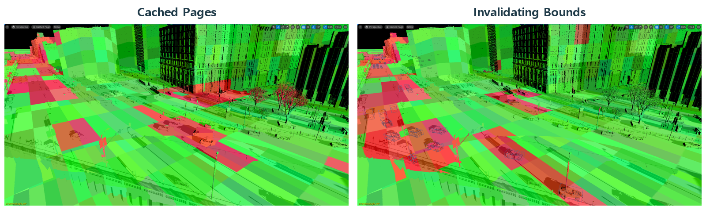

# Virtual Shadow Maps 선명한 그림자와 캐시의 관계

정지한 장면에서 한 번 만든 그림자를 다시 쓸 수 있다면 매번 같은 깊이를 그릴 필요가 줄어듭니다. 그러나 바람이 부는 풀과 이동하는 물체 앞에서는 그 그림자가 곧 낡습니다. VSM은 이 해상도와 재사용, 갱신을 페이지 단위로 다룹니다.

Virtual Shadow Maps는 그림자 데이터를 필요한 작은 페이지 단위로 관리하는 고해상도 그림자 시스템입니다. 광원 관점에서 어떤 표면이 가려지는지 계산하는 그림자 맵의 가상화 방식입니다.

화면에 필요한 그림자 디테일에 데이터를 배분하고, 변하지 않은 결과를 재사용합니다. 해상도와 메모리·갱신 작업을 관리하는 구조이지 그림자를 한 번 그려 영구히 쓰는 기능은 아닙니다.

## 필요한 그림자 페이지를 준비하고 재사용한다

광원과 보이는 영역, 그림자를 만드는 형상과 변화 정보가 필요한 페이지를 정합니다. 준비한 깊이는 화면 표면의 그림자 여부를 평가하는 데 사용됩니다.

현재 시야와 광원에서 필요한 그림자 페이지를 정합니다. 필요한 작은 영역을 할당·준비하므로 거대한 모든 영역을 항상 같은 해상도로 새로 그리지 않습니다. 기존 페이지가 유효하면 재사용합니다. 카메라 이동으로 새 영역이 필요하거나 광원·형상이 변해 결과가 낡으면 새로 그리거나 무효화 후 갱신합니다. 준비한 깊이로 조명 계산 시 가림을 평가합니다. 깊이를 만드는 일과 화면에 그림자를 적용하는 일은 서로 다른 작업으로 관찰할 수 있습니다.

공식 VSM 진단에서 재사용 페이지와 새로 필요하거나 무효화된 페이지가 구분됩니다. 오른쪽에는 갱신에 영향을 주는 Bounds도 표시돼 있습니다.

[© Epic Games · 공식 문서 · 출처 56](https://dev.epicgames.com/documentation/en-us/unreal-engine/virtual-shadow-maps-in-unreal-engine?application_version=5.4)

동일 범위의 원본을 나란히 배치 · 표제 추가

원저작권과 원문 출처 표시는 유지합니다

## 카메라가 멈춰도 풀밭의 그림자가 갱신되는 이유

식생의 바람·이동 소품·광원 변화가 그림자 비용에 미치는 영향을 이해할 때 필요합니다. WPO와 큰 Bounds가 어느 범위의 갱신을 유발하는지 조사합니다.

WPO로 잎의 위치가 달라지면 이전 그림자는 현재 형상과 맞지 않습니다. 영향 영역의 페이지가 무효화되고 다시 그려질 수 있습니다. 카메라가 새 영역을 보아서 만든 페이지와 움직임 때문에 갱신한 페이지는 겉으로 비슷해도 원인이 다릅니다.

## 바람의 외관과 캐시 재사용의 균형

필요 페이지의 메모리, 새 페이지·무효화 영역의 렌더링, 그림자 평가가 비용입니다. 정지 장면의 캐시 효과와 움직이는 장면의 갱신 비용을 구분합니다.

VSM을 이해하면 그림자 품질만 낮추는 대신 어떤 변화가 얼마나 넓은 갱신을 만드는지 생각할 수 있습니다. 선명함과 움직임, 페이지 재사용은 함께 설계할 조건입니다.

## 참고 자료

- [Nanite Virtualized Geometry](https://dev.epicgames.com/documentation/en-us/unreal-engine/nanite-virtualized-geometry-in-unreal-engine)
- [Virtual Shadow Maps](https://dev.epicgames.com/documentation/en-us/unreal-engine/virtual-shadow-maps-in-unreal-engine)

[포스트 목록](../../README.md#포스트-목록) · [용어 찾아보기](../Glossary.md) · [이미지 출처](../Images/Sources.md)
