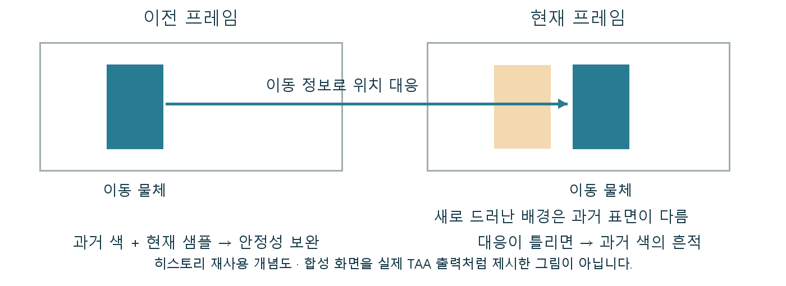

# TAA 과거 프레임이 경계를 안정시키고 잔상을 만드는 이유

철망의 깜빡임은 줄었는데 이동 중에는 흔적이 남을 수 있습니다. 서로 반대처럼 보이는 두 결과가 이전 프레임을 활용하는 같은 구조에서 나옵니다. TAA는 현재 화면만으로 부족한 정보를 시간에 걸쳐 보완합니다.

TAA는 Temporal Anti-Aliasing으로, 현재와 이전 프레임의 정보를 이용해 경계의 계단 현상과 시간적 깜빡임을 줄이는 안티앨리어싱 방식입니다.

제한된 픽셀 샘플이 놓친 세부를 여러 프레임에 걸쳐 보완합니다. 단일 정지 이미지의 경계뿐 아니라 카메라 이동 중 얇은 패턴의 안정성을 담당합니다.

## 과거의 표면을 현재 위치에 대응시킨다

현재 색만으로는 누적할 수 없습니다. 이전 결과인 히스토리와 깊이, 이동 정보 등을 이용해 과거 표면을 현재 위치에 대응시키고 신뢰할 수 있는 정보를 결합합니다.

프레임마다 조금 다른 샘플 위치로 장면을 계산합니다. 같은 얇은 선도 여러 위치에서 검사하면서 한 프레임이 얻지 못한 정보를 모을 수 있습니다. 물체·카메라의 이동 정보로 이전 위치와 현재 위치를 대응시킵니다. Velocity는 화면상의 이동 정보이며, 변형 재질에도 올바른 대응이 필요합니다. 맞는 히스토리는 현재 정보와 결합하고 불확실한 과거 정보는 줄이거나 버립니다. 새로 드러난 표면과 잘못된 대응에서는 잔상·불안정성이 나타날 수 있습니다.

이전 물체 위치를 현재에 대응시키고, 새로 드러난 배경에는 다른 과거 정보가 있음을 보여 주는 직접 제작 시간 흐름도입니다.

## 새로 드러난 배경에는 같은 과거가 없다

철망·가는 가지·WPO 식생과 이동하는 재질의 깜빡임·잔상을 진단할 때 필요합니다. 패턴 크기와 이동 정보를 관리하고 정지·이동·가림 해제를 구분해 관찰합니다.

움직이는 물체 뒤에서 배경이 나타나면 그 위치의 과거 화면에는 다른 표면이 들어 있었습니다. 잘못 대응한 정보를 오래 유지하면 흔적이 남고, 과거 정보를 적게 쓰면 안정성의 이득도 줄 수 있습니다. 정지한 한 장으로 이동 품질을 설명하기 어려운 이유입니다.

## 시간적 안정성과 정보의 신뢰도

현재·과거 버퍼를 읽고 대응·필터링하는 화면 계산과 저장 비용이 있습니다. 화질은 히스토리 조건에도 달려 있어 정지 캡처 한 장으로 품질을 확정하지 않습니다.

TAA의 화질은 경계를 얼마나 매끈하게 만들었는지만으로 정해지지 않습니다. 과거 정보를 언제 믿고 언제 버리는지가 중요하며, 아트의 미세 패턴과 변형 정보도 그 판단 조건을 만듭니다.

## 참고 자료

- [Anti-Aliasing and Upscaling](https://dev.epicgames.com/documentation/en-us/unreal-engine/anti-aliasing-and-upscaling-in-unreal-engine)
- [Temporal Super Resolution](https://dev.epicgames.com/documentation/en-us/unreal-engine/temporal-super-resolution-in-unreal-engine)

[포스트 목록](../../README.md#포스트-목록) · [용어 찾아보기](../Glossary.md) · [이미지 출처](../Images/Sources.md)
