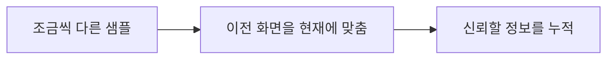

# CH23 TAA와 프레임 히스토리

## 챕터 학습 목표

여러 프레임의 정보를 사용하는 화질 개선과 그 한계를 이해합니다. 철망·식생·반사처럼 얇거나 움직이는 디테일에서 깜빡임·번짐·잔상을 진단하고 모션 정보와 재질을 조정합니다.

### 예제 학습 목표

철망과 WPO 식생을 정지·이동 중 관찰하고 모션 벡터 및 잔상·깜빡임의 변화를 확인합니다.

**구현 상태 — 기본 실습 레벨 준비**

바닥, 조명, 카메라와 비교용 기본 도형을 가진 시작 레벨입니다. 아래 항목은 챕터별 예제를 완성할 때 수행할 실습 절차입니다.

레벨 경로 `/Game/RenderingLab/Chapters/Part04_LightingAndImageQuality/CH23_TAA/Maps/L_CH23_TAA`

## 흐름 개념도

## 원리

TAA는 Temporal Anti-Aliasing의 약자로 여러 프레임의 정보를 사용해 계단과 깜빡임을 줄입니다. 한 번 그린 프레임에 없는 세부 정보를 다른 프레임의 샘플로 보완하는 접근입니다. 저장해 둔 이전 프레임의 정보를 히스토리라고 합니다.

## 작동 과정

카메라 투영 위치를 아주 조금씩 바꾸는 지터로 서로 다른 서브픽셀 위치를 샘플합니다. 서브픽셀은 한 픽셀보다 작은 위치 차이를 뜻합니다. 화면에서 표면이 얼마나 이동했는지를 나타내는 모션 벡터로 과거 정보를 현재 위치에 맞춥니다. 이 과정을 재투영이라고 합니다. 새로 드러난 표면처럼 믿기 어려운 과거 정보는 제한합니다.

## 아트 실무

철망과 케이블, 흔들리는 풀을 정지 화면과 이동 화면에서 비교합니다. 과거 정보가 잘못 남아 뒤로 끌리는 자국은 고스팅이라고 부릅니다. 정점은 움직이는데 모션 정보가 그 움직임을 충분히 반영하지 못하면 시간적 처리에서 문제가 나타날 수 있습니다.

## 성능 비용

히스토리를 저장하는 메모리와 현재 화면에 맞추는 계산이 필요합니다. 오래 누적하면 안정성이 좋아질 수 있지만 움직임에 대한 응답과 선명도가 달라질 수 있습니다. 어떤 값을 조정할지는 정지 선명도보다 실제 이동 중의 결과와 함께 판단합니다.

## 언리얼 실습

Anti-Aliasing Method를 Temporal AA로 선택하고 내부 해상도를 100%로 시작합니다. 철망 앞을 같은 속도로 이동한 영상과 정지 화면을 기록합니다. WPO 켜짐·꺼짐을 비교하고, 지원되는 Velocity 시각화에서 모션 정보가 나타나는지 봅니다. Velocity는 이 문맥에서 화면 이동 정보와 연결되는 이름입니다.

## 핵심 요약

시간적 처리는 현재 화면과 과거 정보의 연결에 의존합니다. 정지 이미지 하나로 움직임 품질을 판정하지 않습니다.

## 공식 자료

- [Anti-Aliasing and Upscaling](https://dev.epicgames.com/documentation/en-us/unreal-engine/anti-aliasing-and-upscaling-in-unreal-engine)
- [Temporal Super Resolution](https://dev.epicgames.com/documentation/en-us/unreal-engine/temporal-super-resolution-in-unreal-engine)

## 관련 개념

- [CH10 Shader와 순열과 WPO](CH10_ShadersWPO.md)
- [CH24 TSR과 시간적 업스케일링](CH24_TSR.md)

## 작업 기록

- 제작한 에셋
- 바꾼 변수와 유지한 조건
- 전후 화면과 실행 시간
- 확인한 기기와 설정

[처음 읽는 방법](../ReadingGuide.md) · [용어집](../Glossary.md) · [보충 주석](../SupplementaryNotes.md) · [챕터 목록](../../README.md#학습-순서)
