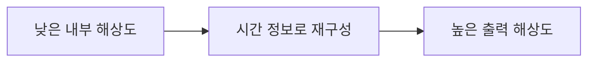

# CH24 TSR과 시간적 업스케일링

## 챕터 학습 목표

내부 렌더링 해상도와 최종 출력 해상도를 구분하고 시간적 재구성의 역할을 이해합니다. 목표 기기에서 이동 중 디테일의 안정성과 절약되는 GPU 작업을 함께 평가해 해상도 예산을 정합니다.

### 예제 학습 목표

출력 해상도를 고정하고 Screen Percentage 100과 67에서 글자·케이블·반사의 이동 품질과 패스 시간을 비교합니다.

**구현 상태 — 기본 실습 레벨 준비**

바닥, 조명, 카메라와 비교용 기본 도형을 가진 시작 레벨입니다. 아래 항목은 챕터별 예제를 완성할 때 수행할 실습 절차입니다.

레벨 경로 `/Game/RenderingLab/Chapters/Part04_LightingAndImageQuality/CH24_TSR/Maps/L_CH24_TSR`

## 흐름 개념도

## 원리

내부 해상도는 장면의 주요 계산을 수행하는 크기이고, 출력 해상도는 최종 표시할 화면 크기입니다. TSR은 Temporal Super Resolution의 약자로 낮은 내부 해상도와 여러 프레임의 정보를 이용해 높은 출력 해상도를 재구성하는 UE 업스케일러입니다.

## 작동 과정

낮은 해상도로 장면을 그리고 지터·깊이·모션과 히스토리를 사용해 더 촘촘한 출력을 만듭니다. 모션은 화면 이동 정보, 히스토리는 이전 프레임 정보입니다. 두 개념과 재투영은 CH23에서 설명했습니다. 새로 드러난 영역이나 움직임이 큰 부분에서는 과거 정보의 기여를 조절해야 합니다.

## 그림으로 연결하기

Epic 공식 TSR 비교 · 왼쪽 네이티브 4K, 오른쪽 1080p에서 4K로 재구성한 결과의 같은 구역을 발췌했습니다.

읽을 곳  출력 크기가 같아도 들어온 정보량은 다릅니다. 글자·창틀 같은 세부를 비교하되 정지된 한 장이 이동 품질을 보장하지는 않습니다. UE 5.5 원문 장면의 성능 수치를 이 프로젝트의 예상 이득으로 사용하지 않습니다.

[© Epic Games · 공식 문서 · 출처 58](https://dev.epicgames.com/documentation/en-us/unreal-engine/temporal-super-resolution-in-unreal-engine?application_version=5.5)

원저작권과 원문 출처 표시는 유지합니다

원본 일부 발췌·확대 · 색상 유지 · 표제 추가

## 아트 실무

출력 크기를 같게 두고 간판 글자, 얇은 케이블과 젖은 벽 반사를 봅니다. 정지 뒤에는 선명해져도 움직이는 동안 정보가 뭉개질 수 있습니다. 게임 중 자주 보는 시점과 카메라 이동 속도에서 읽히는지를 기준으로 품질을 정합니다.

## 성능 비용

Screen Percentage는 출력 크기에 대한 내부 해상도의 가로·세로 비율을 정하는 설정입니다. 67%면 두 축이 각각 줄어 내부 픽셀 수는 약 45%입니다. 전체 GPU 시간까지 그 비율로 줄지는 않습니다. TSR 자체의 재구성과 출력 처리, CPU와 일부 그림자 작업은 별도로 남기 때문입니다.

## 언리얼 실습

Anti-Aliasing Method를 TSR로 선택합니다. 부하에 따라 내부 크기를 자동 변경하는 Dynamic Resolution을 끄고 출력 해상도를 고정합니다. r.ScreenPercentage 100과 67을 비교해 같은 이동 구간의 글자·철망·반사와 전체 GPU·TSR 관련 시간을 기록합니다.

## 관찰과 판단

출력 크기와 Dynamic Resolution을 고정합니다. Screen Percentage 100과 67에서 같은 속도로 이동한 글자·얇은 선·반사를 봅니다. 입력 픽셀 수 변화, TSR 비용과 전체 GPU 시간을 각각 기록합니다.

## 오판을 피하려면

출력 해상도가 같아도 입력 정보량은 다릅니다. 외부 예시의 프레임 시간은 그 장면과 장비의 결과이며 자신의 프로젝트에서 같은 비율의 속도 향상을 보장하지 않습니다.

## 핵심 요약

같은 출력에서 움직임 품질을 비교하고, 줄어든 장면 계산과 재구성 비용을 함께 측정합니다.

## 공식 자료

- [Anti-Aliasing and Upscaling](https://dev.epicgames.com/documentation/en-us/unreal-engine/anti-aliasing-and-upscaling-in-unreal-engine)
- [Temporal Super Resolution](https://dev.epicgames.com/documentation/en-us/unreal-engine/temporal-super-resolution-in-unreal-engine)

## 관련 개념

- [CH23 TAA와 프레임 히스토리](CH23_TAA.md)
- [CH25 CPU와 GPU 병목](CH25_CPUGPUBottlenecks.md)

## 작업 기록

- 제작한 에셋
- 바꾼 변수와 유지한 조건
- 전후 화면과 실행 시간
- 확인한 기기와 설정

[처음 읽는 방법](../ReadingGuide.md) · [용어집](../Glossary.md) · [보충 주석](../SupplementaryNotes.md) · [챕터 목록](../../README.md#학습-순서)
