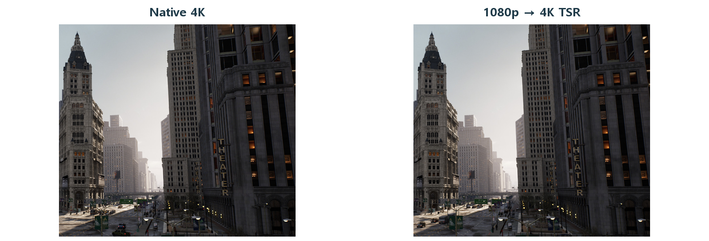

# CH24 TSR과 시간적 재구성

## 중심 질문

낮은 내부 해상도로 그려도 어떻게 높은 출력 해상도를 만들까?

## 먼저 알아둘 답

TSR은 현재의 저해상도 정보와 과거 프레임을 이용해 출력 픽셀을 재구성합니다.

## 왜 알아야 할까

목표 출력 화질을 유지하면서 내부 렌더링 해상도에 쓸 GPU 예산을 정하기 위해 배웁니다.

### 예제 학습 목표

출력 크기를 유지하고 입력 해상도에 따른 총 시간과 이동 품질을 비교합니다.

**구현 상태 — 기본 레벨 준비, 아래 절차에 따른 특화 예제 제작과 실측 필요**

레벨 `/Game/RenderingLab/Chapters/Part04_LightingAndImageQuality/CH24_TSR/Maps/L_CH24_TSR`

## 왜 이런 결과가 생길까

내부 해상도는 장면을 계산할 픽셀 수이고 출력 해상도는 화면에 표시할 픽셀 수입니다. 내부 해상도를 낮추면 많은 화면 단위 작업을 줄일 수 있습니다. TSR은 단순히 한 장을 확대하는 대신 이동 정보와 히스토리를 이용해 높은 출력 해상도를 구성합니다. 줄인 입력 정보의 한계를 시간적 정보로 보완하는 방식입니다.

## 제작 중에는 이렇게 나타납니다

출력 크기가 같아도 처음부터 모든 세부를 같은 수의 샘플로 계산한 것은 아닙니다. 새로 드러난 글자·얇은 선·빠른 반사는 과거 정보를 활용하기 어려워 품질 차이를 드러낼 수 있습니다.

Epic 공식 TSR 비교 · 왼쪽 네이티브 4K, 오른쪽 1080p에서 4K로 재구성한 결과의 같은 구역을 발췌했습니다.

읽을 곳  출력 크기가 같아도 들어온 정보량은 다릅니다. 글자·창틀 같은 세부를 비교하되 정지된 한 장이 이동 품질을 보장하지는 않습니다. UE 5.5 원문 장면의 성능 수치를 이 프로젝트의 예상 이득으로 사용하지 않습니다.

[© Epic Games · 공식 문서 · 출처 58](https://dev.epicgames.com/documentation/en-us/unreal-engine/temporal-super-resolution-in-unreal-engine?application_version=5.5)

원본 일부 발췌·확대 · 색상 유지 · 표제 추가

원저작권과 원문 출처 표시는 유지합니다

## 실습 절차

출력 크기와 Dynamic Resolution을 고정합니다. TSR을 유지한 채 Screen Percentage 100과 67을 비교합니다. 같은 경로의 글자·철망·반사를 녹화하고 전체 GPU 시간과 TSR 시간을 따로 기록합니다.

## 예상 결과와 이유

67%는 가로·세로 각각의 비율이므로 입력 픽셀 수는 약 45%가 됩니다. 화면 단위 작업은 줄 수 있지만 재구성 비용과 고정 비용 때문에 전체 시간이 같은 비율로 줄지는 않을 것입니다.

## 결과를 어떻게 해석할까

정지 상태의 선명도와 이동·가림 해제의 품질을 나눠 판정합니다. TSR 패스가 늘거나 유지돼도 다른 패스의 절감으로 전체가 빨라질 수 있습니다.

## 실제 제작에서의 선택

목표 기기에서 허용할 이동 화질과 총 GPU 시간을 기준으로 내부 해상도를 정합니다.

## 이해한 뒤 확인할 조건

외부 비교의 장비·장면 성능을 자신의 예상 이득으로 사용하지 않습니다. TAAU와 다른 업스케일러는 별도 비교 대상입니다.

## 공식 자료와 확장

- [Anti-Aliasing and Upscaling](https://dev.epicgames.com/documentation/en-us/unreal-engine/anti-aliasing-and-upscaling-in-unreal-engine)
- [Temporal Super Resolution](https://dev.epicgames.com/documentation/en-us/unreal-engine/temporal-super-resolution-in-unreal-engine)

[읽는 순서](../ReadingGuide.md) · [용어집](../Glossary.md) · [심화와 적용 조건](../SupplementaryNotes.md)
