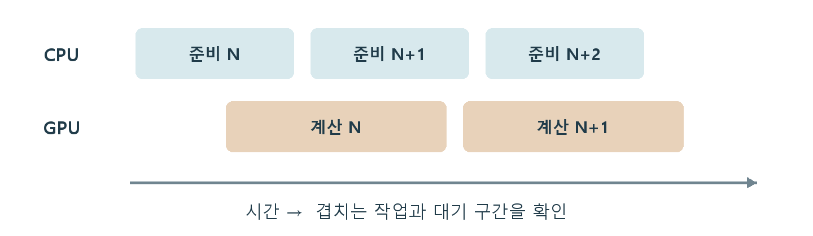

# CH25 CPU와 GPU 병목

## 챕터 학습 목표

프레임 처리율을 제한하는 원인과 스레드·GPU의 대기를 구분합니다. 에셋 수정이 필요한 상황과 게임 로직·제출·동기화 문제를 판별해 효과가 있는 최적화 작업의 우선순위를 정합니다.

### 예제 학습 목표

고정 경로에서 stat unit과 해상도 변경 반응을 확인한 뒤 Insights의 CPU·GPU·대기 구간을 대조합니다.

**구현 상태 — 기본 실습 레벨 준비**

바닥, 조명, 카메라와 비교용 기본 도형을 가진 시작 레벨입니다. 아래 항목은 챕터별 예제를 완성할 때 수행할 실습 절차입니다.

레벨 경로 `/Game/RenderingLab/Chapters/Part05_Profiling/CH25_CPUGPUBottlenecks/Maps/L_CH25_CPUGPUBottlenecks`

## 흐름 개념도

## 원리

병목은 해당 상황에서 처리 속도를 제한하는 작업입니다. CPU와 GPU는 서로 다른 프레임의 일을 겹쳐 처리할 수 있으므로 각 시간을 모두 더해 최종 프레임 시간으로 읽지 않습니다. 한쪽이 다른 쪽을 기다리면 표시된 시간이 실제 계산 시간과 다르게 보일 수도 있습니다.

## 작동 과정

stat unit의 Game은 주로 게임 로직을 처리하는 CPU 실행 흐름, Draw는 렌더 명령을 준비하는 흐름, GPU는 그래픽 계산 시간을 보는 출발점입니다. RHIT가 표시되면 그래픽 API 명령 처리 쪽의 CPU 흐름을 함께 봅니다. 스레드·RHI의 뜻은 CH01과 용어집에서 다시 확인할 수 있습니다.

## 아트 실무

내부 해상도를 낮춰 GPU 시간과 프레임 시간이 함께 줄면 화면 계산을 조사할 근거가 됩니다. 프레임 시간이 그대로라면 CPU, 대기와 프레임 제한도 봅니다. VSync는 화면 갱신에 출력 시점을 맞추는 기능이며, 설정한 FPS 제한과 함께 측정값을 일정 수준에 묶어 둘 수 있습니다.

## 성능 비용

60 FPS의 프레임 간격은 약 16.67 ms, 30 FPS는 약 33.33 ms입니다. ms는 1초의 천분의 1입니다. 평균만 보면 드문 끊김을 놓칠 수 있습니다. P95 프레임 시간은 느린 쪽 5%가 시작되는 경계 부근을 보는 지표입니다. 최대 시간과 느린 구간의 원인도 함께 살핍니다.

## 언리얼 실습

성능 도구를 쓸 수 있는 Development 빌드를 목표 기기에서 실행합니다. stat unit·stat unitgraph로 경향을 보고 내부 해상도만 낮춰 반응을 확인합니다. Unreal Insights는 CPU·GPU 작업을 시간축에 펼쳐 보여 주는 분석 도구입니다. 느린 프레임에서 계산과 대기 구간을 대조합니다.

## 핵심 요약

프레임 제한과 대기를 확인한 뒤, 실제로 처리율을 제한하는 작업을 고릅니다.

## 그림으로 연결하기

CPU와 GPU의 작업은 겹칠 수 있습니다. 단순화한 시간축에서 처리율을 제한하는 구간을 보며, 각 시간의 합을 전체 프레임 시간으로 사용하지 않습니다.

## 공식 자료

- [Introduction to Performance Profiling and Configuration](https://dev.epicgames.com/documentation/en-us/unreal-engine/introduction-to-performance-profiling-and-configuration-in-unreal-engine)
- [Stat Commands](https://dev.epicgames.com/documentation/en-us/unreal-engine/stat-commands-in-unreal-engine)

## 관련 개념

- [CH14 Draw Call과 배칭](CH14_DrawCalls.md)
- [CH26 GPU Profiler와 전후 검증](CH26_GPUProfiling.md)

## 작업 기록

- 제작한 에셋
- 바꾼 변수와 유지한 조건
- 전후 화면과 실행 시간
- 확인한 기기와 설정

[처음 읽는 방법](../ReadingGuide.md) · [용어집](../Glossary.md) · [보충 주석](../SupplementaryNotes.md) · [챕터 목록](../../README.md#학습-순서)
