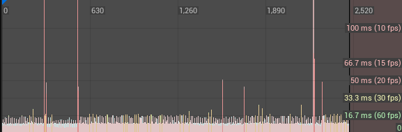

# CPU와 GPU 병목 가벼워진 에셋이 FPS를 올리지 못할 때

폴리곤과 해상도를 줄였는데 FPS가 그대로인 일은 이상한 예외가 아닙니다. 줄인 일이 프레임을 제한하던 원인이 아니었다면 전체 진행 속도는 달라지지 않을 수 있습니다. 병목 분석은 이 제한 관계를 찾는 일입니다.

병목은 프레임의 처리율이나 완료 시간을 제한하는 작업 또는 대기 관계입니다. CPU와 GPU 병목 분석은 어느 쪽의 준비·실행이 실제로 프레임 진행을 제한하는지 찾는 과정입니다.

효과가 있는 최적화 대상의 우선순위를 정합니다. 눈에 복잡한 에셋을 줄이는 것과 프레임을 제한하는 일을 줄이는 것은 같지 않으므로 먼저 제한 원인을 확인합니다.

## 준비와 실행이 겹치는 프레임의 구조

CPU·GPU·프레임 시간과 타임라인은 같은 구간의 실행이 어디에서 제한되는지 보여 주는 단서입니다. 계산과 제출, 동기화와 로딩을 나눠 이해해야 어떤 변경이 의미 있을지 판단할 수 있습니다.

CPU의 게임 상태 갱신과 명령 준비, GPU의 실행은 여러 프레임에서 겹칠 수 있습니다. 단순히 모든 시간을 더해서 프레임 시간을 구하지 않습니다. stat unit의 Frame·Game·Draw·GPU는 비용의 큰 방향을 보여 줍니다. 프레임 제한과 VSync에 의한 대기도 이 숫자의 해석에 영향을 주므로, 긴 값 하나가 곧 수정할 계산이라는 뜻은 아닙니다. 해상도처럼 영향 범위가 알려진 조건에 대한 시간 변화는 제한 원인의 단서가 됩니다. 타임라인은 계산과 기다림, 작업의 의존 관계를 드러내므로 같은 FPS에서도 서로 다른 원인을 구분할 수 있습니다.

외부 Unreal Insights의 프레임 시간 그래프입니다. 기준선과 시간 변화가 드러나지만 CPU·GPU·대기의 원인은 개별 시간축과 함께 읽어야 합니다.

[© John Farrow · Unrealcode.net · 출처 59](https://www.unrealcode.net/Optimization_Part3/)

원본 전체 유지 · 투명 배경은 흰색으로 표시

원저작권과 원문 출처 표시는 유지합니다

## 긴 막대가 모두 계산을 뜻하지는 않는다

폴리곤과 재질을 줄여도 FPS가 그대로일 때, 첫 진입만 끊길 때, CPU 제출이 무거운 대규모 배치에서 필요합니다. 수정할 에셋인지 실행·관리 구조인지 조사 방향을 정합니다.

CPU가 다음 명령을 준비하느라 늦는 동안 GPU 작업만 줄이면 GPU의 여유는 늘어도 전체 프레임은 크게 달라지지 않을 수 있습니다. 반대로 프레임 제한과 VSync 때문에 기다리는 상태도 있습니다. 시간축에서는 실제 계산과 기다림, 서로 의존하는 구간을 구분해야 합니다.

## 부분 최적화와 전체 개선의 차이

GPU만 가벼워져도 CPU가 제한하면 총 프레임은 거의 그대로일 수 있습니다. 가장 긴 막대도 대기를 포함할 수 있어 실제로 제한하는 관계를 확인해야 합니다.

병목을 안다는 것은 가장 복잡해 보이는 물체를 고르는 것이 아닙니다. 프레임의 진행을 실제로 제한하는 일을 찾는 것입니다. 그 관계를 이해해야 에셋 수정이 필요한 상황과 다른 실행 구조를 봐야 할 상황이 갈립니다.

## 참고 자료

- [Introduction to Performance Profiling and Configuration](https://dev.epicgames.com/documentation/en-us/unreal-engine/introduction-to-performance-profiling-and-configuration-in-unreal-engine)
- [Stat Commands](https://dev.epicgames.com/documentation/en-us/unreal-engine/stat-commands-in-unreal-engine)

[포스트 목록](../../README.md#포스트-목록) · [용어 찾아보기](../Glossary.md) · [이미지 출처](../Images/Sources.md)
