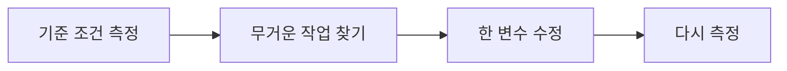
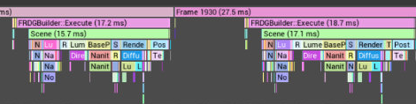

# CH26 GPU Profiler와 전후 검증

## 챕터 학습 목표

느리다는 인상을 재현 가능한 측정과 원인 후보로 바꾸는 방법을 익힙니다. 무거운 패스를 찾고 한 변수의 수정이 총 프레임 시간과 이미지 품질에 실제로 도움이 되는지 검증해 팀에 전달합니다.

### 예제 학습 목표

동일한 카메라 경로에서 한 항목만 바꿔 반복 측정하고 패스 시간·전체 프레임 시간·이동 화질을 전후 비교합니다.

**구현 상태 — 기본 실습 레벨 준비**

바닥, 조명, 카메라와 비교용 기본 도형을 가진 시작 레벨입니다. 아래 항목은 챕터별 예제를 완성할 때 수행할 실습 절차입니다.

레벨 경로 `/Game/RenderingLab/Chapters/Part05_Profiling/CH26_GPUProfiling/Maps/L_CH26_GPUProfiling`

## 흐름 개념도

## 원리

프로파일링은 실행 중 어떤 작업에 시간과 자원이 쓰이는지 측정하는 과정입니다. GPU Profiler는 GPU 작업을 이벤트와 패스 단위로 살피게 해 줍니다. 이벤트는 도구가 이름을 붙여 기록한 작업 구간입니다. 여러 프레임의 경향과 한 프레임의 세부 구조를 함께 확인합니다.

## 작동 과정

stat gpu로 큰 작업 그룹을 확인하고 profilegpu 또는 Unreal Insights의 GPU 시간축으로 원인을 좁힙니다. 부모 이벤트 안에 자식 이벤트가 포함될 수 있으므로 모두 더하면 중복 계산할 수 있습니다. 서로 다른 큐에서 겹쳐 실행되는 작업도 있어 각 항목의 합과 전체 프레임이 다를 수 있습니다. 도구 버전 차이는 보충 주석 4를 참고합니다.

## 그림으로 연결하기

외부 실제 도구 화면 · GPU Insights 시간축의 이벤트 계층을 발췌·확대했습니다.

읽을 곳  큰 Frame 구간 안에 작은 작업 구간이 포함됩니다. 로그에서 Inclusive는 하위 작업을 포함한 시간, Exclusive는 자체 시간입니다. 부모·자식 시간을 모두 더하지 않습니다. UE 5.6 예시이므로 실제 UI와 기록 항목은 현재 빌드에서 확인합니다.

[Tom Looman 문서 수록 · Unreal Engine 도구 화면 · 출처 60](https://tomlooman.com/unreal-engine-5-6-performance-highlights/)

원저작권과 원문 출처 표시는 유지합니다

원본 일부 발췌·확대 · 색상 유지 · 표제 추가

## 아트 실무

같은 골목에서 데칼 투영 범위만 줄여 봅니다. 데칼 관련 시간과 전체 GPU 시간이 같이 줄었는지, 얼룩 범위와 반사가 유지됐는지 확인합니다. 다른 패스가 늘었다면 비용이 이동한 것일 수 있습니다. 장면 전체가 CPU에 의해 제한되고 있다면 GPU 개선이 곧 FPS 개선으로 나타나지 않을 수도 있습니다.

## 성능 비용

에디터와 캡처 도구도 자원을 사용합니다. 셰이더 준비와 데이터 로딩이 끝나 안정된 상태로 만드는 과정을 워밍업이라고 합니다. 첫 진입의 준비 비용은 별도 기록하고, 안정 구간의 전후 비교와 섞지 않습니다. 스크린샷 저장 순간은 평상시의 프레임 시간 측정으로 사용하지 않습니다.

## 언리얼 실습

기기·엔진 버전·그래픽 API·해상도·품질 설정과 카메라 경로를 기록합니다. 같은 길이로 세 번씩 실행해 Frame 중앙값·P95, GPU 중앙값과 해당 패스 시간을 남깁니다. 중앙값은 측정값을 크기순으로 놓았을 때 가운데 값입니다. 이동 영상도 비교한 뒤 변경을 되돌려 효과가 재현되는지 확인합니다.

## 관찰과 판단

느린 프레임을 선택해 부모 이벤트와 세부 GPU 구간을 펼칩니다. 한 변수만 바꾸고 동일 경로를 세 번씩 반복합니다. 변경한 패스·총 프레임·중앙값·P95와 이동 화질을 함께 기록합니다.

## 오판을 피하려면

포함 시간과 자체 시간을 섞어 합산하지 않습니다. 다른 큐에서 겹친 작업과 대기를 구분하며, 캡처 저장이나 셰이더 준비 순간을 안정 구간의 성능으로 사용하지 않습니다.

## 핵심 요약

한 변수의 수정이 특정 패스, 전체 프레임과 화질에 미친 영향을 같은 조건의 기록으로 설명합니다.

## 공식 자료

- [Introduction to Performance Profiling and Configuration](https://dev.epicgames.com/documentation/en-us/unreal-engine/introduction-to-performance-profiling-and-configuration-in-unreal-engine)
- [Stat Commands](https://dev.epicgames.com/documentation/en-us/unreal-engine/stat-commands-in-unreal-engine)
- [Beyond Print String · GPU Profiler](https://dev.epicgames.com/community/learning/talks-and-demos/WDmB/beyond-print-string-debugging-unreal-engine-lightning-round)

## 관련 개념

- [CH25 CPU와 GPU 병목](CH25_CPUGPUBottlenecks.md)
- [CH01 렌더링 파이프라인](CH01_RenderingPipeline.md)

## 작업 기록

- 제작한 에셋
- 바꾼 변수와 유지한 조건
- 전후 화면과 실행 시간
- 확인한 기기와 설정

[처음 읽는 방법](../ReadingGuide.md) · [용어집](../Glossary.md) · [보충 주석](../SupplementaryNotes.md) · [챕터 목록](../../README.md#학습-순서)
